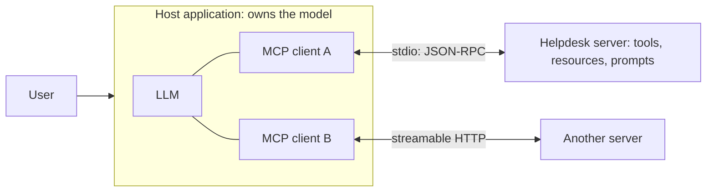

# 11.1 · MCP architecture: hosts, clients, servers, primitives

**Module:** [11 · MCP: architecture and custom servers](../README.md) · **Time:** 45-60 minutes · **Model needs:** none for scripts 1-2; chat + tools for script 3 · **Packages:** `mcp` extra

## What you will learn

- What the **Model Context Protocol (MCP)** is and the roles of **host**, **client** and **server**.
- The three primitives a server offers: **tools** (the model acts), **resources** (the app reads), **prompts** (the user picks).
- The handshake (`initialize`) and capability negotiation.
- What the JSON-RPC messages look like, and the difference between **stdio** and **streamable HTTP**.
- How a host turns MCP tools into the tool schemas of a chat model and forwards the calls.

## The idea

Function calling (module 02) glues tools into one app. MCP standardizes the glue: a tool
written once as an MCP **server** can be used by any MCP-aware app. The **host** is the app
the user talks to (it owns the model). Inside it, one **client** object keeps one connection
to one **server**.



The server offers three primitives, each with a different owner of the decision to use it:

| Primitive | Controlled by | Example here |
|---|---|---|
| Tool | the model | `lookup_ticket(ticket_id)` |
| Resource | the application | `helpdesk://policies/password` |
| Prompt | the user | `triage_prompt(ticket_text)` |

**Transports.** Over **stdio** the host starts the server as a subprocess and exchanges
newline-delimited JSON on its stdin/stdout: simple, local, no port, what these scripts use.
Over **streamable HTTP** the server is a web service at a URL, shared by many clients and
protected by auth. The messages are the same; only the pipe differs.

**On the wire** every message is JSON-RPC 2.0. A tool call and its answer:

```json
{"jsonrpc": "2.0", "id": 3, "method": "tools/call",
 "params": {"name": "lookup_ticket", "arguments": {"ticket_id": "T-1001"}}}

{"jsonrpc": "2.0", "id": 3, "result": {
  "content": [{"type": "text", "text": "T-1001: VPN drops every ten minutes (status: open, category: network)"}],
  "isError": false}}
```

The `id` pairs the response with its request. The Python SDK shows these as
`session.call_tool(...)` and snake_case fields (`is_error`); on the wire they are camelCase.

**Version note (mcp 2.x).** The SDK used here is 2.x: the server class is
`mcp.server.mcpserver.MCPServer` (it was `FastMCP` in 1.x), and the client is
`ClientSession` plus `stdio_client` from `mcp.client.stdio`. Older tutorials will not run as written.

## Scripts

`helpdesk_server.py` is the server, not a lesson: the scripts start it themselves with
`sys.executable`. Read it first; it is 35 lines using `@mcp.tool()`, `@mcp.resource(...)` and `@mcp.prompt()`.

### 1. `01_connect_and_discover.py`: connect and discover

```
./run 11.1/1
```

Starts the server over stdio, performs `initialize`, prints the negotiated protocol version and
capabilities, then lists tools, resources and prompts. No model needed.

**Expected output** (trimmed):

```
Step 2: Initialize: the handshake and capability negotiation
{
  "protocol_version": "2025-11-25",
  "server_info": "larkspur-helpdesk",
  "capabilities": {"prompts": {...}, "resources": {...}, "tools": {...}}
}
Step 3: List the tools
tool: lookup_ticket
{ "description": "Look up a helpdesk ticket by its id ...", "input_schema": {"properties": {"ticket_id": {...}}, "required": ["ticket_id"], ...} }
Step 4: List the resources
resource: helpdesk://policies/password  (text/plain)  Larkspur Labs password policy.
Step 5: List the prompts
prompt: triage_prompt  arguments=['ticket_text']  A reusable instruction for triaging a ticket.
```

### 2. `02_call_read_get.py`: call, read, get

```
./run 11.1/2
```

One request of each kind: `tools/call`, `resources/read`, `prompts/get`, including a call
with an unknown ticket id (a normal answer, not a crash).

**Expected output** (trimmed):

```
tool call | lookup_ticket({"ticket_id": "T-1001"})
   result | T-1001: VPN drops every ten minutes (status: open, category: network)
tool call | lookup_ticket({"ticket_id": "T-9999"})
   result | No ticket with id T-9999. Known ids: T-1001, T-1002, T-1003
helpdesk://policies/password (text/plain): Passwords: at least 14 characters, rotated every 365 days, ...
     user | Classify this IT helpdesk ticket as network, hardware, software, access or other, ...
          | Ticket: My badge does not open the server room.
```

### 3. `03_minimal_host.py`: a minimal host

```
./run 11.1/3
```

The scenario: the model is asked about ticket T-1001. The host converts the server's tools to
OpenAI tool schemas (MCP's `input_schema` is JSON Schema, so it is a rename), lets the model
request `lookup_ticket`, forwards the call with `session.call_tool`, and returns the result.
At most 3 model round trips.

**Expected output** (trimmed):

```
Step 2: Let the model call the tool through MCP
tool call | lookup_ticket({"ticket_id": "T-1001"})
   result | T-1001: VPN drops every ten minutes (status: open, category: network)
Reply from the model
assistant | The ticket T-1001 ("VPN drops every ten minutes") is currently **open** and its category is **network**.
tokens: 139 in + 27 out = 166
```

By hand (module 02) you wrote the tool function in your own file. With MCP the function
lives in a separate process, and the host only needs the protocol.

## Try this

1. Add a second tool (`list_open_tickets`) to `helpdesk_server.py`; rerun script 1 and see it appear with no client change.
2. Add a second resource, then list resources again.
3. Change the tool docstring and watch script 3's model behaviour change: the description is the model's only documentation.
4. Break a tool (raise `ValueError`) and see how `is_error` appears in script 2.
5. Ask in script 3 about ticket T-4242 and read how the model handles "not found".
6. Run the server by hand (`python helpdesk_server.py`) and paste the `tools/call` JSON above into its stdin after an `initialize` message.

## If it does not work

- `./run doctor` checks the setup; install the packages with `uv sync --extra mcp` (the launcher prints the exact command).
- `No module named 'mcp.server.fastmcp'`: you are following 1.x examples; use `MCPServer` as in this lesson.
- Script 3 ends with no tool call: the model may not support tools; `./run doctor` shows its capabilities.
- Output from the server printed to stdout breaks stdio framing: in a server, log to stderr only.

## In the running scenario

The helpdesk's ticket lookup is now a reusable server. Any host, ours or a desktop assistant,
can use `lookup_ticket` without copying code. Later lessons build richer servers and plug in
existing ones.

**Next:** 11.2 · Building custom MCP servers (planned)
