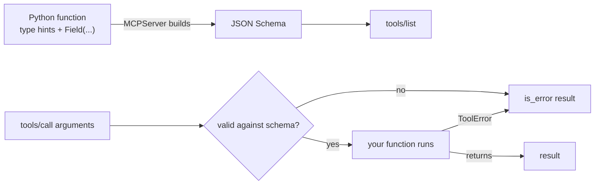

# 11.2 · A minimal server: tools, resources and prompts

**Module:** [11 · MCP: architecture and custom servers](../README.md) · **Time:** 45-60 minutes · **Model needs:** none · **Packages:** `mcp` extra

## What you will learn

- How a Python function signature becomes a tool's JSON Schema, and how the server validates calls against it.
- The two ways a tool can fail (rejected arguments, a deliberate `ToolError`) and what the model sees.
- Static resources versus **resource templates** (`helpdesk://tickets/{ticket_id}`), and how a failed read looks.
- Prompts with arguments, and how a host combines a prompt and a resource into messages.

## The idea

**What is new since 11.1:** the 11.1 server had one tool with one string argument, one fixed resource and one prompt.
Here each primitive grows up: bounded and typed arguments, a family of resources, and a prompt with options.



The schema is the contract: `Literal["open", "closed"]` becomes an `enum`, `Field(ge=1, le=10)` becomes
`minimum`/`maximum`, `Field(pattern=...)` becomes `pattern`, a default makes the argument optional. The model reads
the schema (including `Field(description=...)`), and the server enforces it before your code runs.

Failures. Bad arguments and any `ToolError` come back as a normal result with `is_error=True`, so the model can read
the message and retry. Any other exception is a crash: the model only sees `Error executing tool <name>` and the
traceback goes to the server's stderr. Resources and prompts have no `is_error`: a failed read or render raises
`MCPError` in the client (a JSON-RPC error).

Resources. `resources/list` shows only fixed URIs. A template is announced separately
(`resources/templates/list`); the client substitutes the variable and calls `resources/read`.

**Version note (mcp 2.x).** `ToolError` and `ResourceNotFoundError` live in `mcp.server.mcpserver.exceptions`;
`ClientSession.list_resource_templates()` returns `.resource_templates` with `.uri_template`.

## Scripts

`ticket_server.py` is the server, not a lesson: the scripts start it themselves with `sys.executable` over stdio
(no port). Read it first: one `@mcp.tool`, `@mcp.resource` or `@mcp.prompt` per primitive. The scripts discard the
server's stderr (`errlog`); lesson 11.4 reads it on purpose.

### 1. `01_tools_with_schemas.py`: the signature is the contract

```
./run 11.2/1
```

Lists the two tools with their generated schemas, makes valid calls (with and without optional arguments), then three
invalid calls and one deliberate `ToolError`. No model.

**Expected output** (trimmed):

```
Step 3: Invalid arguments are rejected before the function runs
tool call | set_priority({"ticket_id": "bad", "priority": 9})
   result | is_error=True | Error executing tool set_priority: 2 validation errors for set_priorityArguments
tool call | search_tickets({"category": "network", "status": "pending"})
   result | is_error=True | Error executing tool search_tickets: 1 validation error for search_ticketsArguments
tool call | search_tickets({})
   result | is_error=True | Error executing tool search_tickets: 1 validation error for search_ticketsArguments
Step 4: A failure the function itself raises on purpose (ToolError)
tool call | set_priority({"ticket_id": "T-9999", "priority": 2})
   result | is_error=True | Error executing tool set_priority: No ticket T-9999. Known ids: T-1001, T-1002, T-1003, T-1004
```

### 2. `02_resources_and_templates.py`: static resources and URI templates

```
./run 11.2/2
```

Shows the two list calls, reads the static policy, fills in the template for three tickets (note the lower-case id works
because the function upper-cases it), and triggers a failed read. No model.

**Expected output** (trimmed):

```
static   | helpdesk://policies/password  (text/plain)
template | helpdesk://tickets/{ticket_id}  (application/json)  One ticket as JSON (a resource template: the client fills in the id).
helpdesk://tickets/T-1001 (application/json) -> {"id": "T-1001", "subject": "VPN drops every ten minutes", "status": "open", "category": "network", "priority": 2}
helpdesk://tickets/t-1004 (application/json) -> {"id": "T-1004", "subject": "Wi-Fi unavailable in meeting room 4", "status": "open", "category": "network", "priority": 3}
MCPError: No ticket T-7
Resources have no is_error flag: a missing document is a JSON-RPC error (-32602 invalid params).
```

### 3. `03_prompts_and_arguments.py`: prompts, and composing primitives

```
./run 11.2/3
```

Lists the prompt's arguments, renders it for two audiences, shows a missing and a rejected argument, then composes a
system message, a resource and a rendered prompt into the messages a host would send. It stops before the model call
(11.3 and 11.5 make that call). No model.

**Expected output** (trimmed):

```
Step 3: A missing required argument, and a value the function rejects
get_prompt({}) -> MCPError: Missing required arguments: {'ticket_text'}
get_prompt({'ticket_text': 'x', 'audience': 'bogus'}) -> MCPError: Error rendering prompt triage_prompt
Step 4: Compose: prompt + resource = the messages a host would send
   system | You are the Larkspur Labs IT helpdesk assistant.
     user | Reference record:
          | {"id": "T-1001", "subject": "VPN drops every ten minutes", ...}
     user | Classify this IT helpdesk ticket as network, hardware, software, access or other. Give a one-line reason in a technical tone.
          | Ticket: VPN drops every ten minutes
```

## Try this

1. Change `limit`'s bounds to `ge=1, le=3` and rerun script 1: the schema and the rejection change with no other edit.
2. Replace `ToolError` in `set_priority` with `ValueError` and watch the model-facing message shrink to `Error executing tool set_priority`.
3. Add `Field(description=...)` to `category` listing the five categories as a `Literal`; compare the schema.
4. Add a second template, `helpdesk://tickets/{ticket_id}/history`, and read it.
5. Remove the `.upper()` in `ticket_resource` and see which URIs in script 2 break.
6. Add a prompt that takes a list-like string argument and think about how a client UI would fill it in.

## If it does not work

- `./run doctor` checks the setup; install the packages with `uv sync --extra mcp` (the launcher prints the exact command).
- `cannot import name 'ToolError'`: the module is `mcp.server.mcpserver.exceptions` in mcp 2.x.
- A script hangs: the server printed to stdout, which breaks the protocol. Log to stderr only (11.4 explains).
- Server tracebacks vanish: the scripts send server stderr to `os.devnull`; change `errlog=quiet` to `errlog=sys.stderr` to see them.

## In the running scenario

The helpdesk's tickets are now addressable (`helpdesk://tickets/T-1001`), searchable with bounded arguments, and
triageable with a user-picked prompt. 11.3 writes the client side properly; 11.5 builds the full ticket and asset server.

**Next:** 11.3 · Writing an MCP client; discovery and negotiation
