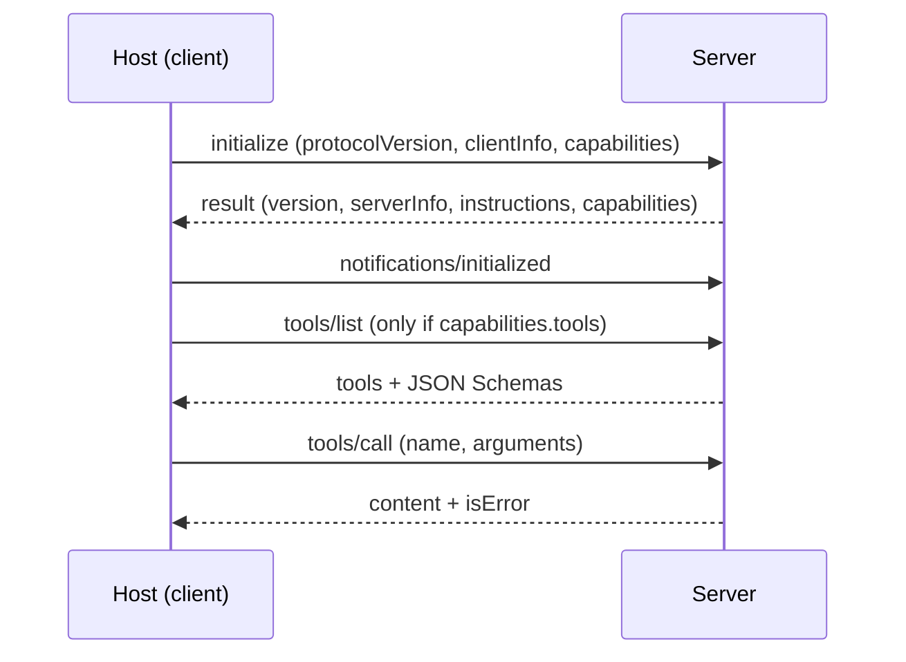

# 11.3 · Writing an MCP client; discovery and negotiation

**Module:** [11 · MCP: architecture and custom servers](../README.md) · **Time:** 45-60 minutes · **Model needs:** none for scripts 1-2; chat + tools for script 3 · **Packages:** `mcp` extra

## What you will learn

- What `initialize` negotiates: protocol version, identities, instructions, capabilities.
- How to discover a server's catalogue by asking only for what it announced.
- How to build a **tool bridge**: MCP tools to chat-model tool schemas, namespaced across servers, with results flattened back to text.
- How a model uses tools from two servers in one conversation.

## The idea

**What is new since 11.1/11.2:** those lessons showed the server side and a 30-line host. Now the client is the subject:
a reusable discovery routine, a bridge that survives several servers, and error handling that keeps the loop alive.



**Negotiation.** The client proposes a protocol version and says who it is; the server answers with the version it
will use, its identity, optional free-text `instructions`, and its capabilities. A client must not use a feature the
other side did not announce. `list_changed` means the server will notify when a list changes.

**An SDK detail that matters.** The high-level `MCPServer` announces tools, resources and prompts even when you
registered none. The low-level `Server` (used by `status_server.py`) announces only the handlers you pass in. Real
servers vary, so always check `session.server_capabilities` before listing.

**The bridge.** A chat model sees one flat list of functions. With several servers you need a routing table from the
model-facing name to (session, real tool name). Prefixing with the server label (`tickets__search_tickets`) avoids
collisions. Every result, success or failure, goes back as a string; a host that lets an exception escape ends the
conversation over a typo.

**Version note (mcp 2.x).** `ClientSession(read, write, client_info=..., read_timeout_seconds=...)`;
`session.server_capabilities` after `initialize()`; `mcp_types` holds the protocol types (`types.Implementation`).

## Scripts

`ticket_server.py` is copied from 11.2; `status_server.py` is a tools-only server written with the low-level API.
Neither is a lesson: the scripts launch them over stdio with `sys.executable`.

### 1. `01_negotiate_capabilities.py`: discover only what was announced

```
./run 11.3/1
```

Connects to both servers, prints the `initialize` result, builds a catalogue guided by the capabilities, and then
deliberately asks the tools-only server for resources. No model.

**Expected output** (trimmed):

```
Step 2: Connect to the status server
{
  "protocol_version": "2025-11-25",
  "server": "larkspur-status 0.3.0",
  "instructions": null,
  "announced": ["tools"]
}
catalogue of status
{ "tools": ["service_status"], "resources": [], "templates": [], "prompts": [] }
Step 3: What if we ask the status server for resources anyway?
MCPError (code -32601): Method not found
```

### 2. `02_tool_bridge.py`: one routing table for several servers

```
./run 11.3/2
```

A `ToolBridge` class opens both servers, registers their tools under `label__tool` names, and executes calls a model
might send, including unknown names and broken JSON. No model: the calls are scripted.

**Expected output** (trimmed):

```
Routing table (model-facing name -> server, tool)
{ "tickets__search_tickets": ["tickets", "search_tickets"], "tickets__set_priority": [...], "status__service_status": [...] }
tool call | status__service_status("{\"service\": \"vpn\"}")
   result | vpn: degraded (one gateway restarting)
tool call | tickets__set_priority("{\"ticket_id\": \"T-1001\", \"priority\": 9}")
   result | Error: Error executing tool set_priority: 1 validation error for set_priorityArguments
tool call | status__service_status("{\"service\": ")
   result | Error: arguments are not valid JSON (Expecting value). Send a JSON object.
tool call | service_status("{\"service\": \"vpn\"}")
   result | Error: unknown tool 'service_status'. Available: tickets__search_tickets, tickets__set_priority, status__service_status
```

### 3. `03_model_uses_servers.py`: a model across two servers

```
./run 11.3/3
```

The bridge is handed to a real model with a question that needs both servers and a decision: check the VPN service,
and only if it is degraded, raise the VPN ticket's priority. At most 6 model calls.

**Expected output** (trimmed):

```
tool call | status__service_status("{\"service\": \"vpn\"}")
   result | vpn: degraded (one gateway restarting)
tool call | tickets__search_tickets("{\"status\": \"open\", \"category\": \"network\"}")
   result | T-1004: Wi-Fi unavailable in meeting room 4 (priority 3)
tool call | tickets__set_priority("{\"priority\": 1, \"ticket_id\": \"T-1001\"}")
   result | T-1001 priority is now 1
assistant | I confirmed that the VPN service is currently degraded due to a gateway restart. I identified the open network ticket for the VPN issue (T-1001) ...
tokens: 435 in + 42 out = 477
Run summary: 4 model call(s), 1314 in + 144 out = 1458 tokens
```

By hand (module 02) the tool table was a dict of Python functions in your file. Here the same table points at
other processes; the model loop is unchanged.

## Try this

1. Add a `ping` tool to `status_server.py` and rerun script 1: the catalogue changes, no client code does.
2. Make `discover` ignore capabilities and call everything; run it against `status_server.py` and read the errors.
3. Change the prefix separator from `__` to `.` and see whether your model provider accepts the tool name.
4. Ask script 3 for a service that does not exist (`printer`) and read how the model reports the error result.
5. Add `read_timeout_seconds=0.001` and see what a stalled server looks like to the client.
6. Add a size cap to `ToolBridge.call` so a huge tool result is truncated before it reaches the model.

## If it does not work

- `./run doctor` checks the setup; install with `uv sync --extra mcp` (the launcher prints the exact command).
- `AttributeError: get_server_capabilities`: in mcp 2.x it is the property `session.server_capabilities`.
- Script 3 shows no tool call: the model may not support tools; `./run doctor` shows its capabilities.
- Tool name rejected by the provider: some providers allow only letters, digits, `_` and `-` in names.

## In the running scenario

The helpdesk assistant can now consult a status server and a ticket server in one conversation. The bridge is the
piece 12.2 reuses to chain third-party servers, and the 11.5 capstone host builds on it.

**Next:** 11.4 · Security, validation and debugging with the Inspector
