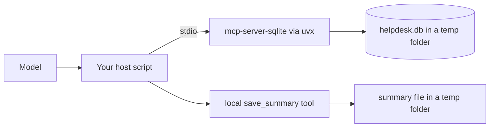

# 12.1 · Ready-made servers: SQLite and filesystem

**Module:** [12 · MCP: ecosystem integrations](../README.md) · **Time:** 45-60 minutes · **Model needs:** chat, tools (script 1 needs no model) · **Packages:** `mcp` extra; also `uv`'s `uvx` command and network on the first run

## What you will learn

- That MCP's value is the ecosystem: you can plug in servers other people published.
- How to launch a published server with `uvx` and talk to it with the client from 11.1.
- How a host chooses which of a server's tools to expose (least privilege).
- How to combine a server's tools with a tool of your own in one model loop.

## The idea

A published MCP server is a program you run, not a library you import. `uvx <name>` downloads
and runs a Python package in an isolated environment, so there is nothing to install by hand.
Your host starts it exactly as in 11.1, with `uvx` as the command.



A server advertises everything it can do. The SQLite server has `write_query` and
`create_table`; a host that only wants questions answered should offer just `list_tables`,
`describe_table` and `read_query`. The model cannot call what you do not list, and the host
refuses anything else anyway.

**Practical notes.**
- The first run downloads the server, so it needs network. Later runs use uv's cache.
- The published SQLite server was written for `mcp` 1.x and breaks against 2.x, so the scripts run it as
  `uvx --with "mcp<2" mcp-server-sqlite --db-path <file>`. Servers carry their own dependencies; your client
  and the server talk only through the protocol, so mixing versions is fine.
- **Filesystem server:** the widely used one (`@modelcontextprotocol/server-filesystem`) is a Node.js package run with
  `npx`. This course does not require Node, so the lesson skips it; if you have Node, point `StdioServerParameters`
  at `npx -y @modelcontextprotocol/server-filesystem <folder>` and everything else in these scripts works unchanged.
  Script 3 shows the safe alternative when you only need one file operation: a single local tool that writes to a fixed path.
- All data here is invented and lives in a temporary folder that is deleted when the script ends.

## Scripts

### 1. `01_connect_sqlite_server.py`: connect and run a query

```
./run 12.1/1
```

Creates the invented `tickets` table, launches the server, lists its six tools, and runs a
`read_query`. No model.

**Expected output** (trimmed):

```
Step 3: List the tools it offers
read_query      Execute a SELECT query on the SQLite database
write_query     Execute an INSERT, UPDATE, or DELETE query on the SQLite database
create_table    Create a new table in the SQLite database
list_tables     List all tables in the SQLite database
describe_table  Get the schema information for a specific table
append_insight  Add a business insight to the memo
Step 4: Run a read-only query through read_query
tool call | read_query({"query": "SELECT category, COUNT(*) AS open_tickets FROM tickets WHERE status = 'open' GROUP BY category"})
   result | [{'category': 'hardware', 'open_tickets': 1}, {'category': 'network', 'open_tickets': 2}, {'category': 'software', 'open_tickets': 1}]
```

### 2. `02_model_asks_the_database.py`: the model uses the server's tools

```
./run 12.1/2
```

Offers only the three read-only tools and lets the model find the schema and run its own SQL
(at most 4 model calls).

**Expected output** (trimmed):

```
Offered to the model: read_query, list_tables, describe_table
tool call | list_tables({})
tool call | describe_table({"table_name": "tickets"})
tool call | read_query({"query": "SELECT category, COUNT(*) FROM tickets WHERE status = 'open' GROUP BY category"})
   result | [{'category': 'hardware', 'COUNT(*)': 1}, {'category': 'network', 'COUNT(*)': 2}, {'category': 'software', 'COUNT(*)': 1}]
assistant | There are currently 4 open tickets in total: 1 hardware, 2 network, and 1 software.
```

The model first discovers the schema, then writes SQL. If it guesses a wrong value (for
example `'Open'` instead of `'open'`) it gets an empty result and may spend a call
recovering; the system prompt states the allowed values to avoid that.

### 3. `03_open_tickets_summary_file.py`: scenario, query then write a file

```
./run 12.1/3
```

The model queries open tickets by category through the server and calls a local
`save_summary` tool that writes `open_tickets_summary.md` into the temp folder. The script prints
the file before the folder is deleted. At most 7 model calls.

**Expected output** (trimmed):

```
Tools: read_query, list_tables, describe_table, save_summary  (the last one is local, not MCP)
tool call | read_query({"query": "SELECT category, group_concat(subject, ', ') as subjects, count(*) as count FROM tickets WHERE status = 'open' GROUP BY category"})
tool call | save_summary({"markdown": "- **hardware**: 1 ticket (Laptop battery swells)\n- **network**: 2 tickets ..."})
   result | Saved.
open_tickets_summary.md (186 bytes):
  - **hardware**: 1 ticket (Laptop battery swells)
  - **network**: 2 tickets (VPN drops every ten minutes, Wi-Fi slow in meeting room B)
  - **software**: 1 ticket (Editor crashes on startup)
```

Note that the model cannot choose the file path: the host fixes it. That is the same
least-privilege idea as hiding `write_query`.

## Try this

1. In script 2, add `write_query` to `READ_ONLY_TOOLS` and ask the model to close ticket 1. Then take it out again and think about why the host, not the server, decides.
2. Ask a question that needs a join or a `LIKE` filter, for example tickets whose subject mentions "VPN".
3. Add a column in `make_tickets_db` and see the model rediscover the schema with `describe_table`.
4. Lower `MAX_ITERATIONS` to 2 and read the "Stopped after..." message.
5. Run `uvx mcp-server-sqlite --help` yourself to see the server as a plain command-line program.
6. If you have Node, swap in the filesystem server as described above and list a temp folder.

## If it does not work

- Exit code 3 with a "`uvx` was not found" message: install uv (https://docs.astral.sh/uv/getting-started/installation/) and open a new terminal.
- Exit code 3 with "Could not start or talk to the SQLite MCP server": the first run needs network; test with `uvx mcp-server-sqlite --help`.
- `./run doctor` checks the model endpoint and the extras; install the packages with `uv sync --extra mcp` (the launcher prints the exact command).
- The model never calls a tool: its endpoint may not support tool calling (see `./run doctor`).

## In the running scenario

The helpdesk team now answers "how many open network tickets?" from a database without anyone
writing a query or a tool function, and gets a written summary. The same pattern, a published
server plus a host that exposes only what is safe, is how most real MCP integrations start.

**Next:** 12.2 · Chaining several servers in one session (planned)
