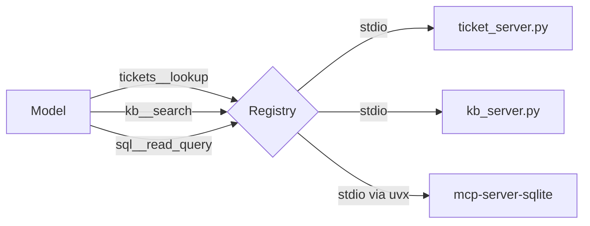

# 12.2 · Chaining several servers in one session

**Module:** [12 · MCP: ecosystem integrations](../README.md) · **Time:** 45-60 minutes · **Model needs:** chat, tools (script 1 needs no model) · **Packages:** `mcp` extra; script 3 also needs `uvx` and network on the first run

## What you will learn

- What goes wrong when a host connects to more than one MCP server: name clashes and routing.
- How to build a registry: aliases, namespaced tool names (`alias__tool`) and a routing table.
- That the model, not the host, decides which server to call next, and how to see the chain.
- How to mix a published server with servers of your own, with a per-server allow-list.

## The idea

**What is new since 12.1:** 12.1 used one server. Here the host holds several sessions open at once and
presents their tools to the model as one list. The new piece is the registry that makes that safe.



Both of this lesson's own servers have a tool called `search`. A host that flattened the lists would offer
two `search` tools and could not tell where a call should go. The registry gives each server an alias
(`tickets`, `kb`, `sql`) and exposes `tickets__search` and `kb__search`. A dictionary maps each exposed name
back to `(session, original name)`. The prefix also helps the model, because the name says what is being searched.

A chain is the model's doing: it calls `tickets__lookup`, reads that the ticket is a VPN problem, and uses that
to call `kb__search`. The host only routes. Use `contextlib.AsyncExitStack` to keep several sessions open and close
them in order, even when a call raises.

Files: `ticket_server.py` and `kb_server.py` are the two small servers (the lessons launch them as subprocesses).

## Scripts

### 1. `01_two_servers_one_registry.py`: the registry, no model

```
./run 12.2/1
```

Starts both servers, shows the name clash, builds the routing table and routes three calls.

**Expected output** (trimmed):

```
tickets  -> server 'ticket-desk' offers: lookup, search
kb       -> server 'knowledge-base' offers: search, read_article
Names offered more than once: search. A model that calls `search` would be ambiguous.
Registry: tickets__lookup, tickets__search, kb__search, kb__read_article
tool call | tickets__search({"text": "VPN"})
   result | T-1001: VPN drops every ten minutes
tool call | kb__search({"text": "VPN"})
   result | KB-10: VPN keeps disconnecting
```

### 2. `02_model_chains_two_servers.py`: the model chains across servers

```
./run 12.2/2
```

Offers the four namespaced tools and asks a question that needs both servers (at most 6 model calls).

**Expected output** (trimmed):

```
tool call | tickets__lookup({"ticket_id": "T-1001"})
   result | T-1001: VPN drops every ten minutes (status: open, category: network, owner: Priya (network team))
tool call | kb__search({"text": "VPN"})
   result | KB-10: VPN keeps disconnecting
tool call | kb__read_article({"article_id": "KB-10"})
   result | KB-10 VPN keeps disconnecting: Switch the VPN client to the TCP profile, ...
assistant | Ticket T-1001 is titled "VPN drops every ten minutes." It is currently open and owned by Priya from the network team.
          | According to KB-10, you should first switch the VPN client to the TCP profile and update the client to version 5.2 or later.
Order of servers called: tickets -> kb -> kb
```

### 3. `03_three_servers_helpdesk.py`: scenario, a published server plus two of yours

```
./run 12.2/3
```

Adds the published SQLite server (launched with `uvx --with "mcp<2"`, as in 12.1), exposes only its three
read-only tools, and asks a question that needs the database, the ticket desk and the knowledge base (at most 8 model calls).
Exit code 3 with install advice if `uvx` or the network is missing.

**Expected output** (trimmed):

```
sql      offers 6 tools, host exposes 3: read_query, list_tables, describe_table
tickets  offers 2 tools, host exposes 2: lookup, search
kb       offers 2 tools, host exposes 2: search, read_article
tool call | sql__read_query({"query": "SELECT category, COUNT(*) as open_count FROM tickets WHERE status = 'open' GROUP BY category ORDER BY open_count DESC LIMIT 1;"})
   result | [{'category': 'network', 'open_count': 3}]
tool call | tickets__search({"text": "network"})
   result | No tickets match.
tool call | tickets__lookup({"ticket_id": "T-1001"})
   result | T-1001: VPN drops every ten minutes (status: open, category: network, owner: Priya (network team))
tool call | kb__search({"text": "network"})
   result | KB-10: VPN keeps disconnecting ...
assistant | Category: network (3 open tickets)
          | Owner: Priya
          | First thing to try: Switch the VPN client to the TCP profile.
Calls per server: sql=1, tickets=2, kb=2
```

Notice the wasted `tickets__search` call: the model guessed a category could be searched. Models explore;
that is why the loop has a cap.

## Try this

1. In script 2, drop the `alias__` prefix for the knowledge base only and see what the model does with two tools called `search`.
2. Add a third tool to `kb_server.py` (for example `list_articles`) and watch it appear in the registry with no host changes.
3. In script 3, add `write_query` to the SQL allow-list and think about who should decide that: the server, the model or the host.
4. Ask the model a question only one server can answer and check that it does not call the other two.
5. Make `routes` raise on duplicate names instead of overwriting and see which mistakes it catches.
6. Print `servers_used` per question and compare how often different questions chain.

## If it does not work

- Scripts 1 and 2 need no network. If they fail, `./run doctor` checks the model endpoint and the extras; install with `uv sync --extra mcp` (the launcher prints the exact command).
- Script 3 exit code 3, "`uvx` was not found": install uv (https://docs.astral.sh/uv/getting-started/installation/) and open a new terminal.
- Script 3 exit code 3, "Could not start or talk to one of the MCP servers": the first run needs network; test with `uvx mcp-server-sqlite --help`.
- The model never calls a tool: its endpoint may not support tool calling (see `./run doctor`).

## In the running scenario

The helpdesk assistant can now answer "what is ticket 1001, who owns it and what should I try?" by reading
three systems that know nothing about each other. Adding a fourth system is a new alias and a new subprocess,
not new glue code in the host.

**Next:** 12.3 · MCP tools inside LangChain, LangGraph and CrewAI (planned)
