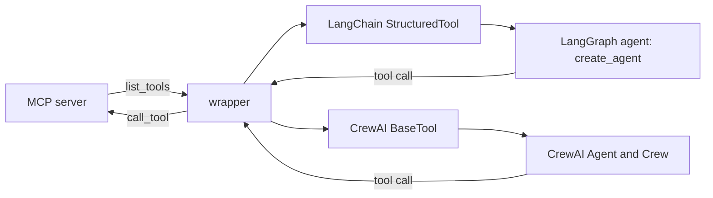

# 12.3 · MCP tools inside LangChain, LangGraph and CrewAI

**Module:** [12 · MCP: ecosystem integrations](../README.md) · **Time:** 45-60 minutes · **Model needs:** chat, tools · **Packages:** `mcp`, `langchain` and `langgraph` extras (scripts 1-2); `crewai` extra (script 3)

## What you will learn

- That an MCP tool becomes a framework tool with a small wrapper: name, description, schema, and a function that calls the server.
- How to build that wrapper for LangChain (async) and for CrewAI (sync) by hand.
- How a LangGraph agent from `create_agent` runs a loop over tools that live in another process.
- The seam to watch: async MCP sessions versus frameworks with synchronous tools.

## The idea

**What is new since 12.2:** until now the loop was ours. Here a framework owns the loop and MCP only supplies
the tools. Everything you learned about registries still holds; the wrapper is the only new code.



The `langchain-mcp-adapters` package is the usual wrapper, but it is not installed by this course, so scripts
write the wrapper by hand (about 10 lines). This is no loss: MCP's `input_schema` is JSON Schema, and
LangChain accepts a JSON Schema dict as `args_schema`, so the conversion is a rename. CrewAI wants a pydantic
model, which the script builds from the schema's properties with `create_model`. CrewAI can also take MCP servers
directly with `Agent(mcps=[...])`; the hand-built bridge shows what that does for you.

Two seams: LangChain tools can be async, so one long-lived session serves the whole agent run. CrewAI tools are
synchronous, so the script's bridge opens a short-lived connection per call with `asyncio.run` and runs the crew in a
worker thread.

Files: `ticket_server.py` is the small ticket desk server the scripts launch.

## Scripts

### 1. `01_mcp_tools_as_langchain_tools.py`: the wrapper

```
./run 12.3/1
```

Wraps both MCP tools as `StructuredTool`s, calls one directly, then lets a chat model with `bind_tools` choose one (1 model call).

**Expected output** (trimmed):

```
StructuredTool  name=lookup  args=['ticket_id']
StructuredTool  name=search  args=['text']
tool call | lookup({"ticket_id": "T-1001"})
   result | T-1001: VPN drops every ten minutes (status: open, category: network, owner: Priya (network team))
The model asked for: lookup({'ticket_id': 'T-1004'})
   result | T-1004: Wi-Fi slow in meeting room B (status: open, category: network, owner: Priya (network team))
```

### 2. `02_langgraph_agent_over_mcp.py`: a LangGraph agent over MCP tools

```
./run 12.3/2
```

Hands the wrapped tools to `create_agent` and runs the whole loop with `ainvoke` and a recursion limit of 9.
Then reads the trace from the message list.

**Expected output** (trimmed):

```
model asks  : search({'text': 'Wi-Fi'})
tool answers: T-1004: Wi-Fi slow in meeting room B
model asks  : lookup({'ticket_id': 'T-1004'})
tool answers: T-1004: Wi-Fi slow in meeting room B (status: open, category: network, owner: Priya (network team))
6 messages in total (human, AI tool calls, tool results, final AI).
The owner of the first ticket (T-1004) is Priya from the network team.
```

### 3. `03_crewai_agent_over_mcp.py`: scenario, a CrewAI dispatcher

```
./run 12.3/3
```

A "dispatcher" agent with the MCP tools looks up ticket T-1002 and reports the owner. CrewAI makes several model
requests per task, so usage is read from CrewAI's own report. It needs the `crewai` extra.

**Expected output** (trimmed):

```
BaseTool subclass  name=lookup  args=['ticket_id']
BaseTool subclass  name=search  args=['text']
result.raw
"The ticket subject is \"Laptop battery swells\". The owner is Tomas from the hardware bench team."
CrewAI made 2 model request(s) for one task.
tokens: 849 in + 153 out = 1002
The answer names the owner the server holds: yes, so the tool was used.
```

"Tomas" appears nowhere in the script or prompt; it can only have come from the server.

## Try this

1. In script 1, print `tools[0].args_schema` to see the JSON Schema that came straight from the server.
2. Change the question in script 2 to something no ticket matches and read the trace: how does the agent handle "No tickets match."?
3. Lower `recursion_limit` to 3 in script 2 and read the "Stopped" message.
4. In script 3, count how many server processes start (hint: one for discovery plus one per tool call) and think about when that is too slow.
5. Give script 2's agent a local `@tool` as well and note that framework tools do not care where a tool lives.
6. Try `Agent(mcps=[...])` in CrewAI's documentation and compare it with the bridge.

## If it does not work

- `./run doctor` checks the endpoint and extras; install with `uv sync --extra mcp --extra langchain --extra langgraph --extra crewai` (the launcher prints the exact command).
- "No module named langchain_mcp_adapters" is not an error here: the lesson does not use that package.
- Script 3 may take several seconds: each tool call starts the server.
- If the model never calls a tool, its endpoint may not support tool calling (see `./run doctor`).

## In the running scenario

The helpdesk assistant's tools no longer have to be Python functions inside the agent: an agent written in
LangGraph and one written in CrewAI can use the same ticket desk server. The team chooses the framework per job
and the integration lives in one place.

**Next:** 12.4 · Capstone: query-to-report pipeline for the helpdesk (planned)
