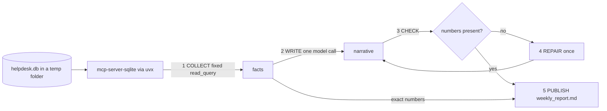

# 12.4 · Capstone: query-to-report pipeline for the helpdesk

**Module:** [12 · MCP: ecosystem integrations](../README.md) · **Time:** 60-90 minutes · **Model needs:** chat, tools (script 1 needs no model) · **Packages:** `mcp` extra; `uvx` and network on the first run

## What you will learn

- How to combine a published MCP server, a model and plain code into a pipeline you can trust.
- Why fixed questions get fixed SQL and the model gets the writing, not the counting.
- How to check model prose against ground truth and repair or flag it.
- How to compare a free-form tool-using model with a staged pipeline.

## The idea

**What is new since 12.3:** nothing new in protocol or framework. This capstone puts 12.1-12.3 to work: a
published server for data, a model for language, and your own code deciding what is trusted.



### The brief

The Larkspur Labs helpdesk lead wants a weekly report from the tickets database: total open tickets, open tickets per
category, the oldest open ticket, and a short written summary. It must be reproducible and the numbers must be right.

### Acceptance criteria

- Data is read only through MCP, with read-only queries (no `write_query`).
- The report file is written to a temp folder (no stray files in the repository).
- Every number in the report table comes from code, never from the model.
- The summary is checked: the total and each category count must appear, and the report says so when they do not.
- The pipeline makes at most 2 model calls and always terminates, even with a model that ignores the instructions.
- Exit code 0 on success; exit code 3 with advice when `uvx` or the network is missing.

### Stretch goals

- Add open tickets by priority to the facts, the table and the check.
- Add a second server (like 12.2's knowledge base) and include a suggested fix for the busiest category.
- Wrap the collect stage as a LangGraph node or CrewAI tool using the 12.3 bridge.
- Make the check stricter: reject any digit in the narrative that is not in the facts.

## Scripts

### 1. `01_collect_facts_through_mcp.py`: stage 1, the numbers

```
./run 12.4/1
```

Connects to the SQLite server and runs four fixed read-only queries. No model.

**Expected output** (trimmed):

```
tool call | read_query({"query": "SELECT COUNT(*) AS n FROM tickets WHERE status = 'open'"})
   result | [{'n': 8}]
tool call | read_query({"query": "SELECT category, COUNT(*) AS n FROM tickets WHERE status = 'open' GROUP BY category ORDER BY n DESC, category"})
   result | [{'category': 'network', 'n': 4}, {'category': 'access', 'n': 2}, {'category': 'hardware', 'n': 1}, {'category': 'software', 'n': 1}]
tool call | read_query({"query": "SELECT id, subject, opened FROM tickets WHERE status = 'open' ORDER BY opened LIMIT 1"})
   result | [{'id': 1, 'subject': 'VPN drops every ten minutes', 'opened': '2026-11-02'}]
```

### 2. `02_model_writes_report_with_tools.py`: stage 2, the free-running model

```
./run 12.4/2
```

The model gets the read-only tools plus a local `save_report` tool and does everything itself (at most 8 model calls).
The script then compares the report with counts taken straight from SQLite.

**Expected output** (trimmed):

```
tool call | read_query({"query": "SELECT category, count(*) FROM tickets WHERE status = 'open' GROUP BY category"})
   result | [{'category': 'access', 'count(*)': 2}, {'category': 'hardware', 'count(*)': 1}, {'category': 'network', 'count(*)': 4}, {'category': 'software', 'count(*)': 1}]
tool call | save_report({"markdown": "# Weekly Helpdesk Report\n\nThere are currently 8 open tickets. ..."})
   result | Saved.
True open counts per category: access=2, hardware=1, network=4, software=1
Every category line carries the right count.
```

This run was right, but 7 model calls and about 3,900 tokens for a job that stage 1 does in none. A weaker model, or a
different day, may get a count wrong or never call `save_report`; the check at the end reports it either way.

### 3. `03_query_to_report_pipeline.py`: the full pipeline

```
./run 12.4/3
```

Collect (code), write (one model call), check (code), repair (at most one more call), publish (code).

**Expected output** (trimmed):

```
Step 1: COLLECT: fixed SQL through the MCP server
Step 2: WRITE: one model call, facts in, prose out
assistant | The IT helpdesk is currently managing a total of 8 open tickets. These issues are categorized as follows: 4 network, 2 access, 1 hardware, and 1 software. ...
Step 3: CHECK (attempt 1): are the numbers in the prose?
Verified: the total and every category count appear in the narrative.
Step 4: PUBLISH: assemble in code and write the file
  # Larkspur Labs helpdesk: weekly report
  Open tickets: **8**
  | Category | Open |
  | network | 4 |
  ...
  ## Summary
  The IT helpdesk is currently managing a total of 8 open tickets. ...
Run summary: 1 model call(s), 128 in + 72 out = 200 tokens, 2.5s
```

With the offline stub model the check fails twice, so you see the repair path: the report is still written with a
line saying the narrative could not be verified.

## Try this

1. Break the check on purpose (change a count in `facts` before the model call) and see the repair step run.
2. Add priority breakdown as in the stretch goals and extend `check_narrative`.
3. Run script 2 three times and compare the number of tool calls and tokens each time.
4. Ask script 3's model for a different tone ("for executives") by editing the system message; does the check still hold?
5. Change the oldest-ticket query to "open longer than 14 days" and see what the report says.
6. Point the report folder at a persistent path you choose and open the Markdown in a viewer.

## If it does not work

- Exit code 3, "`uvx` was not found": install uv (https://docs.astral.sh/uv/getting-started/installation/) and open a new terminal.
- Exit code 3, "Could not start or talk to the SQLite MCP server": the first run needs network; test with `uvx mcp-server-sqlite --help`.
- `./run doctor` checks the model endpoint and the extras; install with `uv sync --extra mcp` (the launcher prints the exact command).
- Script 2 says the model never saved a report: run it again or tighten the task wording; that is the failure the pipeline is designed to avoid.

## In the running scenario

The helpdesk lead gets a weekly report with exact numbers and a readable summary, and the system tells them
when the summary could not be verified. Nobody wrote a query by hand, and nobody has to trust the model's
arithmetic.

**Next:** 13.1 · Reflection: generate, critique, revise
