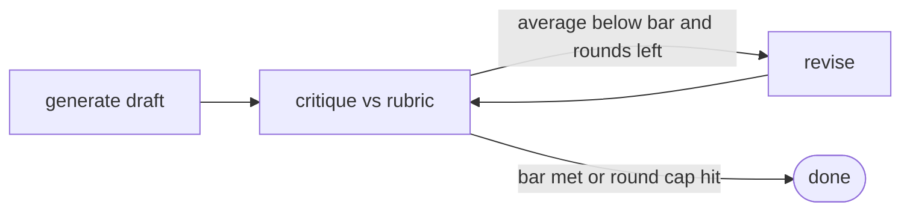

# 13.1 · Reflection: generate, critique, revise

**Module:** [13 · Deep agents: reflection, planning, long-term memory](../README.md) · **Time:** 45-60 minutes · **Model needs:** chat (JSON output helps) · **Packages:** `langgraph` extra (scripts 2 and 3)

## What you will learn

- What reflection is: the model checks its own output against a written standard, then fixes it.
- How to write a rubric (a short list of criteria with a score for each) that a model can score, 1-5 per criterion, as JSON.
- How to turn this into a loop with two stop rules: a quality bar and a hard limit on rounds.
- How reflection differs from planning (13.2) and from memory (13.3).

## The idea

A model's first draft is rarely its best work. Models are also often better at judging text than at
writing it right the first time. Reflection uses that gap. The model writes a draft, critiques it
against a rubric, revises it, and repeats until the text clears a bar.



This module covers three ideas, and each solves a different problem:

- Reflection improves one piece of work by looping over it. Nothing is remembered afterwards.
- Planning (13.2) decides which steps to take, before and during a task.
- Long-term memory (13.3) keeps what was learned across tasks and sessions.

Keep two cautions in mind. First, the critic is a model too, so it can be generous. In our runs it
often gave a first draft 5 out of 5. That is why the rubric must be specific and the critic must be
told to be harsh. Second, every loop that calls a model needs a hard cap on rounds, because "until it
is good enough" may never happen.

## Scripts

Run all three with `./run 13.1` (Windows: `run 13.1`), or one at a time.

### 1. `01_reflect_by_hand.py`: one round in plain Python

```
./run 13.1/1
```

The script writes a draft, critiques it (JSON scores per criterion), and revises it. Then it scores
the revision with the same rubric and prints the scores before and after. That is four model calls
through `ctx.client`, with no framework.

**Expected output** (trimmed; scores and wording will differ):

```
Step 2: Critique the draft against the rubric
Scores and feedback
{
  "scores": { "clarity": 5, "actionability": 5, "tone": 4 },
  "feedback": "The message is clear and direct, though it could be slightly warmer ..."
}

Step 4: Score the revision with the same rubric
Scores before -> after
{ "clarity": "5 -> 5", "actionability": "5 -> 5", "tone": "4 -> 4" }
Average: 4.7 -> 4.7

Run summary: 4 model call(s), 528 in + 228 out = 756 tokens, 6.0s
```

One round can leave the scores unchanged. Reflection does not always improve the text, which is
why you measure it.

### 2. `02_reflect_loop_graph.py`: the same thing as a LangGraph loop

```
./run 13.1/2
```

The graph has three nodes: `generate`, `critique` and `revise`. After `critique`, a conditional edge
(a branch that picks the next step from the current state) ends the run when the average reaches 4.8
or after 3 critiques. You built graphs like this in module 08.

**Expected output** (trimmed):

```
Stops when the average score >= 4.8 or after 3 critiques, whichever comes first.
generate: wrote a new draft (61 words)
critique #1: average 4.67 - The message is clear and provides immediate, helpful steps ...
revise: wrote a new draft (60 words)
critique #2: average 4.67 - ...
revise: wrote a new draft (60 words)
critique #3: average 4.67 - ...

Average score after each critique
[ 4.67, 4.67, 4.67 ]
Hit the cap of 3 critiques without reaching 4.8; returning the latest draft.

Run summary: 6 model call(s), 861 in + 345 out = 1206 tokens, 11.8s
```

Hitting the cap is a normal outcome, and the script tells you why it stopped. It also shows why the
cap exists.

### 3. `03_helpdesk_knowledge_article.py`: a knowledge-base article that must meet a quality bar

```
./run 13.1/3
```

The helpdesk keeps getting the same ticket. People are locked out after a password change, because
their phone keeps retrying the old password. The script writes the article that should stop those
tickets coming in. It reviews the article against four criteria (findable, complete, followable,
concise), revises it, and then either publishes it or flags it for a person.

**Expected output** (trimmed):

```
Step 2: Write, review, revise
write: new draft (207 words)
review #1: {'findable': 5, 'complete': 4, 'followable': 5, 'concise': 4} average 4.50
   editor: The guide is excellent, but it should explicitly state that ...
revise: new draft (235 words)
review #2: ... average 4.25
revise: new draft (195 words)
review #3: ... average 4.50

Average score per review
[ 4.5, 4.25, 4.5 ]
Did not clear the bar within the cap: send to a human editor with the feedback above.
```

Scores can go down as well as up. Each revision fixes the one thing the critic named and may break
something else. The loop stops because of a rule, not because the text finally looks good.

## Try this

1. In script 1, remove the "harsh reviewer" wording from `CRITIC_SYSTEM` and compare the scores.
2. In script 2, set `THRESHOLD = 4.0`. How many rounds does it take now?
3. Add another rubric criterion to script 3 (for example "mentions how to avoid it next time") and watch which feedback the critic returns.
4. In script 2, keep the best-scoring draft instead of the latest one (add `best_draft` to the state).
5. Set `MAX_ROUNDS = 1` and compare the token cost with `MAX_ROUNDS = 3`.
6. If your endpoint offers two models, use a different `LLM_MODEL` for the critic than for the writer.

## If it does not work

- Run `./run doctor` to check the endpoint and installed extras.
- `ModuleNotFoundError: langgraph`: install the extra with `uv sync --extra langgraph` (scripts 2 and 3).
- If the critic returns text that is not JSON, the lesson treats it as an unusable critique. Script 1 says so. Scripts 2 and 3 score it 0 and keep going until the cap.

## In the running scenario

The helpdesk assistant now has a quality check for what it publishes. An article about a repeating
issue only stops tickets if people can find it and follow it. So the assistant writes the article,
reviews it against that standard, and either publishes it or sends it to a person. 13.2 adds
planning and 13.3 adds memory, so the assistant can remember which articles resolved which tickets.

**Next:** 13.2 · Planning and replanning (planned)
