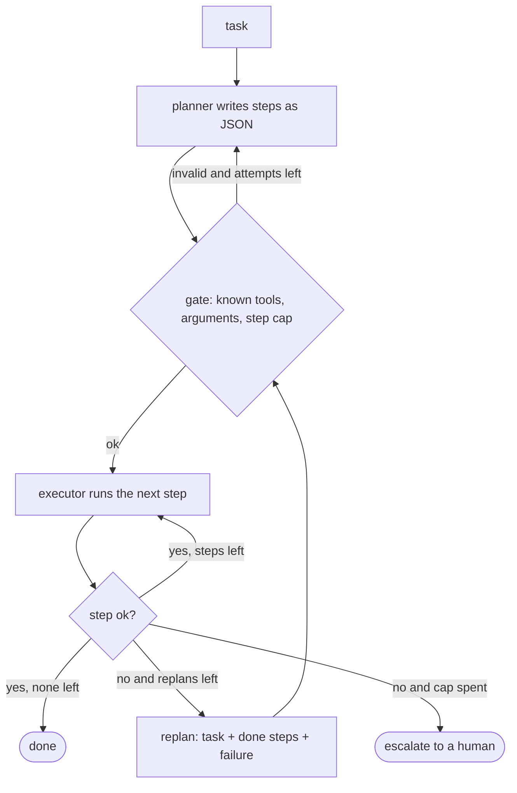

# 13.2 · Planning and replanning

**Module:** [13 · Deep agents: reflection, planning, long-term memory](../README.md) · **Time:** 45-60 minutes · **Model needs:** chat, tools (JSON output helps) · **Packages:** none beyond the base install (`pydantic` is already included)

## What you will learn

- The difference between ReAct (the model decides one step at a time) and plan-and-execute (it writes the whole plan first), and what each costs.
- How to get a plan as JSON and run it with plain Python, so you can inspect the plan before anything happens.
- How to replan when a step fails: give the planner the task, what is done and what went wrong.
- Why a plan from a model needs a gate (a check that rejects unknown tools, missing arguments, too many steps and unapproved risky steps), and why every replan loop needs a cap.

## The idea

In 13.1, reflection improved one piece of text by looping over it. Planning is about actions: which
steps to take, in which order, and what to do when one of them does not work.



Here are the two styles side by side:

| | ReAct | Plan-and-execute |
|---|---|---|
| Model calls | one per step (plus the answer) | one plan, plus an optional summary |
| Adapts to a result | yes, every step | only if you add replanning |
| You can review it first | no | yes, the plan is data |
| Weakness | wanders, can stop early, cost grows with steps | the plan goes stale; later steps may depend on earlier results |

Replanning gives you the best of both. You keep the cheap plan that you can review, and when a step
does not go as planned, you ask the planner again with the new facts. In module 09 you saw the same
loop as a LangGraph cycle. Here it is plain Python, so you can see every decision.

## Scripts

Run all three with `./run 13.2` (Windows: `run 13.2`), or one at a time. All tools are simulated, so nothing real changes.

### 1. `01_react_vs_plan_and_execute.py`: the same task, two ways

```
./run 13.2/1
```

The task is setting up a new starter: an account, two groups, a laptop and a welcome email. The script
runs it first as a ReAct loop with `tools=...` (capped at 8 calls). Then it runs it as one JSON plan that
code executes, plus one summary call. It prints the number of model calls and how many steps each
approach actually ran.

**Expected output** (trimmed; step order and counts can vary):

```
Step 2: A. ReAct: one tool call at a time
tool call | create_account({"full_name": "Jo Park"})
   result | {"ok": true, "username": "jpark"}
...
Reply from the model
assistant | I have successfully created Jo Park's account, added her to the all-staff and sales groups, ...

Step 4: Compare
Model calls
{ "react": 5, "plan_and_execute": 2 }
Steps actually executed
{ "react": 5, "plan_and_execute": 5 }
```

In an earlier run, the real model ended its turn after three steps. Instead of a tool call it wrote text
such as `[Assistant called tool reserve_laptop ...]`, so ReAct finished only 3 of 5 steps. The script
notices when ReAct ran fewer steps than the plan and tells you. With a plan, you can count the steps. With
ReAct, you only find out by checking.

### 2. `02_replan_on_failure.py`: a plan that changes

```
./run 13.2/2
```

The task asks for a ThinkBook 14, which is out of stock. The executor runs the plan, hits the failure, and
calls the planner again with the finished steps and the error. The cap is 3 replans. One of them may be used
for a final "is anything left?" review after a replanned stretch. When the cap is spent, the run stops and
escalates to a person.

**Expected output** (trimmed):

```
tool call | reserve_laptop({"full_name": "Jo Park", "model": "ThinkBook 14"})
   result | {"ok": false, "error": "ThinkBook 14 is out of stock"}
Step reserve_laptop failed (ThinkBook 14 is out of stock). Replan 1 of 3.
Plan 2 (remaining work only)
[ { "tool": "list_laptops", "args": {} } ]
tool call | list_laptops({})
   result | {"ok": true, "in_stock": {"ProBook 15": 3}}
Plan finished after a replan: asking whether anything is left (replan 2 of 3).
...
Plan finished after a replan: asking whether anything is left (replan 3 of 3).
Plan 4 (remaining work only)
[ { "tool": "reserve_laptop", "args": { "full_name": "Jo Park", "model": "ThinkBook 14" } } ]
   result | {"ok": false, "error": "ThinkBook 14 is out of stock"}

Replans used: 3 of 3. Outcome: stopped: reserve_laptop failed and the replan cap (3) is spent -> escalate to a human.
```

This real run shows the main point of the lesson. The replanner looked up stock and saw that only the
ProBook 15 was available. Yet the next review planned the same out-of-stock laptop again. Models do repeat
failed steps. The cap turned what would have been an endless loop into a clean handover to a person. The
usual fix is Try this 2: tell the planner what already failed.

### 3. `03_helpdesk_incident_plan.py`: a plan behind a gate

```
./run 13.2/3
```

A user typed her password into a phishing page (a fake login page that steals passwords). The planner
proposes steps to contain the damage. A pydantic model checks the shape of the plan, and a `validate`
function checks the tools, the required arguments and the step cap. The script lists risky tools for
approval. Here they are approved automatically, because lessons never wait for input. The simulated
identity provider times out on the first `revoke_sessions`, which forces a replan.

**Expected output** (trimmed):

```
Risky steps needing approval: ['revoke_sessions', 'reset_password']. (Auto-approved in this lesson; ...)
tool call | revoke_sessions({"username": "dmorgan"})
   result | {"ok": false, "error": "identity provider timed out"}
revoke_sessions failed (identity provider timed out). Replan 1 of 2.
...
tool call | revoke_sessions({"username": "dmorgan"})
   result | {"ok": true, "revoked": "dmorgan"}
...
Completed steps
[ "lookup_user", "revoke_sessions", "reset_password", "notify_manager", "open_security_ticket" ]
Outcome: all steps done. Replans used: 1 of 2.
```

Look at the manager message in plan 2. It already says access "has been revoked", but that had not
happened yet when the planner wrote it. A plan can describe outcomes in advance. When the wording
matters, generate that text after the steps have run.

## Try this

1. In script 1, make the task longer (six more groups) and compare the call counts again.
2. In script 2, add "Do not repeat a step that has already failed with the same arguments." to the replan prompt, or pass the list of failures into it. Does the run now finish?
3. In script 2, change the task to ask for a ProBook 15. How many replans now (zero is the right answer)?
4. In script 3, set `MAX_STEPS = 3` and watch the gate reject the plan and the planner retry.
5. In script 3, make `revoke_sessions` fail every time. What does the escalation say?
6. Add a `dry_run` flag that prints the plan and the risky steps and stops before executing.

## If it does not work

- Run `./run doctor` to check the endpoint.
- If the model returns a plan that is not JSON, scripts 1 and 2 say so and run nothing. Script 3 retries once with the errors, then escalates. These are expected outcomes, not crashes.
- If the model ends a ReAct run early (script 1), the script reports the steps missing. Re-run, or compare with the plan-and-execute result.

## In the running scenario

The helpdesk assistant can now do work that takes several steps, such as onboarding a new starter or
containing a phishing report, without a person watching every step. The plan is data, so code can check it
and a person can approve it. A failure triggers a replan, up to a fixed limit. Anything the assistant cannot
fix goes to a person, together with the list of what was done. 13.3 gives the assistant memory, so the next
run can start from what worked last time.

**Next:** 13.3 · Long-term memory: episodic, semantic, procedural (planned)
