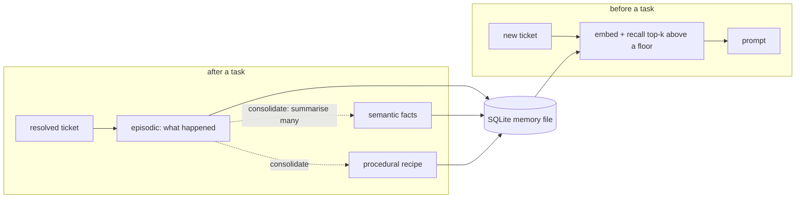

# 13.3 · Long-term memory: episodic, semantic, procedural

**Module:** [13 · Deep agents: reflection, planning, long-term memory](../README.md) · **Time:** 45-60 minutes · **Model needs:** chat (JSON output for script 3), embeddings · **Packages:** `rag` extra (local embeddings via `fastembed`; SQLite is in the standard library)

## What you will learn

- The three kinds of long-term memory an agent can keep: episodic (what happened), semantic (what is true) and procedural (how to do it).
- How to write and recall memories with embeddings, and why recall needs a relevance floor (a minimum score below which a memory is ignored).
- How to keep memory in a SQLite file, so a new session can use what an earlier session learned.
- How to consolidate many episodes into a few facts and a recipe, while keeping track of the sources.

## The idea

In 13.2, planning decided what to do inside one task. Memory carries knowledge across tasks and sessions, so
the next run starts from what the last one learned. This is different from the conversation memory of module 02,
which is only the message list of one conversation.



| Kind | Holds | Example | Written when |
|---|---|---|---|
| Episodic | a specific past event | "LL-3101: locked out; phone retried the old password" | after every task |
| Semantic | a general fact | "lockouts clear after 15 minutes" | by consolidation, or a person |
| Procedural | steps that work | "lockout procedure: confirm identity, check phones, unlock, re-add" | by consolidation, or a person |

To recall a memory, the code turns the query and each stored text into an embedding (a list of numbers that
captures what a text means). It then ranks the memories by cosine similarity, a score for how close two embeddings
are. Here that runs on your machine through `ctx.embed(...)`, which uses the `BAAI/bge-small-en-v1.5` model through
`fastembed` (384 dimensions). With a hosted embedding model you would call
`client.embeddings.create(model="your-embedding-model", input=[...])` and read `.data[i].embedding`. The rest of the
code stays the same.

The scores only mean something compared with each other. Unrelated sentences already score about 0.4 to 0.6. So
choose the floor by looking at real scores, and tune it again whenever you change the model.

## Scripts

Run all three with `./run 13.3` (Windows: `run 13.3`), or one at a time. Scripts that write a database use a temporary
folder and delete it at the end.

### 1. `01_three_kinds_of_memory.py`: the three shapes

```
./run 13.3/1
```

The script keeps eight memories of all three kinds in a list, with their embeddings. For a new lockout ticket, it
recalls the best memory of each kind, puts them into the system prompt, and asks one question.

**Expected output** (trimmed):

```
8 memories, 384-dimensional embeddings (kept in memory only; 13.3/2 moves them to SQLite).
episodic   scores [0.77, 0.63, 0.49] -> best: LL-3101: dmorgan was locked out minutes after a password change; ...
semantic   scores [0.72, 0.5, 0.39] -> best: Account lockouts clear on their own after 15 minutes; ...
procedural scores [0.72, 0.46] -> best: Lockout procedure: 1) confirm identity, ...
...
assistant | ... 1. Verify your identity ... 2. Identify cached passwords ... Based on a past case (LL-3101), we've seen
          | that phones frequently cause lockout loops ... 3. The Unlock: While account lockouts usually clear on their own after 15 minutes ...
```

The answer uses all three. The procedure gives the order of the steps, the episode gives the likely cause, and the
fact gives the waiting time.

### 2. `02_episodic_store_and_recall.py`: a store that survives

```
./run 13.3/2
```

Session 1 writes four resolved tickets to a SQLite file and closes it. Session 2 opens the file again from scratch and
recalls episodes for a new Outlook ticket. It answers twice, once without memory and once with the recalled episodes. A
last step tries an unrelated ticket to show the relevance floor at work.

**Expected output** (trimmed):

```
Recall (score, ticket, problem)
[ [0.86, "LL-3204", "Outlook shows 'disconnected' only on Mondays"], [0.6, "LL-3203", "VPN drops every ten minutes at a hotel"] ]
Relevance floor for 'I have seen this before': 0.62.
Without memory:
assistant | Please try restarting your computer and verifying your internet connection first thing in the morning. ...
With memory (1 relevant episode(s) in the prompt):
assistant | It is possible your mailbox is nearing its storage quota, which can prevent Outlook from connecting and sending mail. Please try archiving old messages ...
...
Unrelated ticket: Can I get a standing desk approved for my new office?
0 episode(s) pass the floor, so the agent should say it has no relevant experience ...
```

The answer with memory names the real cause from a past ticket. The one without memory gives generic advice. Now look at
the scores. The second hit (0.60, a VPN ticket) is only just under the floor, and the unrelated ticket's best hit also
scores 0.60. With a small embedding model, a floor is a blunt tool. That is why the lesson tells you to tune it from real
scores.

### 3. `03_consolidate_into_knowledge.py`: episodes become knowledge

```
./run 13.3/3
```

The store holds six episodes, and four of them are lockouts. One JSON call asks the model for general facts and procedures,
each citing its source tickets. The script drops entries without a real source and saves the rest as semantic and procedural
memories. It then archives the source episodes: they stay in the file, but recall skips them. Finally it compares recall
before and after.

**Expected output** (trimmed):

```
Top 3 (score, id, kind): [0.84, LL-3301, episodic] [0.79, LL-3304, episodic] [0.78, LL-3302, episodic]
70 words of memory in the prompt, mostly the same story told three times.
stored semantic memory from ['LL-3301', 'LL-3302', 'LL-3303', 'LL-3304']: Frequent account lockouts following a password update are typically caused by secondary devices ...
stored procedural memory from [...]: 1) Identify all secondary devices and applications synced with the account 2) Remove or update the saved credentials ...
2 consolidated memory(ies) stored, 4 source episode(s) archived (kept in the file, skipped by recall).
Top 3 (score, id, kind): [0.75, K-1, semantic] [0.69, K-2, procedural] [0.59, LL-3306, episodic]
Words of memory in the prompt: { "before": 70, "after": 73 }
```

The word count did not drop. The two consolidated entries replaced four episodes, but top-3 recall then filled the free slot
with an unrelated episode (the VPN ticket, score 0.59). The gain is in quality, not size. The prompt now holds a fact and a
recipe instead of the same story three times. Use consolidation together with the relevance floor from script 2.

## Try this

1. In script 1, change the question to a printer problem and see which memories win in each kind.
2. In script 2, set `RELEVANCE_FLOOR = 0.5`, then `0.8`. What gets through each time?
3. In script 2, embed `problem + fix` instead of only `problem`. Does recall of the new ticket change? Why might it get worse?
4. In script 3, change `recall(NEW_TICKET)` to use `k=2` and compare the prompt size before and after.
5. In script 3, add a seventh lockout episode with a different cause (an expired certificate) and see whether the summary still holds.
6. Add a `confidence` field to each consolidated entry (number of sources) and recall only entries with two or more sources.

## If it does not work

- Run `./run doctor` to check the endpoint and installed extras.
- `ModuleNotFoundError: fastembed`: install the extra with `uv sync --extra rag`. The first run downloads the small embedding model.
- If script 3's consolidation reply is not usable JSON, the script says so and leaves the episodes untouched. If the model cites tickets that do not exist, the script drops that entry and prints a note.

## In the running scenario

The helpdesk assistant now has somewhere to put what it learns. Each resolved ticket becomes an episode. Patterns that repeat
are consolidated into facts and recipes, with their sources recorded. For a new ticket, the assistant recalls the best of all
three kinds before the model answers. 13.4 builds this into an agent that handles tickets across sessions.

**Next:** 13.4 · Capstone: a helpdesk agent that learns from resolved tickets (planned)
