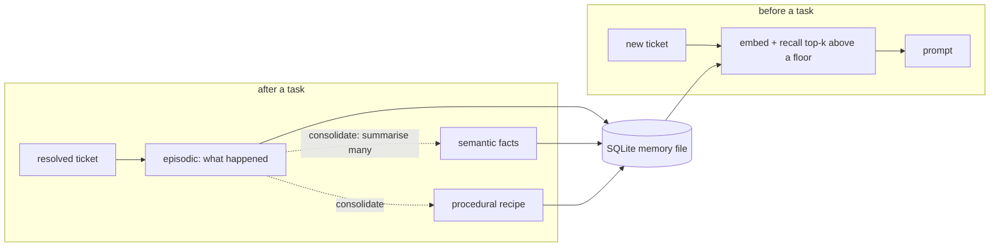

# 13.3 · Long-term memory: episodic, semantic, procedural

**Module:** [13 · Deep agents: reflection, planning, long-term memory](../README.md) · **Time:** 45-60 minutes · **Model needs:** chat (JSON output for script 3), embeddings · **Packages:** `rag` extra (local embeddings via `fastembed`; SQLite is in the standard library)

## What you will learn

- The three kinds of long-term memory an agent can keep: **episodic** (what happened), **semantic** (what is true), **procedural** (how to do it).
- How to **write** and **recall** memories with embeddings, and why recall scores need a **relevance floor**.
- How to keep memory in a **SQLite** file so a new session can use what an earlier session learned.
- How to **consolidate** many episodes into a few facts and a recipe, keeping the sources.

## The idea

**What is new since 13.2:** planning decides what to do inside one task. Memory carries knowledge *across* tasks and
sessions, so the next run starts from what the last one learned. It also differs from the conversation memory of
module 02, which is just the message list of one conversation.



| Kind | Holds | Example | Written when |
|---|---|---|---|
| Episodic | a specific past event | "LL-3101: locked out; phone retried the old password" | after every task |
| Semantic | a general fact | "lockouts clear after 15 minutes" | by consolidation, or a person |
| Procedural | steps that work | "lockout procedure: confirm identity, check phones, unlock, re-add" | by consolidation, or a person |

**Embeddings.** Recall embeds the query and the stored text and ranks by cosine similarity. Here that runs locally
through `ctx.embed(...)` (the `BAAI/bge-small-en-v1.5` model through `fastembed`, 384 dimensions). With a hosted embedding
model you would call `client.embeddings.create(model="your-embedding-model", input=[...])` and read `.data[i].embedding`;
the rest of the code does not change. Scores only mean something relative to each other (unrelated sentences already
score about 0.4 to 0.6), so choose the floor by looking at real scores, and re-tune it when you change the model.

## Scripts

Run all three with `./run 13.3` (Windows: `run 13.3`), or one at a time. Scripts that write a database use a temporary
folder that is deleted at the end.

### 1. `01_three_kinds_of_memory.py`: the three shapes

```
./run 13.3/1
```

Eight memories (episodic, semantic, procedural) in a list with embeddings. For a new lockout ticket it recalls the best of each
kind, puts them into the system prompt, and asks one question.

**Expected output** (trimmed):

```
8 memories, 384-dimensional embeddings (kept in memory only; 13.3/2 moves them to SQLite).
episodic   scores [0.77, 0.63, 0.49] -> best: LL-3101: dmorgan was locked out minutes after a password change; ...
semantic   scores [0.72, 0.5, 0.39] -> best: Account lockouts clear on their own after 15 minutes; ...
procedural scores [0.72, 0.46] -> best: Lockout procedure: 1) confirm identity, ...
...
assistant | ... 1. Verify your identity ... 2. Identify cached passwords ... Based on a past case (LL-3101), we've seen
          | that phones frequently cause lockout loops ... 3. The Unlock: While account lockouts usually clear on their own after 15 minutes ...
```

The answer uses all three: the procedure gives the order, the episode gives the likely cause, the fact gives the wait.

### 2. `02_episodic_store_and_recall.py`: a store that survives

```
./run 13.3/2
```

Session 1 writes four resolved tickets to a SQLite file and closes it. Session 2 opens the file fresh, recalls for a new Outlook
ticket, and answers twice: without memory and with the recalled episodes. A last step shows an unrelated ticket and the relevance floor
at work.

**Expected output** (trimmed):

```
Recall (score, ticket, problem)
[ [0.86, "LL-3204", "Outlook shows 'disconnected' only on Mondays"], [0.6, "LL-3203", "VPN drops every ten minutes at a hotel"] ]
Relevance floor for 'I have seen this before': 0.62.
Without memory:
assistant | Please try restarting your computer and verifying your internet connection first thing in the morning. ...
With memory (1 relevant episode(s) in the prompt):
assistant | It is possible your mailbox is nearing its storage quota, which can prevent Outlook from connecting and sending mail. Please try archiving old messages ...
...
Unrelated ticket: Can I get a standing desk approved for my new office?
0 episode(s) pass the floor, so the agent should say it has no relevant experience ...
```

The with-memory answer names the real cause from a past ticket; the plain one gives generic advice. Look at the scores: the second
hit (0.60, a VPN ticket) is only just under the floor, and the unrelated ticket's best hit also scores 0.60. A floor on a
small embedding model is a blunt tool: this is why the lesson tells you to tune it from real scores.

### 3. `03_consolidate_into_knowledge.py`: episodes become knowledge

```
./run 13.3/3
```

Six episodes, four of them lockouts. One JSON call asks the model for general facts and procedures that cite their source tickets. Entries
without a real source are dropped, the stored ones are saved as semantic and procedural memories, and the source episodes are archived (kept,
but skipped by recall). Recall before and after is compared.

**Expected output** (trimmed):

```
Top 3 (score, id, kind): [0.84, LL-3301, episodic] [0.79, LL-3304, episodic] [0.78, LL-3302, episodic]
70 words of memory in the prompt, mostly the same story told three times.
stored semantic memory from ['LL-3301', 'LL-3302', 'LL-3303', 'LL-3304']: Frequent account lockouts following a password update are typically caused by secondary devices ...
stored procedural memory from [...]: 1) Identify all secondary devices and applications synced with the account 2) Remove or update the saved credentials ...
2 consolidated memory(ies) stored, 4 source episode(s) archived (kept in the file, skipped by recall).
Top 3 (score, id, kind): [0.75, K-1, semantic] [0.69, K-2, procedural] [0.59, LL-3306, episodic]
Words of memory in the prompt: { "before": 70, "after": 73 }
```

The word count did not drop. The two consolidated entries replaced four episodes, but top-3 recall then filled the freed slot with an
unrelated episode (the VPN ticket, score 0.59). The real gain is quality, not size: the prompt now holds a fact and a recipe instead of one story
three times. Pair consolidation with the relevance floor from script 2.

## Try this

1. In script 1, change the question to a printer problem and see which memories win in each kind.
2. In script 2, set `RELEVANCE_FLOOR = 0.5`, then `0.8`. What gets through each time?
3. In script 2, embed `problem + fix` instead of only `problem`. Does recall of the new ticket change? Why might it get worse?
4. In script 3, change `recall(NEW_TICKET)` to use `k=2` and compare the prompt size before and after.
5. In script 3, add a seventh lockout episode with a different cause (an expired certificate) and see whether the summary still holds.
6. Add a `confidence` field to each consolidated entry (number of sources) and recall only entries with two or more sources.

## If it does not work

- Run `./run doctor` to check the endpoint and installed extras.
- `ModuleNotFoundError: fastembed`: install the extra with `uv sync --extra rag`. The first run downloads the small embedding model.
- If script 3's consolidation reply is not usable JSON, it says so and leaves the episodes untouched. If the model cites tickets that do not exist, the entry is dropped with a note.

## In the running scenario

The helpdesk assistant now has somewhere to put what it learns. Each resolved ticket becomes an episode; repeated patterns are consolidated into facts
and recipes with their sources recorded; a new ticket recalls the best of all three before the model answers. 13.4 wires this into an agent that
handles tickets across sessions.

**Next:** 13.4 · Capstone: a helpdesk agent that learns from resolved tickets (planned)
