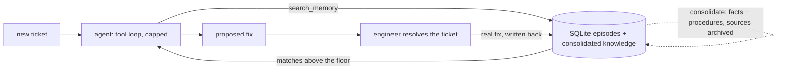

# 13.4 · Capstone: a helpdesk agent that learns from resolved tickets

**Module:** [13 · Deep agents: reflection, planning, long-term memory](../README.md) · **Time:** 45-60 minutes · **Model needs:** chat, tools, embeddings (JSON output for script 3) · **Packages:** `rag` extra (local embeddings via `fastembed`)

## What you will learn

- How the module's pieces fit into one agent: a **tool loop** (13.2) over a **persistent memory** (13.3).
- Where in the lifecycle to **write** memory (after a person resolves the ticket) and where to **read** it (before answering).
- How to **benchmark** memory: the same tickets with and without it, scored by a repeatable rule.
- How to **consolidate** the history and check that consolidation did not lose what made the fixes findable.

## The idea

This is a capstone: no new API, just the module assembled and measured.

**The brief.** The Larkspur Labs helpdesk agent answers a ticket with a likely fix. Today it starts from zero on
every ticket. Make it learn from resolved tickets, across sessions, and prove it helps.

**Acceptance criteria.**

1. A `search_memory` tool over a SQLite file of past resolved tickets, used inside a capped tool loop (at most 5 model calls).
2. Memory is written **after a human resolves** the ticket, with the engineer's real fix, and survives closing the connection.
3. Recall has a relevance floor; when nothing clears it, the agent says it has no experience and does not cite a past ticket.
4. On the four tickets in [`tickets.json`](tickets.json) (three repeat a known problem, one is new) the agent with memory passes at least 3 of 4 and beats the no-memory baseline (script 2).
5. Consolidating the history (script 3) keeps the pass rate at 3 of 4 or better.



The `expected_keyword` in `tickets.json` is the answer key; only scripts 2 and 3 read it, and it is never sent to the model.

## Scripts

Run all three with `./run 13.4` (Windows: `run 13.4`), or one at a time. Databases live in temporary folders.

### 1. `01_agent_with_memory_tool.py`: the agent and the learning step

```
./run 13.4/1
```

Seeds a store from the history, runs the agent on ticket LL-5001 with `search_memory` as a tool, writes the engineer's resolution as a
new episode, then reopens the file as "session 2" and counts the episodes.

**Expected output** (trimmed):

```
tool call | search_memory({"query": "account locked after password change mail app logged in"})
   result | [{"ticket": "LL-4101", "score": 0.86, "problem": "Locked out minutes after changing my password; ...", "fix": "The phone's mail app kept retrying the old password. ..."}, ...]
Reply from the model
assistant | Your account is likely locking because your phone's mail app is still attempting to authenticate with the old password, similar to ticket LL-4101. ...
Stored LL-5001 with the fix the engineer actually applied (not the agent's guess).
Episodes now
{ "count": 9, "includes_new": true }
```

Why store the engineer's fix and not the agent's answer: otherwise a wrong guess becomes a "memory" that the next session trusts.

### 2. `02_benchmark_with_and_without_memory.py`: does it help?

```
./run 13.4/2
```

Four tickets, each answered by the same prompt with and without recalled episodes (eight calls). Three repeat a historical problem; one (installing Figma)
has no precedent and should not cite a past ticket.

**Expected output** (trimmed):

```
Step 3: Ticket LL-5002
Nobody on the third floor can print today; the queue shows jobs stuck.
recalled: LL-4103 (0.78)
baseline: Please restart the third-floor print server and clear the pending print queue on the affected machines. ...
memory:   This issue appears to be caused by a hung print spooler on printsrv02, as seen in ticket LL-4103. Please restart the print spooler service ...
...
recalled: nothing above the floor (best 0.56)       <- the Figma ticket
memory:   I have no past experience with this specific software request. Please escalate this ticket ...
Passes out of 4
{ "baseline": 2, "memory": 4 }
Acceptance (memory passes at least 3 of 4 and beats the baseline): PASS.
```

The baseline passed two tickets: the phone answer (generic advice often guesses it) and the Figma ticket (nothing to cite). The memory answers name the
specific cause and server from history, and the Figma ticket's best score (0.56) sat under the 0.6 floor, so the model was told there was no precedent.

### 3. `03_consolidate_and_re_evaluate.py`: knowledge instead of stories

```
./run 13.4/3
```

One JSON call consolidates the eight episodes into facts and procedures with their sources (the two lockout episodes were the only repeating pair); the sources are archived.
Then the four tickets are answered from the consolidated memory and scored with the same rule.

**Expected output** (trimmed):

```
semantic from ['LL-4101', 'LL-4102']: Frequent account lockouts following a password change are often caused by cached credentials or automated login attempts from secondary devices like mobile phones or tablets.
procedural from ['LL-4101', 'LL-4102']: 1) Identify all devices synced with the account 2) Remove the mail account from the mobile or tablet device 3) Unlock the account via IT support 4) Re-add the account ...
LL-5001 recalled [('K-1', 0.75), ('K-2', 0.75)]
   answer: This is likely caused by your mobile mail app attempting to authenticate with outdated credentials. Please follow the steps in K-2: ...
...
4 of 4 pass. Acceptance bar: 3 of 4 -> PASS.
```

Only two episodes consolidated, so the memory did not shrink (8 active entries: 6 untouched episodes plus 2 new entries). The prompt consolidation asks the model to keep concrete details such as devices,
servers and protocols; without that line, a summary can generalise the keyword away and the ticket would miss.

## Stretch goals

- Add a `confidence` count (number of sources) to consolidated entries and show it to the agent.
- Let the agent also search by category, using a `category` column.
- Add a forget rule: archive episodes older than N days that no recall has used.
- Put a human approval step (module 09) between the agent's answer and the write-back.
- Run script 3 on a larger synthetic history (30 tickets, 5 patterns) and measure the prompt size before and after.

## Try this

1. In script 1, set `FLOOR = 0.9`. What does the agent say, and what does it do with the ticket?
2. In script 2, set `FLOOR = 0.5`. Does the Figma ticket now cite a past ticket?
3. In script 2, replace one `fix` in `tickets.json` with a wrong one. How does the agent with memory fail, and what does that tell you about writing agent guesses to memory?
4. In script 3, delete the sentence about concrete details from `CONSOLIDATE_SYSTEM` and compare which tickets pass.
5. Add a fifth incoming ticket that resembles two different history tickets (for example a Teams camera problem on hotel wifi) and look at what is recalled.
6. Reuse the `validate` gate from 13.2/3 on a plan the agent writes after recalling a procedure.

## If it does not work

- Run `./run doctor` to check the endpoint and installed extras.
- `ModuleNotFoundError: fastembed`: install the extra with `uv sync --extra rag`; the first run downloads the small embedding model.
- A FAIL in scripts 2 or 3 is a result, not a bug: read the answers above it. Models vary, and the keyword rule is deliberately strict.
- If the agent never calls `search_memory` in script 1, the run says so by showing a reply with no tool call. Strengthen the system prompt or lower the model temperature.

## In the running scenario

The helpdesk agent now improves with use. Each resolved ticket makes the next similar ticket cheaper to solve, repeated patterns become compact knowledge with
traceable sources, and a new kind of ticket is escalated instead of guessed. Module 14 turns to several agents working together as a crew.

**Next:** 14.1 · Agents, tasks, crews and processes (module 14 starts there)
