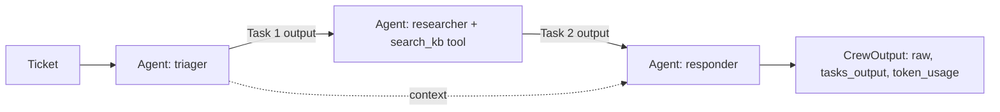

# 14.1 · Agents, tasks, crews and processes

**Module:** [14 · CrewAI: multi-agent orchestration](../README.md) · **Time:** 45-60 minutes · **Model needs:** chat · **Packages:** `crewai` extra (CrewAI 1.6)

## What you will learn

- The four building blocks of CrewAI (a framework for running several agents as a team): Agent (role, goal, backstory), Task (description, expected output), Crew and Process.
- How to point CrewAI at any OpenAI-compatible endpoint.
- How one task's output reaches the next task (`context=`).
- How a plain Python function becomes an agent's tool (`@tool`).
- Why CrewAI makes several model calls per task, and how to see the bill (`result.token_usage`).

## The idea

An Agent is a persona. CrewAI builds its system prompt from the agent's `role`, `goal` and `backstory`.
A Task is one piece of work, with an `expected_output` that tells the agent what "done" looks like.
A Crew holds the agents and tasks, and a Process decides how they run. `Process.sequential`
runs the tasks in order. A task can list earlier tasks in `context=[...]`, and their outputs are added
to its prompt. That text is the only memory the agents share.



If you built this by hand, as in modules 01 and 02, each agent would be one chat call with a system
message. A hand-off would be you pasting one reply into the next messages list. A tool would be the loop
you wrote in 02.1. CrewAI writes that code for you. In return, it wraps every task in a ReAct-style prompt
(think, act, observe, repeat), so one task can cost several model calls. All three scripts print
`result.token_usage` so you can see this.

## Scripts

Run all three with `./run 14.1` (Windows: `run 14.1`), or one at a time. Each script switches off
telemetry (usage data CrewAI would otherwise send) with `CREWAI_DISABLE_TELEMETRY` and `OTEL_SDK_DISABLED`.
It also sets `CREWAI_TESTING` to stop the first-run trace prompt.

### 1. `01_one_agent_one_task.py`: a crew of one

```
./run 14.1/1
```

The script builds one agent, one task with an `expected_output`, and one crew. It prints the agent and
task, runs `crew.kickoff()`, then prints `result.raw` and `result.token_usage`.

**Expected output** (trimmed; the reply will differ):

```
Step 1: Point CrewAI at the endpoint
LLM(model='your-model-name', provider='openai', base_url='https://your-provider.example/v1')
...
Step 4: Read the result
Output
{ "result.raw": "Hi Mei, I'm sorry to hear the printer is acting up right before your visitor arrival. ..." }
result.token_usage
{ "total_tokens": 329, "prompt_tokens": 235, "completion_tokens": 94, "cached_prompt_tokens": 0, "successful_requests": 1 }
tokens: 235 in + 94 out = 329
```

### 2. `02_two_agents_in_sequence.py`: triager, then responder

```
./run 14.1/2
```

This script has two agents and two tasks. The second task has `context=[triage_task]`, so the triage
text goes into its prompt. The script prints each task's output from `result.tasks_output`.

**Expected output** (trimmed):

```
Output of the Ticket triager task
"Category: Access and Network\nUrgency: High\nReason: The user is locked out ... customer call at 2pm."
Output of the Helpdesk responder task
"I am sorry to hear you are locked out, and I understand the urgency of getting you back online before your 2pm call. ..."
result.token_usage
{ "total_tokens": 1306, "prompt_tokens": 1040, "completion_tokens": 266, "successful_requests": 4 }
```

Two tasks made four requests. That is the ReAct wrapper at work.

### 3. `03_helpdesk_crew_with_a_tool.py`: the three-agent helpdesk crew

```
./run 14.1/3
```

This is the helpdesk scenario. There is a triager, a researcher, and a responder. The researcher has a
`search_kb` tool over a made-up knowledge base defined in the script. The tool prints each call. This
script makes about a dozen model requests, so it is the slowest and most expensive of the three.

**Expected output** (trimmed):

```
tool call | search_kb({"topic": "monitor"})
   result | Flicker on a second monitor: check the refresh rate is 60 Hz in display settings, update the dock firmware, ...
Ticket triager
"Category: Hardware, Topic: Monitor"
KB researcher
"Flicker on a second monitor: check the refresh rate is 60 Hz ..."
Helpdesk responder
"I am sorry to hear you are experiencing flickering on your second monitor. To resolve this, please first ensure ..."
result.token_usage
{ "total_tokens": 5166, "prompt_tokens": 3753, "completion_tokens": 1413, "successful_requests": 12 }
```

The run summary at the end counts the crew's usage as one entry, because CrewAI reports a total
instead of call by call. Use `successful_requests` for the real number of calls.

## Try this

1. In script 1, delete the `expected_output` sentence about "four sentences". How does the reply change?
2. Change the agent's `backstory` to something unhelpful and compare. How much of the persona comes from the model, and how much from the prompt?
3. In script 2, remove `context=[triage_task]`. Does the responder still mention the deadline? Why or why not?
4. Swap the order of the two tasks in the crew's `tasks` list. What breaks?
5. In script 3, change the ticket to a VPN problem. Does the researcher pick `vpn`? Add a topic to `KB`.
6. Set `max_iter=1` on the researcher. What happens when the agent runs out of iterations?

## If it does not work

Run `./run doctor`. Install the extra with `uv sync --extra crewai`. If CrewAI says it needs LiteLLM, the
`LLM(...)` call is missing `provider="openai"`. CrewAI 1.6 only sends calls straight to the OpenAI SDK for
model names it knows, and an explicit `provider=` works for any name. If a script seems to hang, it is
waiting on the model. CrewAI makes many small calls, so a slow endpoint feels even slower here.

## In the running scenario

The helpdesk now has a small team, with triage, research and reply as three roles. It also costs
noticeably more than one well-written call from module 01. Remember that when you decide whether a
problem needs a crew at all.

**Next:** 14.2 · Sequential and hierarchical processes; delegation (planned)
