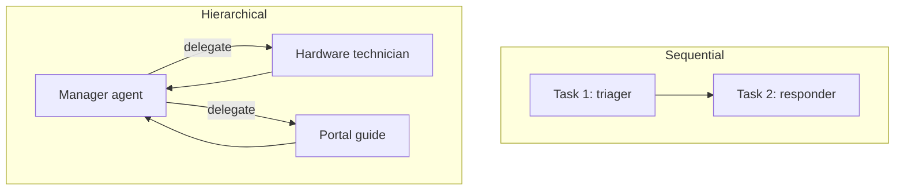

# 14.2 · Sequential and hierarchical processes; delegation

**Module:** [14 · CrewAI: multi-agent orchestration](../README.md) · **Time:** 45-60 minutes · **Model needs:** chat, tools · **Packages:** `crewai` extra (CrewAI 1.6)

## What you will learn

- The difference between `Process.sequential` (you set the order) and `Process.hierarchical` (a manager decides).
- How to get a typed Python object out of a task (`output_pydantic`).
- How `manager_llm` creates a manager agent, and what it costs.
- How `allow_delegation=True` gives an agent two extra tools, and how to watch them with the event bus (CrewAI's way of reporting what happens during a run).

## The idea

In 14.1, every crew ran in a fixed order. Now you choose who decides the order.

In a sequential crew, each task names its agent, and the tasks run in list order. In a hierarchical
crew, the tasks have no agent. CrewAI builds a manager from `manager_llm`. The manager picks a worker for
each task, reviews the answer and may delegate again. Separately, any agent with `allow_delegation=True`
gets two tools, "Delegate work to coworker" and "Ask question to coworker". So even a sequential crew can
pass sub-questions around. The model always decides whether to delegate, so it is never guaranteed.



By hand, this would be a controller function that decides which prompt to send next. CrewAI moves that
decision into a model call. That is flexible but expensive: the hierarchical script below made 15
requests for one task.

## Scripts

Run all three with `./run 14.2`. Each prints `successful_requests` from `result.token_usage`.

### 1. `01_structured_handoff.py`: sequential, typed output

```
./run 14.2/1
```

A triager returns a `Triage` pydantic object (a Python object with typed fields). Python code then
branches on `triage.urgency`. The responder gets the triage as text through `context=`.

**Expected output** (trimmed; model output varies):

```
Triage object
{ "category": "software", "urgency": "normal", "summary": "User unable to access camera in video conferencing application ..." }
Plain Python decision on a typed field: urgency='normal' -> normal queue
Final reply
"I am sorry to hear you are having trouble accessing your camera ..."
requests and tokens
{ "successful_requests": 4, "total_tokens": 1530 }
```

### 2. `02_hierarchical_manager.py`: a manager and two workers

```
./run 14.2/2
```

This crew has one task with no agent, two workers, `Process.hierarchical` and `manager_llm`. An event
handler on `ToolUsageStartedEvent` records each time the manager uses a delegation tool.

**Expected output** (trimmed):

```
tool call | Ask question to coworker({"by": "Crew Manager"})
   result | (see the crew's answer below)
tool call | Ask question to coworker({"by": "Crew Manager"})
Final answer
"Hello Anya, I am sorry to hear about your laptop's battery and fan issues. Please check ..."
requests and tokens
{ "successful_requests": 15, "total_tokens": 15609 }
```

That is fifteen requests and about 15,000 tokens for a five-sentence reply. This is what the manager costs.

### 3. `03_delegation_in_a_sequential_crew.py`: delegation without a manager

```
./run 14.2/3
```

The lead has `allow_delegation=True`. The identity specialist is in the crew but owns no task. The script
prints whether the lead delegated.

**Expected output** (trimmed):

```
allow_delegation
{ "Helpdesk lead": true, "Identity specialist": false }
tool call | Delegate work to coworker({"agent": "Helpdesk lead", "args": "{\"task\": \"Troubleshoot and resolve a non-functional security key ..."})
   result | ok
Final reply
"I have submitted a request for your access to the shared contracts folder ..."
requests and tokens
{ "successful_requests": 6, "total_tokens": 4296 }
```

## Try this

1. In script 1, add `"critical"` handling: change the ticket to an outage and see whether `urgency` becomes `high`.
2. In script 1, make `Triage.urgency` a `Literal["low", "normal", "high"]`. What happens to an off-list answer?
3. In script 2, give the task to one worker with `agent=hardware` while keeping `Process.hierarchical`. What does the manager still do?
4. In script 2, add a third worker that is irrelevant. Does the manager ignore it? Compare `successful_requests`.
5. In script 3, set the lead's `allow_delegation=False`. Does the answer get worse, and how many requests are saved?
6. Run script 3 several times. How often does the lead actually delegate?

## If it does not work

Run `./run doctor`. Install the extra with `uv sync --extra crewai`. The hierarchical script can take 10-30
seconds on a slow endpoint. If `.pydantic` is `None` in script 1, the model's answer did not fit the schema.
The script then prints the raw text instead of failing.

## In the running scenario

The helpdesk team gets a coordinator. A fixed pipeline (sequential) is the right choice when the steps never
change. A manager is only worth its cost when the right worker really depends on the ticket.

**Next:** 14.3 · Tools, MCP and LangGraph alongside a crew (planned)
