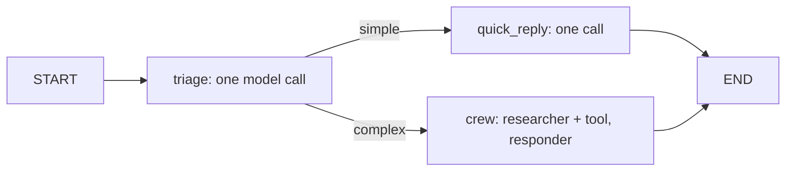

# 14.3 · Tools, MCP and LangGraph alongside a crew

**Module:** [14 · CrewAI: multi-agent orchestration](../README.md) · **Time:** 45-60 minutes · **Model needs:** chat, tools · **Packages:** `crewai` and `langgraph` extras (CrewAI 1.6, LangGraph 1.2, mcp 2.x)

## What you will learn

- How to give a crew the tools of an MCP server (module 11), and a version mismatch to watch for.
- How to put a whole crew inside one LangGraph node.
- How a LangGraph router can decide when a crew is worth paying for.

## The idea

**What is new since 14.2:** crews now meet the rest of your stack. Tools can come from an MCP server
instead of a Python function, and the crew itself becomes one step of a graph.

A LangGraph node is just a function from state to a state update, so `crew.kickoff()` can run inside it.
The graph keeps the control flow (testable, branching, resumable); the crew does the open-ended text work.
Because a crew costs several requests per task, a conditional edge can send easy tickets down a cheap
one-call path.



## Scripts

Run all three with `./run 14.3`. The folder also holds `asset_server.py`, a tiny MCP server that script 1
launches over stdio (no port).

### 1. `01_mcp_tools_in_a_crew.py`: an MCP server as a toolbox

```
./run 14.3/1
```

CrewAI has `Agent(mcps=[MCPServerStdio(...)])`. On this install it builds an **empty argument schema** for
the tool (it reads the camelCase `inputSchema`, but mcp 2.x calls it `input_schema`), so the model is
not told the tool needs a `tag` and guesses wrong arguments. The script shows the empty schema, then
bridges the tool by hand: it lists the server's tools with the module 11 client and wraps each one as a
CrewAI `BaseTool` whose `args_schema` is built from the real schema.

**Expected output** (trimmed):

```
schema CrewAI built for the native MCP tool
{ "properties": {}, "title": "MCPNativeToolSchema", "type": "object" }
An empty 'properties' means the model is not told that the tool needs a 'tag'. ...
bridged tool schema
{ "properties": { "tag": { "title": "Tag", "type": "string" } }, "required": ["tag"], ... }
tool call | get_asset({"tag": "LT-204"})
   result | Laptop, 3 years old, battery health 61 percent, warranty expired
Answer
"The inventory indicates that the laptop is 3 years old with a battery health of 61 percent and an expired warranty. ..."
requests and tokens
{ "successful_requests": 2, "total_tokens": 931 }
```

### 2. `02_crew_as_a_langgraph_node.py`: a crew in a graph

```
./run 14.3/2
```

`intake` (plain Python), `crew` (drafter and reviewer) and `finish` (plain Python) as a graph. The script
streams each node's update and reports how many requests the crew node used.

**Expected output** (trimmed):

```
node 'intake' returned
{ "cleaned": "Ticket #5402 from Omar (Finance): the shared scanner on floor 2 says 'toner low' ..." }
node 'crew' returned
{ "draft": "Thank you for reporting this issue, Omar. ...", "requests_used": 4 }
node 'finish' returned
...
The crew node used 4 model request(s); the other two nodes used none.
```

### 3. `03_routed_incident_graph.py`: route first, crew only when needed

```
./run 14.3/3
```

A JSON triage call sets `complexity`. Simple tickets get one plain call; complex ones go to a crew whose
researcher has a `search_runbook` tool. Two tickets run through the same graph.

**Expected output** (trimmed):

```
Step 2: Ticket #5410: how do I change my desk phone ringtone?
assistant | { "complexity": "simple" }
result: { "complexity": "simple", "path": "quick_reply", "reply": "To change your ringtone, press ..." }
Step 3: Ticket #5411: since 08:00 nobody on floor 3 can reach the file server ...
assistant | { "complexity": "complex" }
tool call | search_runbook({"topic": "file server"})
crew finished: 6 request(s)
result: { "complexity": "complex", "path": "crew", "reply": "We are aware of the file server outage ..." }
```

The simple ticket cost two plain calls; the incident cost one call plus six crew requests.

## Try this

1. In script 1, remove `tools=bridged` and use `mcps=[...]` instead. Does the agent find the right argument name?
2. Add a second tool to `asset_server.py` and see whether the bridge picks it up without changes.
3. In script 2, add a `checkpointer` to `graph.compile(...)` (module 09) and resume. What is saved?
4. In script 3, add a ticket that is ambiguous. Which path does the router choose, and is it right?
5. In script 3, make the triage call fail by changing the system prompt. What does the fallback do?
6. Replace the crew in script 3 with one plain call. Compare the replies and the request counts.

## If it does not work

Run `./run doctor`. You need `uv sync --extra crewai --extra langgraph`. Script 1 starts a Python
subprocess for the MCP server; if it times out, check that `asset_server.py` runs on its own.

## In the running scenario

Easy tickets stay cheap and incidents get a team. The graph, not the crew, decides which.

**Next:** 14.4 · Capstone: a helpdesk incident-response crew (planned)
