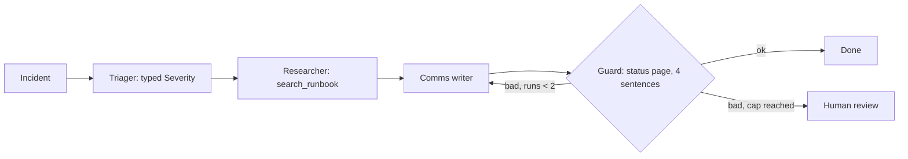

# 14.4 · Capstone: a helpdesk incident-response crew

**Module:** [14 · CrewAI: multi-agent orchestration](../README.md) · **Time:** 45-60 minutes · **Model needs:** chat, tools · **Packages:** `crewai` and `langgraph` extras

## What you will learn

- How to combine typed hand-offs, a tool, a graph and a capped retry loop in one design.
- How to turn acceptance criteria into checks that run on a crew's output.
- How to keep a crew's request count inside a budget.

## The idea

**What is new since 14.3:** nothing new to learn; this lesson combines everything. When an incident
arrives, a crew triages it, finds the runbook steps and writes the message to staff. A LangGraph
guard checks the message and sends it back at most once.

**Brief.** Larkspur Labs wants a first status message within a minute of an incident report.

**Acceptance criteria.**
1. Severity is a typed field (`low`, `medium`, `high`); an incident blocking many people or a deadline is `high`.
2. The message uses the runbook steps, not invented ones.
3. The message mentions the status page and has at most four sentences.
4. A triage-and-write crew (no tool) stays within 8 model requests; adding the tool-using researcher costs more (script 1 used 12), so state your budget.
5. Every loop has a cap and a person reviews a message that still fails after the cap.

**Stretch goals.** Add a fourth agent that reviews the message; route low-severity incidents to one plain call (14.3/3); add a runbook entry and test it; persist the graph state with a checkpointer.



## Scripts

Run all three with `./run 14.4`. `runbook.json` is the invented runbook the researcher reads.

### 1. `01_incident_crew.py`: the reference crew

```
./run 14.4/1
```

Triager (output_pydantic), researcher (tool) and writer in a sequential crew.

**Expected output** (trimmed):

```
tool call | search_runbook({"topic": "VPN Connectivity"})
   result | VPN outage: 1) check the status page, 2) ask users to sign in again with their security key, ...
Severity (typed)
{ "severity": "High", "topic": "VPN Connectivity", "reason": "Approximately 40 employees ... " }
Status message
"We are currently investigating a VPN connectivity issue affecting the Berlin office. Please check the status page at ..."
requests and tokens
{ "successful_requests": 12, "total_tokens": 5853 }
```

The model invented a status-page address in this run. The runbook only says "the status page", so criterion 2 is not fully met: a good Try-this experiment.

### 2. `02_graph_with_a_guard_loop.py`: a guard and a capped retry

```
./run 14.4/2
```

A one-agent crew inside a graph. A plain-Python guard checks the message; on failure the crew runs again with the problem in the task, at most twice.

**Expected output** (trimmed):

```
crew run 1: 1 request(s)
guard after run 1
{ "problems": ["does not mention the status page"], "message": "We are currently experiencing email delays ..." }
crew run 2: 2 request(s)
guard after run 2
{ "problems": "none", ... }
final: { "crew_runs": 2, "problems_left": "none", ... }
```

### 3. `03_acceptance_check.py`: acceptance criteria as code

```
./run 14.4/3
```

A triager and a writer handle a deadline incident; six checks print PASS or FAIL.

**Expected output** (trimmed):

```
PASS  typed severity parsed
PASS  severity is low/medium/high
PASS  deadline incident rated high
PASS  message mentions the status page
PASS  message at most four sentences
PASS  requests within budget (4 <= 8)
```

## Try this

1. In script 1, replace the incident with an email delay. Does the researcher pick the `email` entry?
2. Add a runbook entry to `runbook.json` and write an incident that needs it.
3. In script 1, add a check that every step number in the message appears in the runbook text (criterion 2).
4. In script 2, set `MAX_CREW_RUNS = 1`. What does the cap note say?
5. In script 3, make the incident low severity. Which checks should now fail, and do they?
6. Count requests per agent: which of the three costs the most in script 1?

## If it does not work

Run `./run doctor`. Install with `uv sync --extra crewai --extra langgraph`. Real models can fail a check;
that is a result, not a bug. With the offline stub model the checks fail by design, and the loops end on their caps.

## In the running scenario

Larkspur Labs now has an incident desk: a typed triage, a runbook lookup, a guarded status message, and a
test that says whether the crew meets the brief.

**Next:** 15.1 · RAG failure modes and how to diagnose them
