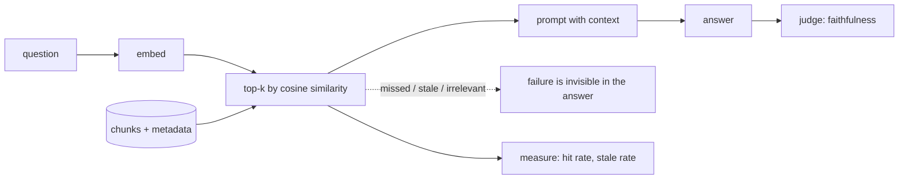

# 15.1 · RAG failure modes and how to diagnose them

**Module:** [15 · Agentic RAG and GraphRAG](../README.md) · **Time:** 45-60 minutes · **Model needs:** chat, embeddings (embeddings run locally by default) · **Packages:** `rag` extra

## What you will learn

- The three silent ways plain RAG fails: **missed retrieval**, **stale context** and **irrelevant context**.
- Why a fact split across two chunks, or two near-duplicate documents, hurts retrieval.
- How to measure RAG with a **retrieval hit rate**, a **stale rate** and an LLM-judged **faithfulness** score.
- Two cheap fixes (a metadata filter and neighbour expansion) and how to prove they helped by re-measuring.

## The idea

Plain RAG is: split documents into chunks, embed them, embed the question, take the top-k chunks
by cosine similarity and paste them into the prompt. Every step can go wrong, and the model's
fluent answer hides it. You only find the fault by looking at what was retrieved.



The knowledge base here is a folder of small invented documents in `kb/`, each with a short
header (`id`, `effective` date, `status`). It contains deliberate traps: an old VPN policy and the
one that replaced it, two near-duplicate laptop documents, and a stipend whose topic is in one
paragraph and whose amount is in the next.

By hand versus a library: the code here is what evaluation tools such as RAGAS automate. They
compute context recall, faithfulness and similar scores with model judges. Writing three checks once
shows you what those numbers mean. Embeddings come from `ctx.embed(...)`, a local model by
default. With a provider that has embedding models you would call
`client.embeddings.create(model=..., input=[...])` and read `.data[i].embedding`.

## Scripts

Run all three with `./run 15.1` (Windows: `run 15.1`), or one at a time.

### 1. `01_plain_rag_and_its_failures.py`: three questions, three failures

```
./run 15.1/1
```

Plain RAG with top-2 retrieval. Each question is chosen to trigger one failure, and the retrieved
chunks are printed with their scores so you can see it.

**Expected output** (trimmed; scores and wording will differ):

```
Step 2: Missed retrieval
Question: How much can I spend on a standing desk through the home office stipend?
  score 0.69  [purchases #0, 2024-05-20]  Desks, chairs and monitors for the office are ordered by facilities...
  score 0.67  [stipend #0, 2025-01-15]  Larkspur Labs gives remote and hybrid staff a home office stipend...
assistant | I do not know. The provided context does not specify the spending limit for the home office stipend.

Step 3: Stale context
  score 0.91  [vpn-2023 #1, 2023-03-01]  VPN sessions last 12 hours. After 12 hours the client signs you out...
  score 0.90  [vpn-2025 #1, 2025-09-01]  VPN sessions last 8 hours. After 8 hours the client signs you out...
assistant | VPN sessions last 8 hours, at which point you must sign in again using your security key...

Step 4: Irrelevant context
  score 0.65  [stipend #0, 2025-01-15]  Larkspur Labs gives remote and hybrid staff a home office stipend...
  score 0.64  [vpn-2025 #2, 2025-09-01]  The supported client is Larkspur Connect. The old Heron VPN client...
assistant | I do not know. Larkspur Labs does not provide information about pet insurance...
```

Notice the stale case: the superseded 2023 policy ranked first, yet this model happened to prefer
the newer one. That is luck, not a guarantee. The 400 USD chunk never arrived, so the model
could not answer.

### 2. `02_measure_retrieval_and_faithfulness.py`: turn "feels wrong" into numbers

```
./run 15.1/2
```

Runs a five-question test set, each with the chunk id that holds the answer. It computes the hit
rate and the stale rate with no model at all, then makes one batched model call that judges whether
each answer is supported by its context, using a pydantic schema for structured output.

**Expected output** (trimmed):

```
Step 3: Check 1 and 2: retrieval hit rate and stale rate (no model needed)
Q1: MISS                     stale chunk retrieved: False
Q2: HIT                      stale chunk retrieved: True
Q3: HIT                      stale chunk retrieved: False
Q4: HIT                      stale chunk retrieved: False
Q5: n/a (KB cannot answer)   stale chunk retrieved: False
Retrieval metrics
{ "hit_rate": "3/4", "stale_rate": "1/5 questions got a superseded chunk" }

Step 4: Check 3: faithfulness, judged by a model with structured output
Q1: faithful=False  unsupported: The context states managers approve spending limits for office purchases, ...
Q2: faithful=True
...
Faithfulness
{ "faithful": "4/5 judged answers" }
Run summary: 6 model call(s), ...
```

Faithfulness is not correctness: an answer can be faithful to a stale or incomplete context.
That is why the retrieval checks come first.

### 3. `03_fix_stale_and_split_facts.py`: fix two failures, re-measure

```
./run 15.1/3
```

The scenario. Fix 1 is a metadata filter that removes superseded documents before ranking. Fix 2
is neighbour expansion: each retrieved chunk brings the chunk after it. The retrieval metrics are
re-run for all questions before and after, then the two affected questions are answered and judged
again.

**Expected output** (trimmed):

```
before (plain top-k)
{ "hit_rate": "3/4", "questions with a stale chunk": "1/5", "average chunks in the prompt": 2.0 }
after (filter + neighbours)
{ "hit_rate": "4/4", "questions with a stale chunk": "0/5", "average chunks in the prompt": 2.8 }

before (plain top-k) | ['purchases#0', 'stipend#0']
    -> I do not know. Please ask your manager, who approves the spending limit for each team.
after (filter + neighbours) | ['purchases#0', 'stipend#0', 'stipend#1']
    -> The home office stipend limit is 400 USD per person, which you can claim once every two years...

before (plain top-k)           faithful=False  How much can I spend on a standing desk throu
after (filter + neighbours)    faithful=True   How much can I spend on a standing desk throu
```

The price: about 40% more chunks in every prompt. The duplicate laptop documents and the
unanswerable pet-insurance question are still not fixed. Those need a retriever that can decide
what to do, which is the next lesson.

## Try this

1. Change `TOP_K` in script 1 to 1, then 4. Which failures disappear, and which new ones appear?
2. Add a document to `kb/` that contradicts another, without marking it superseded. Does any check catch it?
3. In script 3 set only `drop_superseded=True`. Which metric moves, and which does not?
4. Add a sixth test question of your own, with its expected chunk id, to script 2.
5. Make the judge prompt stricter ("any extra detail not in the context is unsupported") and compare the scores.
6. Copy `laptop-refresh-guide.md` to a third near-duplicate. What happens to the top-2 slots?

## If it does not work

Run `./run doctor`. Install the extra with `uv sync --extra rag` if the `rag` packages are missing.
The local embedding model downloads about 130 MB the first time. If your endpoint refuses
`json_schema`, script 2 and 3 say so and fall back to JSON mode. If faithfulness shows "not judged",
the judge returned something unparseable; run it again.

## In the running scenario

The helpdesk assistant can now answer policy questions from documents, and you can say how often it
is right about what it retrieved. It has a measured weak spot: it always retrieves, once, whether or
not that is wise.

**Next:** 15.2 · Agentic RAG: deciding when and what to retrieve (planned)
