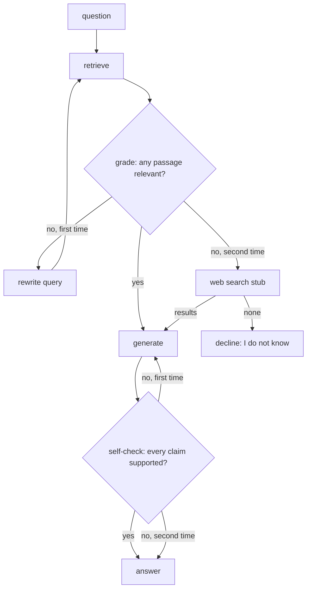

# 15.2 · Agentic, self- and corrective RAG

**Module:** [15 · Agentic RAG and GraphRAG](../README.md) · **Time:** 45-60 minutes · **Model needs:** chat, tools, embeddings (embeddings run locally by default; JSON output for scripts 2 and 3) · **Packages:** `rag` and `langgraph` extras (script 3 uses LangGraph)

## What you will learn

- What makes RAG **agentic**: retrieval becomes a tool the model chooses to call, with its own query, as often as needed.
- **Corrective RAG** (CRAG): grade what was retrieved, rewrite the query when it is useless, fall back to another source.
- **Self-RAG**: the model checks its own answer against the sources and the system regenerates when a claim is unsupported.
- How to wire these loops as a LangGraph state machine, with a hard cap on every loop.

## The idea

**What is new since 15.1.** Lesson 15.1 measured plain RAG and fixed two failures with filters. The retriever still ran
exactly once, with the user's words, whatever the question. Now the system gets to decide and to check.



Three separate ideas, often sold as one:

- **Agentic RAG.** Retrieval is one tool among others in the loop from module 02. The model may skip it (small
  talk), call it twice with different queries (a two-part question), or rewrite its query after a poor result.
- **Corrective RAG.** A grader sits between retrieval and generation. If nothing relevant came back, the system
  rewrites the query, and if that fails it uses another source. Here the other source is `web_search_stub`, a local
  function with canned results, because this course has no internet access. In production it would be a search API.
- **Self-RAG.** After generating, the model judges its own answer against the sources. The original Self-RAG paper
  trains special "reflection tokens" into the model; this lesson gets the same effect with a prompt and a JSON verdict,
  which works with any chat endpoint.

By hand versus a framework: scripts 1 and 2 are plain Python; script 3 is the same logic as a LangGraph graph (module 08).
Nodes still call `ctx.client`, so what is new there is only the wiring: named nodes, conditional edges, a shared state.

Every extra model call costs money and time, and every grader and checker is another model that can be wrong.
The caps (4 turns, one rewrite, one regeneration, a graph recursion limit) exist because the stub and sometimes
the real model will not behave as the loop hopes.

## Scripts

Run all three with `./run 15.2` (Windows: `run 15.2`), or one at a time.

### 1. `01_the_agent_decides_to_retrieve.py`: search as a tool

```
./run 15.2/1
```

A tool loop with one tool, `search_kb`. Three questions: a thank-you, a one-fact policy question and a two-part question.
Watch how many searches each gets.

**Expected output** (trimmed; the model's choices and wording will differ):

```
Step 2: Question: Thanks, the reset link worked!
assistant | You're very welcome! I'm glad to hear that you're all set. ...
Step 3: Question: How long does a VPN session last before I must sign in agai...
tool call | search_kb({"query": "VPN session duration"})
   result | ['vpn-2025#1: VPN sessions last 8 hours. After 8 hours the client signs yo...', ...]
assistant | VPN sessions last for 8 hours before you are required to sign in again. ...
Step 4: Question: Which Wi-Fi network should a visitor join, and how many mon...
tool call | search_kb({"query": "visitor wifi network"})
tool call | search_kb({"query": "laptop replacement cycle"})
assistant | Visitors should connect to the Larkspur-Guest network, which requires a daily code from reception. Laptops are replaced every 36 months.
Searches per question: 0, 1, 2.
```

Plain RAG would have searched once for each. The two-part question needed two different queries; a single retrieval
for the whole sentence would have been pulled towards one half.

### 2. `02_grade_rewrite_and_fall_back.py`: corrective RAG by hand

```
./run 15.2/2
```

Retrieve, grade every chunk in one batched call, rewrite once if nothing passed, then fall back to the web stub.
Question 1 is easy, question 2 is the stipend question that plain RAG missed in 15.1, question 3 is not in the knowledge base at all.

**Expected output** (trimmed):

```
Step 2: Question: How much can I spend on a standing desk through the home of...
Attempt 1: query = 'How much can I spend on a standing desk through the home office stipend?'
  retrieved: purchases#0, stipend#0
  graded relevant: none
Attempt 2: query = 'home office stipend equipment reimbursement limit'
  retrieved: purchases#0, stipend#1
  graded relevant: stipend#1
assistant | You can spend up to 400 USD on a standing desk through the home office stipend. ... [stipend#1].

Step 3: Question: Which operating systems does the Larkspur Connect VPN clien...
Attempt 1: ... graded relevant: none
Attempt 2: query = 'Larkspur Connect VPN client supported operating systems list'
  graded relevant: none
Still nothing relevant. Falling back to the web search stub.
tool call | web_search_stub({"query": "Larkspur Connect VPN client supported operating systems list"})
   result | [{'id': 'web-1', 'text': 'Larkspur Connect release notes (stub result): the client supports Windows 11, ...'}]
assistant | Larkspur Connect supports Windows 11, macOS 14 and later, and Ubuntu 22.04. [web-1]

Model calls in this script: 10. Plain RAG would have used 3, one per question.
```

A real finding from developing this lesson: with a looser grader prompt ("carries part of the answer") the
grader kept `purchases#0` for the stipend question because it is about the same topic, so no rewrite happened and the
model said it did not know. Tightening the prompt to "states the specific fact asked for" fixed it. The grader is
a prompt, and prompts need testing like any other code.

### 3. `03_helpdesk_graph_with_self_check.py`: the loop as a LangGraph graph

```
./run 15.2/3
```

The same checks as a graph with seven nodes (`retrieve`, `grade`, `rewrite`, `web`, `generate`, `self_check`, `decline`) and
a state dictionary. It adds the self-check. Three questions: near-duplicate laptop documents, a policy that changed, and
a question nothing can answer.

**Expected output** (trimmed):

```
Step 3: Question: Is the Heron VPN client still supported?
  retrieve('Is the Heron VPN client still supported?') -> ['vpn-2025#2', 'vpn-2025#1']
  grade -> kept ['vpn-2025#2']
  generate
  self_check -> supported=True
  route: knowledge base   model calls: 3
assistant | The Heron VPN client is not supported, as it was retired on 2025-10-31 and no longer connects. ... [vpn-2025#2].

Step 4: Question: Does Larkspur Labs offer pet insurance?
  retrieve(...) -> ['stipend#0', 'vpn-2025#2']
  grade -> kept []
  rewrite -> 'Larkspur Labs service offerings insurance policy 2024'
  retrieve(...) -> ['stipend#0', 'vpn-2025#2']
  grade -> kept []
  web_search_stub -> 0 result(s)
  decline (no model call)
assistant | I do not know. I could not find this in the knowledge base or on the web.
```

The unanswerable question now ends in an honest "I do not know" instead of an answer built from irrelevant chunks.
In this run the self-check passed every answer, so the regenerate edge never fired. The real model is a lenient
checker; try Try this 4 to force the branch.

## Try this

1. In script 1 add a second tool, `web_search_stub`, and let the model choose between it and `search_kb`. Which does it pick for the operating-systems question?
2. In script 2 change the grading prompt back to "carries part of the answer". Which question changes, and how?
3. Make the stipend question harder: rewrite it as "Can I expense a desk?". Does one rewrite still find the 400 USD chunk?
4. In script 3 make `CHECK_PROMPT` stricter (for example "any claim not quoted word for word is unsupported") and watch the regenerate edge fire. How many model calls does a question now cost?
5. Lower the `recursion_limit` in script 3 to 4. What error does LangGraph raise, and why is that better than looping?
6. Add a `route` node that sends greetings straight to `END`, as script 1's model did on its own.

## If it does not work

Run `./run doctor`. Install the extras with `uv sync --extra rag --extra langgraph` if packages are missing.
If a grade or check shows as unreadable, your endpoint may ignore JSON mode; scripts 2 and 3 then keep all passages or accept the
answer rather than crash, and the trace says so. If script 1 never calls the tool, your model may not support tool calling.

## In the running scenario

The helpdesk assistant now answers "thanks" without a search, asks twice when a question has two parts, retries
with a better query, uses a second source, and says "I do not know" when nothing supports an answer. It
also costs 3-5 model calls per question where 15.1 used one. The next lesson attacks the other side of the
trade: making the retrieval itself better so that fewer retries are needed.

**Next:** 15.3 · Re-ranking, HyDE and query expansion
