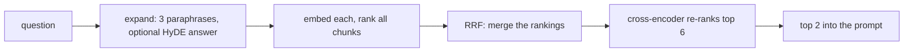

# 15.3 · Re-ranking, HyDE and query expansion

**Module:** [15 · Agentic RAG and GraphRAG](../README.md) · **Time:** 45-60 minutes · **Model needs:** chat (JSON output) for scripts 2 and 3; embeddings run locally by default · **Packages:** `rag` extra (fastembed also provides the cross-encoder, about 90 MB downloaded once)

## What you will learn

- Why retrieval is usually **two stages**: a cheap wide recall step, then a precise re-ranker over a few candidates.
- How a **cross-encoder** differs from the embedding model (a bi-encoder) and what its scores mean.
- **HyDE**: embed a model-written hypothetical answer instead of the question.
- **Multi-query expansion** with **Reciprocal Rank Fusion** (RRF), and how to measure whether any of it helps.

## The idea

**What is new since 15.2.** Lesson 15.2 made the system retry when retrieval failed. This lesson makes the first
retrieval better, so fewer retries are needed. Nothing here changes the answer prompt; only what reaches it.



- **Cross-encoder re-ranking.** The embedding model sees the question and each chunk separately. A cross-encoder reads them
  together and scores the pair, which is slower but more exact. Recall with embeddings, precision with the cross-encoder.
  Scores are not probabilities and are only comparable within one question.
- **HyDE.** Questions and answers use different words. A short invented answer ("Staff receive a stipend of ...") sits
  closer to the real document than the question does. The invented answer can be wrong; it is only used for searching.
- **Multi-query + RRF.** Search with the question and three paraphrases. A chunk scores `1 / (60 + rank)` in each list;
  the sums decide the order. A chunk that is fairly high in every list beats one that is top in just one.

By hand versus a framework: this is what LangChain's `MultiQueryRetriever` and rerank wrappers do for you. Writing the
fusion loop once shows that none of it is more than sorting.

Honest expectation: on a 13-chunk knowledge base plain embeddings are already good, so the measured gains are small or
absent. These tricks pay off on large, noisy collections. The lesson's job is to give you the measurement, not a promise.

## Scripts

Run all three with `./run 15.3` (Windows: `run 15.3`), or one at a time.

### 1. `01_rerank_with_a_cross_encoder.py`: two-stage retrieval

```
./run 15.3/1
```

Six questions phrased with different words from the documents. For each, the top 6 by cosine similarity are re-ordered by
a cross-encoder (`Xenova/ms-marco-MiniLM-L-6-v2`); the script prints both orders side by side. No chat model is called.
The first run downloads the model; if that fails the script stops with exit code 3 and a plain explanation.

**Expected output** (trimmed):

```
Step 2: Question 1: Can I expense a standing desk for my home?
  wanted: ['stipend#1']
  stage 1 (cosine)                       stage 2 (cross-encoder score)
  purchases#0      0.70                    stipend#0         -5.76
  stipend#1        0.62                    purchases#0       -9.99
  stipend#0        0.62                    stipend#1        -11.19
...
Step 8: Result over the test set
embeddings only              correct chunk ranked first: 5/6   in the top 2: 6/6
embeddings + cross-encoder   correct chunk ranked first: 5/6   in the top 2: 5/6
```

On this run the cross-encoder did not help, and it demoted the 400 USD chunk (`stipend#1`) on question 1. This general-purpose
web-search model probably favours the chunk that describes the stipend over the one that holds the number. A re-ranker is a second model with
its own blind spots; adopt it only if your own test set says so.

### 2. `02_hyde_and_query_expansion.py`: improve the query

```
./run 15.3/2
```

One batched call asks the model for a hypothetical answer and three paraphrases for every question. Four retrieval
strategies (baseline, HyDE, multi-query + RRF, both) are then scored by how often the right chunk comes first.

**Expected output** (trimmed):

```
Rewrites for question 1
{ "hypothetical_answer": "Full-time employees are eligible for a $500 home office stipend that covers ergonomic equipment, ...",
  "queries": ["home office equipment reimbursement", "can I buy a standing desk with stipend", "ergonomic furniture expense policy"] }
Q1 wanted stipend#1      first-ranked: purchases#0 | stipend#0 | purchases#0 | purchases#0
...
baseline (question)                      first: 5/6   in top 2: 6/6
HyDE (embed the hypothetical answer)     first: 4/6   in top 2: 4/6
multi-query + RRF                        first: 5/6   in top 2: 5/6
HyDE + multi-query + RRF                 first: 5/6   in top 2: 5/6
```

Look at the invented answer: it says "$500", which is false. HyDE found a nearer chunk (`stipend#0`) but the invented
specifics did not help retrieval overall. The baseline won here. That is a legitimate outcome of a measurement.

### 3. `03_helpdesk_retrieval_pipeline.py`: the pipeline with switchable stages

```
./run 15.3/3
```

Runs three questions through three configurations (plain, expand + fuse, expand + fuse + re-rank) and answers with the last.
The cross-encoder is optional: if it cannot load, that stage is skipped with a note.

**Expected output** (trimmed):

```
Step 3: Question: Which program do I install to connect remotely?
[plain] top 2: ['vpn-2025#2', 'wifi#0']
[expand + fuse] top 2: ['vpn-2025#0', 'vpn-2025#2']
[expand + fuse + re-rank] top 2: ['vpn-2025#2', 'stipend#0']
    paraphrases: ['remote access software installation guide', 'how to set up remote desktop connection', ...]
assistant | To connect remotely, you must install the supported client, Larkspur Connect. ...
Run summary: 9 model call(s), 708 in + 354 out = 1062 tokens
```

Mixed results again: on the third question the right chunk was already in the plain top 2; fusion kept it second, and
re-ranking put it first but replaced its neighbour with an unrelated stipend chunk. For the stipend question the answer
still lacked the 400 USD figure, because fusion ranked `stipend#0` above `stipend#1`. Retrieval tricks move errors around;
module 15.5 measures the whole system.

## Try this

1. In script 1 change `CANDIDATES` to 3, then 13. How does the cross-encoder behave when the right chunk is not in the candidate set at all?
2. Try `BAAI/bge-reranker-base` as `CROSS_ENCODER` (larger download). Does it handle question 1?
3. In script 2 change `RRF_K` to 5. How much more does the top rank dominate?
4. Edit `REWRITE_PROMPT` to say the hypothetical answer must contain no numbers. Does HyDE improve?
5. Add three questions of your own to `TEST_SET` (with expected chunk ids). Do the winners change?
6. In script 3 add a fourth configuration: re-rank only, without expansion.

## If it does not work

Run `./run doctor`. Install the extra with `uv sync --extra rag`. The cross-encoder and the embedding model download on
first use; without network access script 1 exits with code 3 and script 3 skips re-ranking. If script 2 says the model
returned unusable JSON, the baseline columns still work; run it again.

## In the running scenario

The helpdesk retriever now has three optional upgrades and a way to judge each. The honest finding on a small
knowledge base is that none is a clear win, which is why the module ends with a benchmark rather than a recommendation.
The next lesson handles a question type none of these can fix: questions that need several documents connected.

**Next:** 15.4 · GraphRAG: knowledge graphs and multi-hop questions
