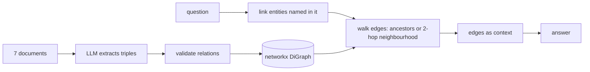

# 15.4 · GraphRAG: knowledge graphs and multi-hop questions

**Module:** [15 · Agentic RAG and GraphRAG](../README.md) · **Time:** 45-60 minutes · **Model needs:** chat (JSON output), embeddings (local by default) · **Packages:** `rag` extra (`networkx` is installed with it)

## What you will learn

- What **GraphRAG** is: extract entities and relations into a graph, then retrieve by walking edges instead of matching words.
- How to have a model extract triples, validate them against a closed list of relations, and load them into `networkx`.
- Why **multi-hop** questions defeat vector search and what graph traversal does differently.
- How to **route** between graph and vector retrieval, and what graph retrieval costs to maintain.

## The idea

**What is new since 15.3.** The earlier lessons improved retrieving paragraphs. Some questions are not answered by any
paragraph: "what is affected when Atlas-2 is patched?" needs the chain Atlas-2, Directory Service, Larkspur SSO, Payroll
Portal, spread over five small documents in `docs/`.



A graph holds facts like `Payroll Portal --depends_on--> Larkspur SSO`. A question that names an entity starts a walk:
`nx.ancestors` finds everything with a path to Atlas-2, however many hops away. Microsoft's GraphRAG adds community
detection and summaries for questions about a whole corpus; this lesson covers the core idea, local graph retrieval.

By hand versus a framework: libraries such as LlamaIndex or Microsoft GraphRAG automate extraction, storage and community summaries.
Here it is about forty lines, so you can see where it breaks: entity names must match exactly, and the extraction call must
be repeated when documents change.

## Scripts

Run all three with `./run 15.4` (Windows: `run 15.4`), or one at a time.

### 1. `01_extract_a_knowledge_graph.py`: text to graph

```
./run 15.4/1
```

One batched call extracts triples from all seven documents. Triples with an unknown relation are rejected. The graph is then printed
and checked against three edges we know are in the documents.

**Expected output** (trimmed):

```
Step 3: Validate and build the graph
14 triples returned, 14 kept, 0 rejected: []
Graph: 13 nodes, 14 edges.
  Atlas-2  --has_maintenance_window-->  Sundays 02:00-04:00 UTC
  Badge Service  --runs_on-->  Atlas-2
  Directory Service  --runs_on-->  Atlas-2
  Larkspur SSO  --depends_on-->  Directory Service
  Payroll Portal  --depends_on-->  Larkspur SSO
  ...
  edge Larkspur SSO -> Directory Service: found
```

The real model extracted all 14 facts correctly, including "staff sign in through" as `depends_on`, because the prompt names
canonical entity spellings. Remove that instruction (Try this 2) to see names drift.

### 2. `02_multi_hop_vector_rag_vs_graph.py`: the comparison

```
./run 15.4/2
```

The same multi-hop question answered from vector top-3 paragraphs and from a graph walk, each scored against a hand-written list of seven affected services.

**Expected output** (trimmed):

```
retrieved: atlas-2, atlas-2, directory-service
entities found in the question: ['Atlas-2']
7 things depend on it, directly or indirectly: ['Badge Service', 'Directory Service', 'Expense Tool', 'Helpdesk Portal', 'Larkspur SSO', 'Payroll Portal', 'VPN Gateway']
--- vector RAG ---
assistant | When Atlas-2 is being patched, the Directory Service and the Badge Service are affected. Because the Directory Service is impacted, users will be unable to sign in to Larkspur SSO or use the VPN Gateway.
--- graph retrieval ---
assistant | The affected services are Badge Service, Directory Service, Larkspur SSO, Expense Tool, Helpdesk Portal, Payroll Portal, and VPN Gateway.
vector RAG       names 4/7 affected services
graph retrieval  names 7/7 affected services
```

Vector search got the first two hops from text that mentions Atlas-2 and Directory Service, and never saw the payroll, expense and helpdesk documents.

### 3. `03_helpdesk_graph_and_vector_router.py`: use both

```
./run 15.4/3
```

A model call routes each question to `graph` or `vector`. Graph questions get every edge within 2 hops of the entities named; lookup questions get the top-2 paragraphs.

**Expected output** (trimmed):

```
Question: Which team owns the sign-in system that the Payroll Portal relies on?
route: graph. entities: ['Payroll Portal']. 8 edges within 2 hops.
assistant | The Payroll Portal relies on Larkspur SSO, which is owned by the Identity team.
Question: On what day of the month are payslips published?
route: vector. retrieved: ['payroll', 'expense']
assistant | Payslips are published on the 25th of each month.
3/3 answers contain the expected keyword.
```

The payslip date is a fact inside one paragraph and the graph has no edge for it, so routing to vector is right. A graph
alone would have missed it.

## Try this

1. Add a document `printing.md` saying a Print Server depends on the Directory Service, and re-run script 2. Does the affected list grow without any code change?
2. In script 1 remove the sentence about exact names from `EXTRACT_PROMPT`. Do duplicate nodes appear?
3. In script 2 follow only `depends_on` edges (not `runs_on`). What is lost, and why?
4. Change `RADIUS` in script 3 to 1, then 3. Which question breaks first?
5. Ask script 3 a question about a service that does not exist. What does the fallback do?
6. Add an `owned_by` summary question ("which team owns the most services?") and compute it with `graph.in_degree` instead of the model.

## If it does not work

Run `./run doctor`. Install the extra with `uv sync --extra rag`. If the graph is empty, the model's JSON was unusable
(the script says so) or your endpoint ignores JSON mode. If a question finds no entity, the name in the question differs from the graph's spelling: print `graph.nodes`.

## In the running scenario

The helpdesk assistant can now answer incident-style questions ("who is affected, who do I call") from relationships, and keeps
vector search for single facts. The cost: an extraction pass for every content change and exact-name matching you must maintain.
The capstone puts the module's ideas against a plain RAG baseline.

**Next:** 15.5 · Capstone: benchmark agentic against plain RAG on helpdesk questions
