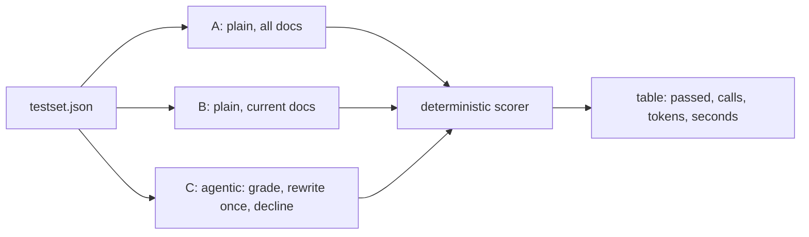

# 15.5 · Capstone: benchmark agentic against plain RAG on helpdesk questions

**Module:** [15 · Agentic RAG and GraphRAG](../README.md) · **Time:** 45-60 minutes · **Model needs:** chat (JSON output), embeddings (local by default) · **Packages:** `rag` extra

## What you will learn

- How to **benchmark** a RAG system: a fixed test set, a deterministic scoring rule, and cost next to quality.
- How the fixes of this module combine: a metadata filter, grading, one rewrite and an honest "I do not know".
- How to compare variants fairly and read the failures, not just the score.
- Why a six-question benchmark is a smoke test and not a verdict.

## The idea

This is a capstone: no new API, just the module assembled and measured.

**The brief.** The Larkspur Labs helpdesk assistant answers policy questions from a small knowledge base (`kb/`, with a
superseded VPN policy and a split stipend fact). Show with numbers whether an agentic pipeline beats plain RAG, and at what cost.

**Acceptance criteria.**

1. A test set (`testset.json`) of at least six questions, two of them unanswerable, each with a deterministic pass rule: keywords for answerable questions, a decline for unanswerable ones.
2. A plain RAG baseline (script 1) that scores below 6/6 on it, with its failures explained.
3. An agentic pipeline (script 2) with a metadata filter, a relevance grade, at most one query rewrite and a decline path. Every loop is capped.
4. A benchmark table (script 3) with pass count, model calls, tokens and seconds for three systems, and the failing answers listed.
5. The agentic pipeline passes at least as many questions as plain RAG, and the extra cost is stated.

**Stretch goals.** Add the cross-encoder of 15.3 as a fourth system. Add five harder questions (for example the laptop duplicates, or a two-part question) and rerun. Add the 15.4 graph as a retrieval route for a dependency question. Run the benchmark three times and report the spread.



## Scripts

Run all three with `./run 15.5` (Windows: `run 15.5`), or one at a time.

### 1. `01_plain_rag_baseline.py`: the number to beat

```
./run 15.5/1
```

**Expected output** (trimmed):

```
Q1 FAIL  retrieved ['purchases#0', 'stipend#0']
      I do not know. Please ask your manager, who approves the spending limit for each team.
Q2 PASS  retrieved ['vpn-2025#1', 'vpn-2023#1']
Q4 PASS  retrieved ['vpn-2025#2', 'vpn-2023#2']
Q5 PASS  retrieved ['stipend#0', 'vpn-2025#2']
      I do not know.
Plain RAG: 5/6 passed, 6 model calls.
```

The stipend question fails because the 400 USD chunk never arrives (the 15.1 split-fact failure). Note Q2 and Q4 retrieved the stale 2023 policy
as a second chunk and still passed: the model preferred the newer policy. Luck, not a guarantee.

### 2. `02_agentic_pipeline.py`: the reference solution

```
./run 15.5/2
```

**Expected output** (trimmed):

```
Q1 PASS  How much can I spend on a standing desk through the home off
      try 1: ['purchases#0', 'stipend#0'] -> kept []
      rewrite -> 'home office stipend reimbursement limit policy'
      try 2: ['purchases#0', 'stipend#1'] -> kept ['stipend#1']
      The limit for the home office stipend is 400 USD per person. ...
Q5 PASS  Does Larkspur Labs offer pet insurance?
      try 1: ... -> kept []
      rewrite -> 'Larkspur Labs service offerings insurance coverage policy'
      try 2: ... -> kept []
      decline without calling the model
Agentic pipeline: 6/6 passed, 16 model calls (2.7 per question).
```

### 3. `03_benchmark_table.py`: quality next to cost

```
./run 15.5/3
```

Runs three systems on the same test set: about 28 model calls in all, more than the usual cap in this course because comparing systems needs all of them.

**Expected output** (trimmed):

```
system                        passed  calls  tokens  seconds
A plain, all documents           5/6      6     931      4.1
B plain, current documents       5/6      6     936      5.7
C agentic                        6/6     16    2759     10.4
What failed
A plain, all documents
   Q1: I do not know. Please ask your manager, who approves the spending limit for each team.
```

The agentic system passed one more question for about 2.7 times the calls and 3 times the tokens. Filtering stale documents (B) cost
nothing and changed no score here, because the model resisted the stale policy; its value is insurance. Your table
will differ in the numbers; read the failure lines.

## Try this

1. Run script 3 three times. Does any score change between runs?
2. Add five questions to `testset.json`, including one that needs two documents. Which system fails first?
3. Make the grader prompt loose (as in 15.2) and watch question 1 regress in system C.
4. Change `TOP_K` to 3 in all systems. Does plain RAG close the gap?
5. Implement the stretch goal of adding re-ranking and report whether it earns its CPU time.
6. Replace the keyword rule for one question with an LLM judge (as in 15.1) and compare verdicts.

## If it does not work

Run `./run doctor`. Install the extra with `uv sync --extra rag`. A FAIL on an answer that looks right means the keyword
rule is too narrow: print the answer and widen `any_of`. Model calls run in sequence, so script 3 takes a minute or more on a slow endpoint.

## In the running scenario

The helpdesk assistant ends this module as a measured system: it retrieves, checks, retries, declines when it should, and
you can state its pass rate and price per question. The same discipline (fixed test set, deterministic scorer, cost column) carries into
the evaluation modules later in the course.

**Next:** 16.1 · Docker fundamentals and a production Dockerfile
