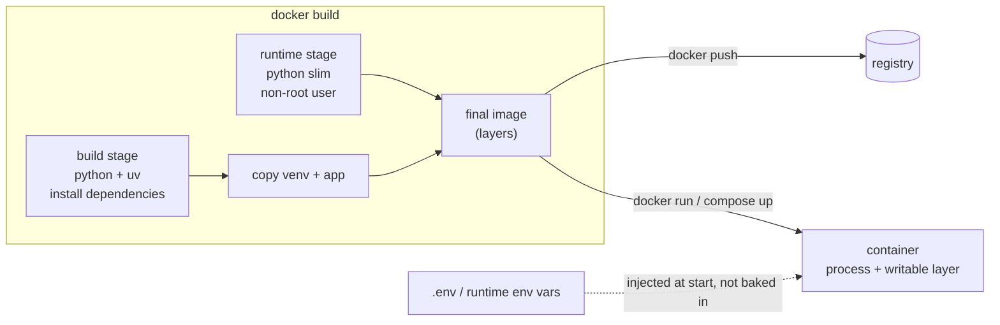

# 16.1 · Docker fundamentals and a production Dockerfile

**Module:** [16 · Containers and deployment](../README.md) · **Time:** 45-60 minutes · **Model needs:** none for the scripts (the sample API calls a chat model only when you run it yourself) · **Packages:** `apps` extra (the sample API uses FastAPI) · **Services:** `DOCKER` (optional; only script 3 needs it)

## What you will learn

- The difference between an **image** and a **container**, and what a **layer** is.
- How the **build cache** decides what is rebuilt, and how Dockerfile order makes builds fast or slow.
- Why production Dockerfiles are **multi-stage**, run as a **non-root** user and carry a **HEALTHCHECK**.
- How configuration and **secrets** reach a container without being baked into the image.
- Graceful shutdown, registries, a conceptual Cloud Run deployment, CI/CD and blue/green/canary rollouts.

## The idea

An **image** is a read-only package: a filesystem built from stacked layers plus metadata (the start command, the user, the port). A **container** is a running process started from an image, with a thin writable layer on top. One image can start many containers, like one class and many objects.



**Layers and cache.** Each `RUN`, `COPY` or `ADD` makes a layer. Docker reuses a cached layer only if its instruction and every layer below it are unchanged. So put things that change rarely (base image, dependency files, install) first and things that change often (your code) last. Copy `pyproject.toml` and install before `COPY app`, and a one-line code edit rebuilds one layer instead of reinstalling every package.

**Multi-stage builds.** The first stage has uv and build tooling; the final stage starts from a clean base and copies in only the installed environment and code. The result is smaller and has fewer tools for an attacker to use.

**Env vars and secrets.** Anything in the image (`ENV`, `ARG`, a copied `.env`) can be read by anyone who can pull it, and stays in layer history even if you delete it later. So the image holds no secrets. Settings arrive when the container starts: `env_file: .env` in compose, `-e` flags, or the platform's secret manager. `.dockerignore` keeps `.env` out of the build context, and `.env` stays git-ignored.

**Reaching a model on your machine.** Inside a container, `localhost` is the container itself. If your model server (for example Ollama or LM Studio) runs on your computer, set `LLM_BASE_URL=http://host.docker.internal:<port>/v1` in `.env`. Docker Desktop (macOS, Windows) provides that name; on Linux add `extra_hosts: ["host.docker.internal:host-gateway"]` to the service. A hosted provider URL needs no change.

**Health checks.** `HEALTHCHECK` runs a command on a schedule; the container shows `healthy` or `unhealthy`, and orchestrators use it to route traffic and restart. Our `/health` is a liveness check and does not call the model, so a slow provider does not make the container look dead.

**Graceful shutdown.** `docker stop` sends SIGTERM, waits (10 s by default), then SIGKILL. The `CMD` is in exec form (a JSON array) so uvicorn is PID 1 and receives the signal, finishes in-flight requests and exits. Shell-form `CMD python ...` runs under `/bin/sh`, which usually swallows the signal.

**Registries and Docker Hub.** A registry stores images by name and tag: `docker push` uploads, `docker pull` downloads. Docker Hub is the default public one; clouds offer private ones (GitHub Container Registry, Google Artifact Registry, ECR). Pin base images to a major tag (`python:3.12-slim`, never `latest`) and tag your own images with a version or commit SHA.

**Cloud Run, conceptually.** Cloud Run runs a container image as a serverless HTTP service. You push the image to a registry, create a service pointing at it, set env vars and secrets (from Secret Manager) on the service, and it scales instances from zero by request load. Your container must listen on the port given in the `PORT` environment variable and be stateless. Nothing here deploys anything; module 16.4 returns to this.

**CI/CD overview.** A pipeline builds the image, runs tests (ideally inside it), and pushes it to a registry on success; a deploy step then points the platform at the new tag. Module 16.4 covers it in detail.

**Blue/green and canary.** Blue/green runs the new version (green) beside the old (blue), switches all traffic at once after checks pass, and keeps blue for instant rollback. It is simple but needs double capacity during the switch. A canary sends a small share of traffic (say 5%) to the new version, watches error rate and latency, and widens the share in steps; it limits the blast radius of a bad release and suits LLM apps, where bad behaviour often shows only on real traffic.

## Scripts

### 1. `01_image_layers_and_cache.py`: layers and cache, from the Dockerfile text

```
./run 16.1/1
```

Parses the shipped `Dockerfile`, prints each instruction as a layer or metadata, checks for cache-busting order mistakes, and simulates which layers rebuild after a code edit versus a dependency change. The rebuild list is a **simulation** from the file text, not a real build. Needs no Docker.

**Expected output** (real run, trimmed):

```
 5. [layer   ] COPY        pyproject.toml ./
 6. [layer   ] RUN         uv sync --no-install-project --no-dev
 7. [layer   ] COPY        app ./app
...
No order problems: dependency files are copied before the code.

You edit one line of code (app/main.py): 5 layer(s) cached, 1 rebuilt
   rebuilt: COPY app ./app

You change a dependency (pyproject.toml): 3 layer(s) cached, 3 rebuilt
   rebuilt: COPY pyproject.toml ./
   rebuilt: RUN uv sync --no-install-project --no-dev
   rebuilt: COPY app ./app
```

### 2. `02_dockerfile_review.py`: a read-only Dockerfile linter

```
./run 16.1/2
```

Checks: pinned base tag (not `latest`), multi-stage, non-root `USER`, `HEALTHCHECK`, no secret-looking `ENV`/`ARG`, `.dockerignore` exists, dependency install not after `COPY .`, exec-form `CMD`. Runs on the shipped Dockerfile (passes) and an embedded bad one (fails). It only reads files and exits 0.

**Expected output** (real run, trimmed):

```
Step 1: The shipped Dockerfile
PASS: no problems found by the 8 checks.

Step 2: A bad Dockerfile (embedded example)
8 problem(s):
  FAIL base image 'python:latest' is not pinned (no tag or :latest)
  FAIL no non-root USER: the container runs as root
  FAIL ENV with a secret-looking name (OPENAI_API_KEY): inject secrets at runtime
  ...
```

### 3. `03_build_and_inspect.py`: Docker version and compose config (read-only)

```
./run 16.1/3
```

Needs Docker. It calls `require("DOCKER")`, then runs only `docker version` and `docker compose config`, and prints the build and run commands for you to type. It never builds or runs anything.

**Expected output without Docker** (real, from the author's machine, which has no Docker; exit code 3):

```
╭─ This lesson needs Docker: the docker command was not found. ────────────╮
│ - Install Docker Desktop (macOS, Windows) or Docker Engine (Linux): ...  │
│ - Then run this lesson again. (Lessons that do not need Docker still run │
│   without it.)                                                           │
╰──────────────────────────────────────────────────────────────────────────╯
```

With Docker running you will see the client and server versions, then "compose file is valid" (after you copy `.env.example` to `.env`), then the command list. The compose file and Dockerfile are verified by structure checks and the lint script, **not built or run on the author's machine**.

### The shipped files

`app/main.py` (FastAPI: `GET /health`, `POST /reply`), `pyproject.toml`, `Dockerfile`, `.dockerignore`, `docker-compose.yml` (port bound to `127.0.0.1:8000`, `env_file: .env`, healthcheck), `.env.example`. To try it yourself:

```
cd modules/16-containers-and-deployment/01-docker-fundamentals-and-a-production-dockerfile
cp .env.example .env        # edit the three LLM_ settings
docker compose build
docker compose up -d
curl http://127.0.0.1:8000/health
curl -X POST http://127.0.0.1:8000/reply -H "Content-Type: application/json" -d '{"question":"My VPN keeps dropping."}'
docker compose down
```

## Try this

1. In the `Dockerfile`, move `COPY app ./app` above the `uv sync` line and run scripts 1 and 2. What do they report?
2. Change `python:3.12-slim` to `python:latest` and re-run script 2.
3. Add `ENV API_TOKEN=abc` and see the lint failure. Then explain why `RUN rm` afterwards would not help.
4. Add `ENV` lines to the build stage only and ask which of them survive into the runtime stage.
5. Change `CMD` to shell form and read the finding about PID 1.
6. (With Docker) run `docker history larkspur-helpdesk-api:0.1` and match each layer to a Dockerfile line.

## If it does not work

- Run `./run doctor`. The `apps` extra is installed with `./setup.sh --extra apps` (or `./setup.sh --all`).
- Scripts 1 and 2 need no Docker. Script 3 exits with code 3 and install instructions if Docker is missing or its engine is not running (start Docker Desktop).
- The container cannot reach your model server: use `host.docker.internal` instead of `localhost` in `LLM_BASE_URL` (see above), and make sure the server listens on all interfaces, not just loopback.
- No Docker on your machine? Use a cloud instance: build in CI or a cloud shell, or use a hosted Docker environment, and point `LLM_BASE_URL` in `.env` at your hosted model provider.

## In the running scenario

The Larkspur Labs helpdesk assistant becomes a small API in a container image. Anyone on the IT team can start it the same way, with their own `.env`, and nothing secret ever sits in the image.

**Next:** 16.2 · Docker Compose: API, vector store, Redis, worker (planned)
