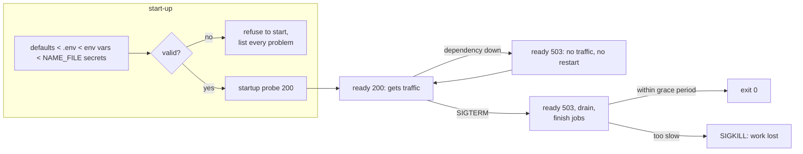

# 16.3 · Health checks, configuration and secrets

**Module:** [16 · Containers and deployment](../README.md) · **Time:** 45-60 minutes · **Model needs:** none · **Packages:** `apps` extra (FastAPI, pydantic) · **Services:** none needed (the compose file uses `DOCKER` if you start it yourself)

> **Honest note:** Docker is not installed on the author's machine. All three scripts run in process; `docker-compose.yml` here is checked by structure tests only and was not started.

## What you will learn

- Why one `/health` endpoint is not enough: **liveness**, **readiness** and **startup** probes answer different questions.
- What a probe must never do (call the model, hit a database in the liveness check).
- The configuration precedence order, **fail-fast** validation, and masking secrets in output.
- How **Docker secrets** deliver a key as a file, read through a `NAME_FILE` variable.
- **Graceful shutdown**: handling SIGTERM, draining, finishing in-flight work inside the grace period.

## The idea

**What is new since 16.2:** the stack there had a basic `/health/live` and `/health/ready`. Now we say why they differ, how settings and secrets reach the app safely, and how the app behaves when the platform stops it.



**Three probes.** *Live*: is the process alive? A failure means restart, so it must not depend on anything outside the process. *Ready*: can this instance serve now? A failure means stop sending traffic, not restart. *Startup*: has warm-up finished? It gives slow starters time before the other probes judge them. Docker's `HEALTHCHECK` is one probe, so point it at live; Kubernetes and Cloud Run map all three. Keep the model out of both: a provider's bad minute should not restart your fleet or burn money on probe calls.

**Configuration.** The same image runs everywhere; what differs is configuration read at start-up. Precedence, lowest to highest: defaults in code, a `.env` file, real environment variables, then secret files. Validate everything at start-up and report all problems at once.

**Secrets.** Environment variables appear in `docker inspect`, crash dumps and child processes. A Docker secret is mounted as a file under `/run/secrets/`; the app reads the path in `LLM_API_KEY_FILE`. The compose file here does that, and also uses `read_only: true` with a `tmpfs` for `/tmp`. The secret source file `secrets/llm_api_key.txt` is git-ignored; copy `llm_api_key.txt.example` and put your key in it.

**Graceful shutdown.** `docker stop` sends SIGTERM, waits `stop_grace_period`, then SIGKILL (uncatchable). A good service flips readiness off, stops taking work, lets running jobs finish, requeues what it never started and exits 0. Keep the signal handler tiny (set flags); do the draining in normal code. Uvicorn does this for HTTP; a queue worker must do it itself.

## Scripts

### 1. `01_live_ready_startup.py`: three probes through an outage

```
./run 16.3/1
```

Builds a small FastAPI app with `/health/live`, `/health/startup`, `/health/ready` and drives it through start-up, a queue outage, recovery and draining with the test client.

**Expected output** (real run, trimmed):

```
Step 1: The app is starting (warm-up not finished) ─────────────────────────────
  process just started                         live=200  startup=503  ready=503
live is 200 already, ready is 503: do not send traffic yet, and do not restart it either.

Step 2: Warm-up done and settings loaded ───────────────────────────────────────
  healthy                                      live=200  startup=200  ready=200

Step 3: The queue (Redis) goes down for a minute ───────────────────────────────
  dependency outage                            live=200  startup=200  ready=503
ready is 503 so the load balancer stops sending tickets; live stays 200 so nothing is restarted pointlessly.
  ready body: {'started': True, 'not_draining': True, 'queue': False, 'model_settings': True}

Step 4: The queue recovers ─────────────────────────────────────────────────────
  recovered                                    live=200  startup=200  ready=200

Step 5: SIGTERM arrives (docker stop): drain ───────────────────────────────────
  draining                                     live=200  startup=200  ready=503
ready flips to 503 first, so no new request arrives while in-flight ones finish. Next script shows the handler.
```

### 2. `02_config_and_secrets.py`: precedence, fail-fast, masking

```
./run 16.3/2
```

A pydantic settings loader with the precedence rules and `NAME_FILE` secrets, using temporary files and a fake key. Shows start-up refusing bad config with every error listed, and the difference between `repr(settings)` (leaks) and a masked view (does not).

**Expected output** (real run, trimmed):

```
Step 2: Fail fast: bad or missing settings stop the app at start-up, with eve… ─
  nothing configured: REFUSING TO START
     - LLM_BASE_URL: Field required
     - LLM_MODEL: Field required
     - LLM_API_KEY: Field required
  typos and bad values: REFUSING TO START
     - LLM_BASE_URL: Value error, must start with http:// or https://
     - WORKER_CONCURRENCY: Value error, must be between 1 and 32
  secret file missing: REFUSING TO START
     - FileNotFoundError: secret file could not be read

Step 3: Never print a secret: the masked view ──────────────────────────────────
  repr(settings) leaks the key: True
  settings.masked() leaks it:   False
pydantic's SecretStr type also hides a value in repr; an explicit masked() view is the simplest thing to teach and test.
Log the masked view at start-up so you can see which values were used, without the secret.
```

### 3. `03_graceful_shutdown.py`: a real SIGTERM, handled

```
./run 16.3/3
```

Installs a SIGTERM handler, runs two workers on six jobs, sends the process a real SIGTERM with `signal.raise_signal` (nothing is killed; the old handler is restored), then reports what finished, what was put back and whether any job outlived the grace period (scaled to 1 to 1.5 s).

**Expected output** (real run, trimmed):

```
Step 1: Scenario A: jobs are short, the grace period is enough ─────────────────
  t=0.3s  2 done, 2 running, 2 waiting; ready=True
  -> sending SIGTERM to ourselves (what `docker stop` does)
  handler ran: ready=False, stopping=True
  finished: ['LL-1001', 'LL-1002', 'LL-1003', 'LL-1004']
  not started, put back for the next instance: ['LL-1005', 'LL-1006']
  exit code 0: every started job finished inside the grace period

Step 2: Scenario B: one job takes far longer than the grace period ─────────────
  t=0.3s  1 done, 2 running, 3 waiting; ready=True
  -> sending SIGTERM to ourselves (what `docker stop` does)
  handler ran: ready=False, stopping=True
  finished: ['LL-1002', 'LL-1003']
  not started, put back for the next instance: ['LL-1004', 'LL-1005', 'LL-1006']
  STILL RUNNING at the deadline: ['LL-1001'] -> SIGKILL would cut these off
  fix: raise stop_grace_period, make jobs shorter, or requeue unacknowledged jobs on restart
```

### The shipped files

`docker-compose.yml` (reuses the 16.2 image, `environment:` for settings, `secrets:` for the key, read-only filesystem), `secrets/llm_api_key.txt.example`, `.gitignore`. Not run by the author. To try it: build the image in 16.2 first, then

```
cd modules/16-containers-and-deployment/03-health-checks-configuration-and-secrets
cp secrets/llm_api_key.txt.example secrets/llm_api_key.txt     # put your key in it
docker compose up -d
docker compose exec api ls /run/secrets
docker compose stop api      # watch the shutdown in the logs
```

Note: the 16.2 app reads `LLM_API_KEY`, not `LLM_API_KEY_FILE`; this lesson's script 2 is the loader you would add to it (an exercise below).

## Try this

1. In script 1 make `ready` also require `model_settings`, then unset it. What changes and what stays 200?
2. In script 2 add a `database_url` field with no default and see the start-up report.
3. Put a `*_FILE` variable and a plain variable for the same setting and confirm which wins. Is that the order you want?
4. In script 3 set the grace period for scenario B to 6 s. Does the long job now finish?
5. Remove the `stopping` check between jobs and move it inside the job sleep. What goes wrong?
6. Replace `masked()` with pydantic's `SecretStr` and see what `repr` shows.
7. Port the `NAME_FILE` rule into `app/worker.py` of 16.2.

## If it does not work

- Run `./run doctor`; install the extra with `./setup.sh --extra apps` (or `--all`).
- Script 3 uses `signal.raise_signal`, which works on macOS, Linux and Windows (SIGTERM handlers are supported there too).
- No Docker? The scripts need none. To use a hosted Redis or registry later, set the address in `.env` (for example `REDIS_URL`); nothing in this lesson needs it.
- `docker compose up` fails on the secret file: you must create `secrets/llm_api_key.txt` first.

## In the running scenario

The helpdesk assistant now reports honestly whether it is alive and whether it can take tickets, refuses to start on bad settings, keeps its API key out of the image and of `docker inspect`, and finishes the tickets in hand before it stops.

**Next:** 16.4 · CI/CD and rollout strategies (planned)
