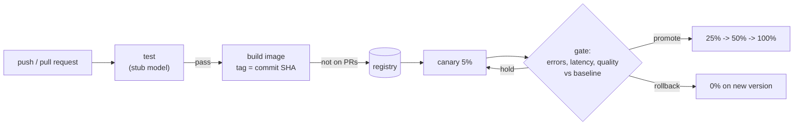

# 16.4 · CI/CD and rollout strategies

**Module:** [16 · Containers and deployment](../README.md) · **Time:** 45-60 minutes · **Model needs:** none · **Packages:** `apps` extra (the scripts themselves use only the standard library and `labkit`) · **Services:** none

> **Honest note:** GitHub Actions and Docker are not available on the author's machine. `ci-workflow.yml` is read and checked by script 1; it was **not run on GitHub**. The rollout scripts are simulations with invented numbers, not measurements.

## What you will learn

- What a **CI/CD pipeline** is for the helpdesk API: test, build, push, deploy, in that order.
- How to read and check a **GitHub Actions** workflow: triggers, `needs`, permissions, pinned actions, timeouts, secrets.
- **Blue/green** and **canary** rollouts, and why canary suits LLM apps.
- A **gate** that promotes, holds or rolls back by comparing the new version with the baseline.

## The idea

**What is new since 16.3:** until now you ran the stack by hand. Now a pipeline builds and publishes it on every change, and a rollout strategy decides how users meet the new version.



**CI and CD.** Continuous integration runs the tests on every change so a broken change is found while it is small. Continuous delivery builds a deployable image from every passing change and can deploy it. In `ci-workflow.yml`: the `test` job runs the repository tests (which use a stub model, so they are free and fast); `build` needs `test`, builds the image and pushes it to the GitHub Container Registry tagged with the commit SHA, but only when the event is not a pull request; `deploy-canary` runs only on `main` and needs the `production` environment, where you can require a human approval.

**Pipeline hygiene.** Pin actions to a version (`@v4`), set `permissions: contents: read` and widen it per job (`packages: write` only for build), set `timeout-minutes`, cancel superseded runs with `concurrency`, keep keys in GitHub Secrets (`${{ secrets.NAME }}`) and never print them. Model-quality checks (module 10) can be another job that blocks the deploy.

**Blue/green.** Run the new version beside the old, test it, flip all traffic at once, keep the old one for instant rollback. Its safety is the safety of the pre-switch checks, and the blast radius after the flip is 100%.

**Canary.** Send a small share to the new version, watch it, widen in steps. A bad release harms only its share. For LLM apps this matters most: a changed prompt or model can pass every test and still answer worse on real tickets. Because rates from a few requests are noise, a gate needs a minimum sample, and it compares with the **baseline** because a provider outage hurts both versions.

**Rollback.** Keep the previous image tag; rollback is "point traffic back", not "rebuild". Database or message-format changes must be backward compatible for one version, or rollback is impossible.

## Scripts

### 1. `01_check_the_ci_workflow.py`: read and check the pipeline

```
./run 16.4/1
```

Parses `ci-workflow.yml` with a small built-in YAML reader (real projects use PyYAML), prints the stages in `needs` order, and runs checks (runs on pull requests, least-privilege permissions, timeouts, pinned actions, no secrets in the file, build needs test, no push on pull requests) on it and on an embedded careless workflow.

**Expected output** (real run, trimmed):

```
Step 1: The pipeline in ci-workflow.yml ────────────────────────────────────────
  triggers: push ['main'], pull_request ['main']
  stage 1: test           runs on ubuntu-latest; steps: actions/checkout@v4; astral-sh/setup-uv@v5; Install dependencies; Run tests against a stub model
  stage 2: build          runs on ubuntu-latest; steps: actions/checkout@v4; docker/setup-buildx-action@v3; Log in to the registry; Build and push
  stage 3: deploy-canary  runs on ubuntu-latest; steps: Point 5 percent of traffic at the new image
'needs' makes a stage wait for the one before it. If test fails, build and deploy never start.

Step 2: Checks on the shipped workflow ─────────────────────────────────────────
  all checks pass

Step 3: The same checks on a careless workflow (embedded) ──────────────────────
  FAIL does not run on pull requests: broken code is found only after merging
  FAIL no top-level permissions: the token gets broad default rights (set contents: read)
  FAIL job build: no timeout-minutes (a hung job burns minutes for hours)
  FAIL job build: actions/checkout is not pinned to a version
  FAIL job build: some/action@main follows a moving branch
  FAIL job build: a secret is written in the file; use ${{ secrets.NAME }}
  FAIL no test job
```

### 2. `02_traffic_split_simulation.py`: blue/green against canary

```
./run 16.4/2
```

A seeded simulation of 1000 requests a minute. Version 2 fails 20% of requests. It compares how many users see failures under blue/green (with a weak smoke test) and under a canary, then runs a good release through the canary and 200 seeded runs of each strategy.

**Expected output** (real run, trimmed):

```
Step 1: A bad release (v2 fails 20% of requests) with a smoke test that only … ─
  blue/green: error rate alarm, switched back to blue; bad requests before rollback: 201
Blue/green is as safe as its pre-switch checks. Once switched, 100% of users get v2 until the alarm fires.

Step 2: The same bad release as a canary ───────────────────────────────────────
    canary   5%: 66 requests to v2, error rate 24.2%
  canary: rolled back at 5%; bad requests before rollback: 16
The canary stopped at the first step, so only about 5% of one minute of traffic ever saw v2.

Step 3: A good release (v2 fails 1%, like v1) ──────────────────────────────────
    canary   5%: 65 requests to v2, error rate 0.0%
    canary  25%: 248 requests to v2, error rate 0.4%
    canary  50%: 516 requests to v2, error rate 1.2%
    canary 100%: 1000 requests to v2, error rate 1.2%
  canary: promoted to 100%

Step 4: Many runs: how many users get hurt by a bad release? (200 seeded runs… ─
  blue/green: average 41 failed requests per bad release, worst 239
  canary:     average 10 failed requests per bad release, worst 19

Step 5: Choosing ───────────────────────────────────────────────────────────────
  blue/green: database migrations or protocol changes that cannot serve two versions; instant full rollback.
  canary:     most LLM changes (prompt, model, tool set): quality problems only show on real traffic.
  both:       need a rollback that is one command, and a health signal that is not 'the pod started'.
```

The exact numbers are a property of the invented model; the pattern (canary limits the damage) is the point.

### 3. `03_rollout_gate.py`: promote, hold or roll back

```
./run 16.4/3
```

A gate function comparing a canary window with the baseline on error rate, p95 latency and quality, with a minimum sample size, replayed over five invented releases and a provider-outage case.

**Expected output** (real run, trimmed):

```
Step 2: Five releases through the gate ─────────────────────────────────────────
  A. Prompt tweak, no change in behaviour
      canary: 600 req, errors 1.0%, p95 1800 ms, quality 90%
      -> PROMOTE: all three signals within limits
  B. New model: faster but answers worse
      canary: 600 req, errors 1.0%, p95 1200 ms, quality 78%
      -> ROLLBACK: quality 78% vs baseline 91%
  C. New tool: a slow lookup added
      canary: 600 req, errors 1.2%, p95 3400 ms, quality 91%
      -> ROLLBACK: p95 3400 ms vs baseline 1850 ms
  D. Config bug: bad requests
      canary: 600 req, errors 15.0%, p95 1700 ms, quality 89%
      -> ROLLBACK: error rate 15.0% vs baseline 1.0%
  E. Looks fine but too little traffic yet
      canary: 40 req, errors 0.0%, p95 1700 ms, quality 90%
      -> HOLD: only 40 canary requests (need 200); keep the share and wait

Step 3: Why compare with the baseline? ─────────────────────────────────────────
  A provider outage hurts v1 and v2 equally:
    absolute rule (rollback if errors > 5%) would say: ROLLBACK, wrongly blaming v2
    baseline-relative gate says: PROMOTE (all three signals within limits)
Rolling back would not have helped, since v1 is failing too. The gate separates 'my release broke' from 'the world broke'.
```

### The shipped file

`ci-workflow.yml`: the pipeline. To use it in a real repository, copy it to `.github/workflows/`, adjust `context:` to your Dockerfile folder and replace the placeholder deploy command with your platform's (for example `gcloud run services update-traffic` on Cloud Run, which supports tagged revisions and percentage splits).

## Try this

1. Remove `needs: test` from the `build` job and run script 1. Which check fails?
2. Change `actions/checkout@v4` to `actions/checkout@main`.
3. Remove `permissions:` at the top and read the finding.
4. In script 2 change the canary steps to `(0.5, 1.0)`. How does the average damage change?
5. In script 3 set `MIN_REQUESTS = 20`. Which release changes decision, and why is that dangerous?
6. Add a fourth signal (for example cost per ticket) to the gate and a release that only fails on it.

## If it does not work

- Run `./run doctor`; install the extra with `./setup.sh --extra apps` (or `--all`).
- None of these scripts needs Docker, GitHub or a network. If the workflow check reports a finding on a file you edited, the message names the job.
- To try the real pipeline you need a GitHub repository; a hosted registry (GitHub, Google, AWS) address goes in the workflow's `IMAGE` variable and keys go in the repository's Secrets, not in `.env`.

## In the running scenario

A change to the Larkspur Labs helpdesk assistant (a new prompt, a different model) is tested, built into a tagged image, and offered to 5% of tickets first. The gate compares errors, latency and answer quality with the current version and either widens the share or puts everyone back on the old image.

**Next:** 16.5 · Capstone: the helpdesk stack in containers (planned)
