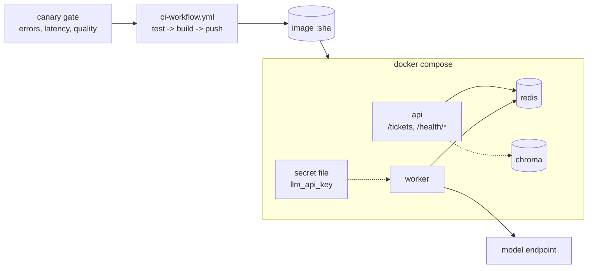

# 16.5 · Capstone: the helpdesk stack in containers

**Module:** [16 · Containers and deployment](../README.md) · **Time:** 60-90 minutes · **Model needs:** chat (scripts 2 and 3; script 1 calls no model) · **Packages:** `apps` extra (FastAPI) · **Services:** none needed for the scripts; `DOCKER` only if you start the stack yourself

> **Honest note:** Docker is not installed on the author's machine. The stack in this folder has **never been built or started**; it is checked by structure tests, by script 1, and its Python code is exercised in process by script 2.

## What you will learn

- How to review a containerised stack against written acceptance criteria.
- How the pieces of module 16 (compose, probes, secrets, graceful shutdown, CI, canary gates) fit together on the helpdesk assistant.
- How to test deployment behaviour without Docker, and be honest about what that does not prove.

## The brief

Larkspur Labs wants the IT helpdesk assistant deployed so any engineer can start it with two commands, a new prompt can be rolled out safely, and a restart never loses a ticket. This folder contains a reference stack (compose file, Dockerfile, CI workflow, app code). Review it against the acceptance criteria, run its code, gate a prompt change, then extend it.



## Acceptance criteria

1. Four services: `api`, `worker`, `redis`, `chroma`.
2. Every image is pinned to a tag.
3. Published ports are bound to `127.0.0.1`; Redis is not published at all.
4. The API key reaches the containers as a Docker **secret** (a file); no secret is written in the compose file.
5. Healthchecks on `api`, `worker` and `redis`.
6. The API waits for a **healthy** Redis.
7. Grace periods of at least 15 s for `api` and `worker`.
8. Restart policy and named volumes for Redis and Chroma.
9. The Dockerfile is multi-stage, pinned, non-root, has a `HEALTHCHECK` and an exec-form `CMD`.
10. CI tests before it builds, and never pushes on pull requests.
11. `.env` and secret files are git-ignored; `.env.example` holds no real key.
12. The code behaves: settings are validated at start-up, tickets are queued, the worker stops on SIGTERM (script 2).
13. A prompt change is gated against the baseline before it is promoted (script 3).

## Stretch goals

- Make the API fail its **readiness** check while the worker's heartbeat is stale (share it through Redis).
- Add a dead-letter list in Redis for jobs that fail all attempts, and an endpoint that lists them.
- Make `app/api.py` read its settings with `app/settings.py` too and refuse to start on bad config.
- Use Chroma: add a `/kb` endpoint that stores and retrieves knowledge-base articles (module 04 ideas), and make `/health/ready` depend on it.
- Add a third job to `ci-workflow.yml` that runs script 3's gate and fails the pipeline on ROLLBACK.
- Write a short rollback procedure: which command sets traffic back, and what must stay backward compatible.

## Scripts

### 1. `01_acceptance_audit.py`: check the files against criteria 1-11

```
./run 16.5/1
```

Parses the compose file, Dockerfile, workflow, `.gitignore` and `.env.example` and prints PASS or FAIL for each criterion. Edit the files and re-run it as you work. Needs no Docker and no model.

**Expected output** (real run, trimmed):

```
Step 1: Acceptance criteria ────────────────────────────────────────────────────
  PASS  1. Four services: api, worker, redis, chroma
  PASS  2. Every image pinned to a tag
  PASS  3. Published ports bound to 127.0.0.1; redis not published
  PASS  4. API key delivered as a Docker secret, none written in the file
  PASS  5. Healthchecks on api, worker and redis
  PASS  6. api waits for a HEALTHY redis (service_healthy)
  PASS  7. Grace periods of at least 15 s for api and worker
  PASS  8. Restart policy and named volumes for redis and chroma
  PASS  9. Dockerfile: multi-stage, pinned base, non-root, HEALTHCHECK, exec-form CMD
  PASS  10. CI: test then build then deploy via needs; pushes skipped on pull requests
  PASS  11. .env and secret files are git-ignored; .env.example has no real key

Step 2: Result ─────────────────────────────────────────────────────────────────
  11 of 11 criteria pass
These are structure checks. They do not prove the stack runs: build and start it with the commands in the README when you have Docker.
```

### 2. `02_run_the_stack_in_process.py`: criterion 12, the stack's own code

```
./run 16.5/2
```

Imports `app/api.py`, `app/settings.py` and `app/worker.py` (the code the containers run), uses the in-memory twin of the Redis queue, a worker thread that calls the real `worker.handle`, the API through its test client, and a real SIGTERM that triggers the worker's stop handler. 4 model calls.

**Expected output** (real run, trimmed):

```
Step 1: Settings check (what the container does at start-up) ───────────────────
  problems with the current settings: none
  with LLM_MODEL missing:            ['LLM_MODEL is not set']

Step 2: Readiness ──────────────────────────────────────────────────────────────
  GET /health/live  -> 200
  GET /health/ready -> 200 {'status': 'ready', 'checks': {'redis': True, 'chroma': True}}

Step 3: Submit tickets: instant 202s ───────────────────────────────────────────
  202 {'job_id': '38fe23b56464', 'status': 'queued'}
  202 {'job_id': '059469908778', 'status': 'queued'}
  202 {'job_id': '58d8f3684f4e', 'status': 'queued'}
  202 {'job_id': '0320916e9866', 'status': 'queued'}

Step 4: A worker thread runs app.worker.handle on each job (real model call) ───
  poll: ['queued', 'queued', 'queued', 'queued']
  poll: ['done', 'queued', 'queued', 'queued']
  poll: ['done', 'done', 'done', 'queued']
  poll: ['done', 'done', 'done', 'done']
  [done] 'The VPN disconnects every ten minutes when I wor' -> Please ensure your home router firmware is up to date and try disabling any local firewall
  [done] 'My laptop screen is cracked and flickers.' -> I am sorry to hear about your screen; please submit a hardware repair ticket through the L
  [done] 'Outlook keeps rejecting my password since I chan' -> Please try clearing your saved credentials in the Windows Credential Manager and restartin
  [done] 'Excel crashes every time I open the finance work' -> Please try opening Excel in Safe Mode by holding the Ctrl key while launching the applicat

Step 5: SIGTERM: the worker's real stop handler ────────────────────────────────
  worker.stopping before: False
  worker.stopping after:  True
  worker thread ended: True
In the container, the same flag ends the loop after the current job and the worker prints 'stopped cleanly' (exit 0).
```

Replies differ from run to run.

### 3. `03_canary_gate_on_prompts.py`: criterion 13, gate a prompt change

```
./run 16.5/3
```

Sends the same four tickets (`tickets.json`) through the current prompt and a candidate prompt (8 model calls), measures errors, slowest call and a category-match quality score, and applies the gate from 16.4. Four tickets is a toy sample, and the script says so.

**Expected output** (real run, trimmed):

```
Step 1: Measure v1 (current) ───────────────────────────────────────────────────
Messages sent to the model
   system | Classify the IT ticket. Answer with one word from: network, hardware, software, access, other.
  4 tickets, errors 0, slowest call 0.9s, quality 100%

Step 2: Measure v2 (candidate) ─────────────────────────────────────────────────
Messages sent to the model
   system | Classify the IT ticket into one of: network, hardware, software, access, other. A password or account problem is access even if an app is named. Answer with the single word only.
  4 tickets, errors 0, slowest call 0.7s, quality 100%

Step 3: The gate ───────────────────────────────────────────────────────────────
  PROMOTE: signals within limits
Four tickets is a toy sample: one different answer moves quality by 25 points. Treat this as the shape of the check, not as evidence.
In the pipeline (16.4) this decision gates the deploy-canary job; PROMOTE widens the share, ROLLBACK fails the job.
```

Both prompts scored the same here, so the gate promoted; your model may differ, and a rollback is a perfectly good result.

### Starting the stack (not run by the author)

```
cd modules/16-containers-and-deployment/05-capstone-the-helpdesk-stack-in-containers
cp .env.example .env                                   # LLM_BASE_URL and LLM_MODEL
cp secrets/llm_api_key.txt.example secrets/llm_api_key.txt   # put your key in this file
docker compose up --build -d
docker compose ps                                      # wait for (healthy)
curl http://127.0.0.1:8000/health/ready
curl -X POST http://127.0.0.1:8000/tickets -H "Content-Type: application/json" -d '{"text":"My VPN keeps dropping."}'
docker compose down
```

The worker reads the key from `/run/secrets/llm_api_key` through `LLM_API_KEY_FILE` (see `app/settings.py`). The API in this reference never calls the model; only the worker needs the key.

## Try this

1. Remove `service_healthy` from the API's `depends_on` and run script 1.
2. Add `ports: ["6379:6379"]` to Redis and see which criterion fails.
3. Change the worker's `stop_grace_period` to `5s`.
4. Write a third, clearly worse prompt for script 3 (for example "Answer with a joke") and see whether the gate rolls it back.
5. Add a ticket to `tickets.json` whose expected category is ambiguous. Does the gate stay stable?
6. Break `.env.example` by putting a real-looking key in it and read the audit.

## If it does not work

- Run `./run doctor`; install the extra with `./setup.sh --extra apps` (or `--all`).
- Scripts 1 to 3 need no Docker and no Redis.
- No Docker? Build and run in a cloud shell, or put a hosted Redis address in `REDIS_URL` and run `uvicorn app.api:app` and `python -m app.worker` natively from this folder; point `LLM_BASE_URL` at your hosted provider in `.env`.
- Containers cannot reach a model on your machine: use `host.docker.internal` (see 16.1).

## In the running scenario

The Larkspur Labs helpdesk assistant is now a deployable service: a small stack that starts the same way everywhere, keeps its key out of the image, drains work on shutdown, and takes a new prompt through a gate instead of straight to every employee.

**Next:** 17.1 · Logs, metrics and traces with OpenTelemetry (the next module)
