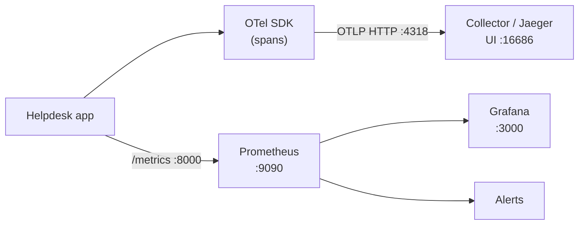

# 17.1 · Logs, metrics and traces with OpenTelemetry

**Module:** [17 · Monitoring, evaluation and fine-tuning](../README.md) · **Time:** 45-60 minutes · **Model needs:** chat · **Packages:** `observability` extra (`opentelemetry-sdk`, `opentelemetry-exporter-otlp-proto-http`, `prometheus-client`; install with `./setup.sh --all`) · **Services (optional):** Jaeger (`OTEL_EXPORTER_OTLP_ENDPOINT`), Prometheus (`PROMETHEUS_URL`), Grafana (`GRAFANA_URL`)

## What you will learn

- What logs, metrics and traces each tell you, and why you want all three.
- What spans, attributes and context propagation mean in OpenTelemetry (OTel), the open standard for recording this data.
- Why an LLM app needs token and cost metrics, not just speed and error counts.
- How to expose metrics for Prometheus and send traces to Jaeger.
- A short look at SLOs, cost budgets and alerts, and where Arize Phoenix and LangSmith fit.

Scripts 1 and 2 need no service. Only script 3 needs Jaeger.

## The idea

Once your helpdesk assistant is live, you need to see what it is doing without reading its code. That is what monitoring (often called observability) gives you. It rests on three kinds of record, and each answers a different question about the Larkspur Labs helpdesk assistant:

| Pillar | Question | Shape | Cost to store |
| --- | --- | --- | --- |
| Logs | What exactly happened in this request? | Timestamped events, best as JSON | High (every event) |
| Metrics | How much, how often, how slow, overall? | Numbers aggregated over time | Low (fixed series) |
| Traces | Where did the time go inside one request? | A tree of timed spans | Medium (often sampled) |

A **span** is one timed step, such as classify or reply. It has a name, a start, an end and **attributes**: small key-value facts such as `llm.model`, `llm.tokens.in` or `ticket.category`. Spans form a tree, because each child span records the id of its parent.

**Context propagation** is how that parent link gets passed along. Inside one process it travels in a context variable, so `start_as_current_span` nests spans for you. Between services it travels in the `traceparent` HTTP header. That way one trace can cover your API, a background worker and the model gateway.

If you put the trace id in your log lines, you can jump from any log line straight to its trace.



### Why LLM apps need token and cost metrics

An ordinary web service costs about the same for every request. An LLM request can cost 50 times more than the one before it, depending on the prompt size, retries or an agent stuck in a loop. Speed and error rate will not show you that.

So track input tokens, output tokens and estimated dollars as counters. Label them with a few stable values, such as model and category. Then, on the day a prompt change doubles your spend, you will see it.

### SLOs, budgets and alerts (short)

- A **service level objective** (SLO) is a target for a metric, for example "95% of replies finish in under 5 seconds over 30 days". The error budget is the 5% you are allowed to miss.
- Alert on problems users feel (slow, failing, too expensive), not on every internal counter.
- A **cost budget** applies the same idea to money: a monthly limit, alerts at 50% and 80% of it, and at 100% either a hard stop or a switch to a cheaper model. Script 2 models the budget as a gauge. Wiring up real alerts (Alertmanager, Grafana alerts) is only described here, not built.

### Where Phoenix and LangSmith fit

Jaeger and Prometheus work for any kind of software. Tools built for LLM apps add views that understand prompts, completions, token counts and evaluations. Two examples are Arize Phoenix (open source, speaks OpenTelemetry) and LangSmith (hosted, from the LangChain team). If you instrument your code with OTel, you can usually send the same spans to several of them. Evaluation is covered in 17.2 and later. Fine-tuning comes in 17.4 and is not taught here.

## Scripts

### 1. `01_logs_metrics_traces.py`: the pillars in one process

Run: `./run 17.1/1`. The script writes JSON logs with Python's standard logging, wraps a two-step call (classify, then reply) in an OTel tracer that keeps spans in memory, and prints the spans as a tree. No service needed.

**Expected output** (trimmed, real run):

```text
Step 4: Read the logs
{"category": "network", "event": "classified", "level": "INFO", "step": "classify", "trace_id": "aa71a2201d805fbd425f7ce378d7f5ea"}
{"chars": 238, "event": "replied", "level": "INFO", "step": "reply", "trace_id": "aa71a2201d805fbd425f7ce378d7f5ea"}

Step 5: Read the trace
- handle_ticket  (4313 ms)
    ticket.chars = 74
    ticket.category = network
  - classify  (2723 ms)
      llm.model = your-model-name
      llm.tokens.in = 42
      llm.tokens.out = 1
      ticket.category = network
  - reply  (1590 ms)
      llm.model = your-model-name
      llm.tokens.in = 38
      llm.tokens.out = 44
      reply.chars = 238
3 spans, 1 trace.
```

### 2. `02_metrics_prometheus.py`: metrics with `prometheus_client`

Run: `./run 17.1/2`. The script keeps a Counter (requests, tokens, cost), a Histogram (latency) and a Gauge (budget left), with made-up prices stored as constants. It makes four real calls and prints `generate_latest()`, which is the text a `/metrics` endpoint would serve. No server starts.

**Expected output** (trimmed, real run):

```text
network: 24 in, 14 out, $0.000033
...
helpdesk_requests_total{category="network",status="ok"} 1.0
helpdesk_llm_latency_seconds_bucket{le="2.0"} 2.0
helpdesk_llm_latency_seconds_bucket{le="5.0"} 4.0
helpdesk_llm_latency_seconds_count 4.0
helpdesk_llm_latency_seconds_sum 8.421816584988846
helpdesk_llm_tokens_total{direction="in"} 101.0
helpdesk_llm_tokens_total{direction="out"} 79.0
helpdesk_llm_cost_dollars_total 0.00016900000000000002
helpdesk_budget_remaining_dollars 24.999831
```

PromQL is the query language of Prometheus. Here are example queries you would run in Prometheus or Grafana once a real service exposes these metrics (this lesson does not run them):

```promql
# requests per second, by category, over 5 minutes
sum by (category) (rate(helpdesk_requests_total[5m]))

# 95th percentile latency
histogram_quantile(0.95, sum by (le) (rate(helpdesk_llm_latency_seconds_bucket[5m])))

# error ratio
sum(rate(helpdesk_requests_total{status="error"}[5m])) / sum(rate(helpdesk_requests_total[5m]))

# tokens per minute, and dollars per hour
sum by (direction) (rate(helpdesk_llm_tokens_total[1m])) * 60
increase(helpdesk_llm_cost_dollars_total[1h])

# alert idea: less than 20% of the monthly budget left
helpdesk_budget_remaining_dollars < 5
```

### 3. `03_export_to_jaeger.py`: send the trace to Jaeger

Run: `./run 17.1/3`. This is the same traced call as script 1, but it sends the spans with the OTLP HTTP exporter to `OTEL_EXPORTER_OTLP_ENDPOINT`. That variable holds the base URL, for example `http://localhost:4318`. The script calls `require("OTEL_EXPORTER_OTLP_ENDPOINT")` first and exits with code 3 if nothing is listening.

**Expected output on this machine (no Jaeger), real run, exit code 3:**

```text
Step 1: Check that a trace backend is reachable
This lesson needs OpenTelemetry collector / Jaeger: OTEL_EXPORTER_OTLP_ENDPOINT is not set.
- Start one: from this lesson's folder run: docker compose up -d   (Jaeger UI: http://localhost:16686)
- Then set it in .env, for example OTEL_EXPORTER_OTLP_ENDPOINT=http://localhost:4318
```

With Jaeger running, you will see the model calls, then a trace id, then a prompt to open `http://localhost:16686`. In the UI, pick the service `larkspur-helpdesk` and click Find Traces. The waterfall shows `handle_ticket` as one wide bar, with `classify` and `reply` nested under it, one after the other. The bar lengths are the model calls. Click a span to see its attributes (`llm.model`, token counts, `ticket.category`).

This part is described, not pasted, because the author could not run Jaeger here. The exporter code was only checked against a throwaway local HTTP listener that accepted the POST.

## Try this

1. In script 1, add a third span `redact` (a plain function) between classify and reply. Where does it appear in the tree?
2. Make `classify` raise an exception inside its span, and call `span.record_exception(e)` and `span.set_status(...)`. How would you find failed requests in a trace UI?
3. In script 2, add a `model` label to the request counter. How many time series would 5 models times 4 categories times 2 statuses create? Why is a `user_id` label dangerous?
4. Change the made-up prices and the budget so the gauge goes below zero after four calls. What alert would catch it?
5. Add `ctx.settings.model` as a log field and log the ticket text. What privacy problem did you just create? (Module 18 comes back to this.)
6. With the stack running, start your own tiny app that calls `prometheus_client.start_http_server(8000)`, and watch the target turn UP at `http://localhost:9090/targets`.

## If it does not work

- Run `./run doctor` to see which services and extras it finds. Install the extra with `./setup.sh --all`.
- The stack lives in `docker-compose.yml`. It starts Jaeger (`all-in-one:1`, UI 16686, OTLP HTTP 4318), Prometheus (`v3`, 9090, config in `prometheus.yml`, scraping `host.docker.internal:8000`) and Grafana (`12`, 3000). Every port is bound to `127.0.0.1`. Start it with `docker compose up -d` in this folder and stop it with `docker compose down`. In Grafana, add a Prometheus data source with the URL `http://prometheus:9090`.
- These files were not run on the author's machine, which has no Docker. They were only checked for structure. If an image tag has moved on, adjust it.
- To use a cloud or native install instead of Docker, set the address in `.env`, for example `OTEL_EXPORTER_OTLP_ENDPOINT=https://your-collector.example:4318`, `PROMETHEUS_URL=...`, `GRAFANA_URL=...`. Hosted backends often need auth headers. Set `OTEL_EXPORTER_OTLP_HEADERS` as the OTel docs describe, and keep it in `.env`, never in code.
- Port 4318 is the OTLP **HTTP** port. Port 4317 is for gRPC and will not work with this exporter.
- If script 3 says the export timed out, Jaeger may still be starting. Wait a few seconds and run it again.

## In the running scenario

The helpdesk assistant can now explain itself. Each ticket leaves a JSON log line, a trace with classify and reply timings and token counts, and metric updates for requests, latency, tokens and dollars. When someone asks "why was Tuesday expensive?" or "why is the assistant slow?", you look at a chart and then a trace instead of guessing.

**Next:** 17.2 · Prometheus metrics and Grafana dashboards (planned)
