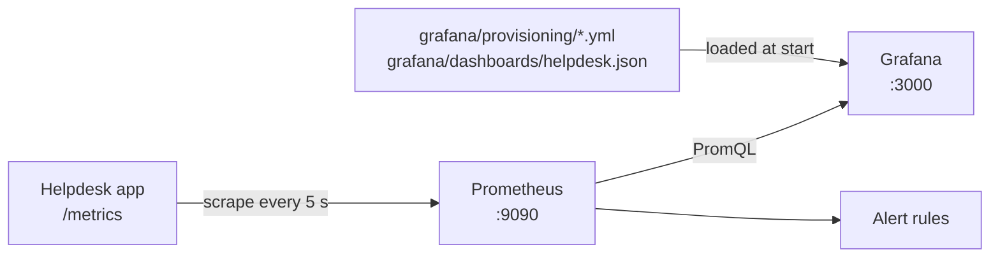

# 17.2 · Prometheus metrics and Grafana dashboards

**Module:** [17 · Monitoring, evaluation and fine-tuning](../README.md) · **Time:** 45-60 minutes · **Model needs:** chat (script 1 only) · **Packages:** `observability` extra (`prometheus-client`; install with `./setup.sh --all`) · **Services (optional):** Prometheus (`PROMETHEUS_URL`), Grafana (`GRAFANA_URL`)

## What you will learn

- How Prometheus collects metrics: it **pulls** them, which means it scrapes (fetches) a `/metrics` HTTP endpoint on a schedule.
- How to serve metrics from your own process and read them back with a plain HTTP request.
- How `rate()`, `increase()` and `histogram_quantile()` turn raw counters into per-second rates and percentiles.
- How to set up a Grafana dashboard and data source **from files**, so they live in git.
- How to check a dashboard offline: do its queries use only metrics the app really exposes?

Scripts 1 and 2 need no service. Only script 3 needs Prometheus.

## The idea

In 17.1 you printed `generate_latest()` as text. Now a real HTTP endpoint serves the metrics, and you read them back the way a scraper would. You also add the other half: a dashboard that charts them, defined in files.

Prometheus stores numbers over time. Every few seconds it sends a GET request to your `/metrics`, stamps the values with the time, and keeps them. It stores running totals, because counters only go up. So a chart needs a function that turns totals into something you can read:

| PromQL | Meaning |
| --- | --- |
| `rate(x_total[5m])` | per-second increase of a counter, averaged over 5 minutes |
| `increase(x_total[1h])` | how much a counter grew in an hour |
| `histogram_quantile(0.95, sum by (le) (rate(x_bucket[5m])))` | estimated 95th percentile from histogram buckets |
| `sum by (category) (...)` | add series together, keep one label |



**Provisioning** means Grafana reads its setup from files when it starts, instead of you clicking through the UI. Three files do the work:

- `provisioning/datasources/prometheus.yml` says where Prometheus is.
- `provisioning/dashboards/dashboards.yml` says which folder holds the dashboard JSON.
- `dashboards/helpdesk.json` has six panels: request rate by category, error ratio, p95 latency, tokens per minute, dollars in the last hour, and budget left.

A dashboard in git can be reviewed, compared line by line and rolled back.

Keep two cautions in mind. First, the p95 from a histogram is an estimate, and it depends on where you put your bucket edges. Script 1 prints the bucket counts so you can see why. Second, `rate()` needs two scrapes inside its window, so a freshly started app shows empty panels for the first 10-15 seconds.

## Scripts

### 1. `01_serve_and_scrape.py`: serve `/metrics`, then scrape it yourself

Run: `./run 17.2/1`. The script defines the metrics and starts `prometheus_client.start_http_server` on a free port (port 0), bound to `127.0.0.1`. It makes four real calls, fetches `/metrics` with `urllib` and parses the text with `prometheus_client.parser`. Then it works out the average latency and the running bucket totals by hand. To serve on a fixed port for a real Prometheus, set `LESSON_METRICS_PORT=8000`. The script then waits 60 seconds.

**Expected output** (trimmed, real run):

```text
Step 2: Start the metrics server on a free port
Serving http://127.0.0.1:62656/metrics from a background thread. Prometheus calls this a 'target'.
...
Step 4: Scrape it like Prometheus does: an HTTP GET to /metrics
HTTP 200, Content-Type: text/plain; version=0.0.4; charset=utf-8, 43 lines. The first helpdesk lines:
helpdesk_requests_total{category="network",status="ok"} 1.0
helpdesk_requests_total{category="account",status="ok"} 1.0
...
Step 5: Parse the scraped text into samples
25 samples parsed. helpdesk_requests_total{category=network,status=ok} = 1

Step 6: Compute by hand what PromQL would say
average latency = sum / count = 2.79 s / 4 = 0.70 s
  le=0.25s  0 of 4 calls
  le=0.5s  0 of 4 calls
  le=1s  4 of 4 calls
  le=2s  4 of 4 calls
...
Run summary: 4 model call(s), 101 in + 79 out = 180 tokens, 3.3s
```

Notice the `_created` lines. The client library adds a creation timestamp to each series, and Prometheus ignores them for charts.

### 2. `02_validate_the_dashboard.py`: check the dashboard files offline

Run: `./run 17.2/2`. No model call. The script reads the three files in `grafana/`. It checks the data source uid in each panel, the brackets in each PromQL expression, and that every metric name is one the app exposes. It also lists exposed metrics that no panel uses.

**Expected output** (trimmed, real run):

```text
Step 3: Load the dashboard JSON and check each panel
dashboard uid='larkspur-helpdesk' title='Larkspur helpdesk assistant', 6 panels
ok   [timeseries] Requests per second by category
      sum by (category) (rate(helpdesk_requests_total[5m]))
...
Step 4: Is every exposed metric shown somewhere?
Unused metrics: helpdesk_llm_latency_seconds_count, helpdesk_llm_latency_seconds_sum
Step 5: Result
All checks passed: provisioning files and dashboard agree with the metrics the app exposes.
```

### 3. `03_query_prometheus.py`: run the dashboard's queries for real

Run: `./run 17.2/3`. Needs `PROMETHEUS_URL`. The script calls `require("PROMETHEUS_URL")` first. Then it asks `/api/v1/query` for the current result of every panel expression and tells you which panels have data.

**Expected output on this machine (no Prometheus), real run, exit code 3:**

```text
Step 1: Check that Prometheus is reachable
This lesson needs Prometheus: PROMETHEUS_URL is not set.
- Start one: docker run --rm -p 9090:9090 prom/prometheus
- Then set it in .env, for example PROMETHEUS_URL=http://localhost:9090
```

Use this lesson's `docker compose up -d` instead of `docker run`, because it also loads `prometheus.yml` with the scrape target. With the stack running and script 1 serving on port 8000, you will see `target UP`, then one line per panel with a list of values. (This is described, not pasted, because it was not run here.) Open Grafana at `http://localhost:3000` and look in the folder "Larkspur Labs" for the dashboard.

## Try this

1. In script 1, add a `model` label to the request counter and call it with two different `--model` names. What does the scrape text look like now?
2. Change `BUCKETS` so the smallest bucket is 2 seconds. What does the "p95" become for calls that take 0.7 s? What does that tell you about choosing bucket edges?
3. Add a panel to `helpdesk.json` for `helpdesk_budget_remaining_dollars < 5` and run script 2. Then add a panel that uses a metric that does not exist, and watch it fail.
4. Write a PromQL expression for "dollars per ticket" (the cost increase divided by the request increase over an hour). Which two metrics does it need?
5. Scrape twice, ten seconds apart, and work out `rate()` yourself from the two counter values.
6. In `docker-compose.yml`, why is the Grafana provisioning folder mounted `:ro` (read-only)? What would you lose if you only edited dashboards in the UI?

## If it does not work

- Run `./run doctor` to see which services and extras it finds. Install the extra with `./setup.sh --all`.
- The stack lives in `docker-compose.yml`. It starts Prometheus (`prom/prometheus:v3`, scraping `host.docker.internal:8000` as set in `prometheus.yml`) and Grafana (`grafana/grafana:12`, with anonymous viewer access for local use). Ports are bound to `127.0.0.1`. Start it with `docker compose up -d` in this folder and stop it with `docker compose down`. Then set `PROMETHEUS_URL=http://localhost:9090` and `GRAFANA_URL=http://localhost:3000` in `.env`.
- These files were checked by CI structure checks and by script 2, but not run on the author's machine, which has no Docker. Image tags may have moved on. The Grafana dashboard JSON format also changes over time, so if a panel looks odd, open the dashboard once and save it again.
- To use a cloud or native install instead of Docker, set `PROMETHEUS_URL` (and `GRAFANA_URL`) in `.env` to the hosted address. A hosted Prometheus must be able to reach your app's metrics, through remote write or an agent. Keep any credentials in `.env`.
- If the target shows DOWN on Linux, check the `extra_hosts` line. It is what makes `host.docker.internal` resolve. Without it, use your machine's address.
- If you see `Address already in use` with `LESSON_METRICS_PORT`, pick another port and edit `prometheus.yml` to match.

## In the running scenario

The helpdesk assistant now has a wall display. Support leads can see tickets per category, the share that failed, how slow the slowest replies are, and how many dollars the day has cost. The dashboard is a file in the repo, so a new on-call engineer gets the same view by running one command.

**Next:** 17.3 · Cost tracking, budgets and service-level objectives (planned)
