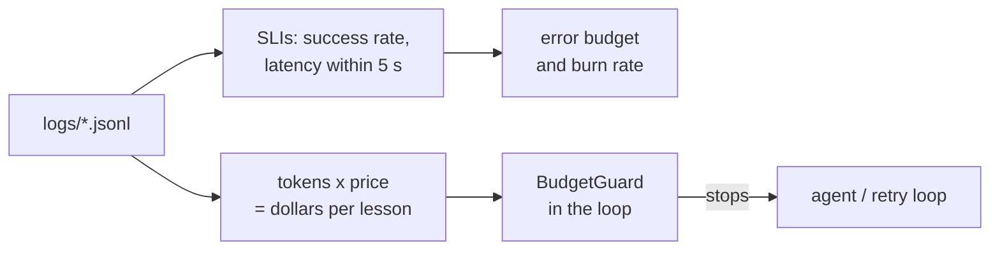

# 17.3 · Cost tracking, budgets and service-level objectives

**Module:** [17 · Monitoring, evaluation and fine-tuning](../README.md) · **Time:** 45-60 minutes · **Model needs:** chat · **Packages:** none beyond the base install (everything is computed from run logs; no service needed)

## What you will learn

- How to read the JSON-lines run logs that every lesson writes, and turn token counts into dollars.
- Why input and output tokens are priced separately and kept as separate columns.
- How to write a **budget guard** that stops a runaway loop, even when the endpoint reports no token usage.
- What an **SLI**, an **SLO**, an **error budget** and a **burn rate** are, and how to compute them from logs.
- Why percentiles and burn-rate alerts beat averages and raw error counts.

## The idea

**What is new since 17.2.** 17.2 charted live metrics. This lesson works from the other end: the raw log of what happened, offline. It adds two ideas that sit on top of metrics: a **budget** you enforce in code, and an **SLO** you measure against.

Every lesson run writes `logs/<time>-<lesson>.jsonl`. Three event types are enough for operations:

| Event | Fields used | Gives you |
| --- | --- | --- |
| `start` | `lesson` | who made the calls |
| `usage` | `reported`, `tokens_in`, `tokens_out` | cost |
| `wire` | `direction`, `summary`, `t` | latency (response `t` minus request `t`) and success (`200 OK`) |



**Cost.** dollars = tokens_in x price_in + tokens_out x price_out. The prices in these scripts are invented; use your provider's list. Input is usually most of the tokens (long prompts), output usually costs more per token.

**Budget guard.** A guard checks before each call and charges after it, with caps on dollars, tokens and calls. It is a second line of defence: the loop still has its own iteration cap. Caveat: the last allowed call can overshoot a cap, so leave headroom. When usage is missing it estimates tokens as characters divided by four, a rough rule that is better than not counting.

**SLOs.** An SLI is a measurement ("share of calls that succeeded"). An SLO is the target for it ("99%"). The **error budget** is what is left to fail: 1% of 759 calls is 7.6 failures. The **burn rate** is the observed failure share divided by the allowed share. At 1.0x you use the budget exactly over the window; at 14x you would burn a month of budget in about two days, which is worth waking someone for. Latency SLOs use percentiles ("95% of calls within 5 seconds"), because an average hides the slow tail.

## Scripts

### 1. `01_cost_from_logs.py` — cost per lesson from run logs

Run: `./run 17.3/1`. Makes two small calls (so the logs are never empty), reads every `*.jsonl` in the logs folder (`labkit.config.state_dir("logs")`), groups by lesson and prints a ranked table with totals. The numbers depend on what you have run on your machine.

**Expected output** (trimmed, real run on the author's full logs folder):

```text
Step 2: Read every run log
522 log file(s) in the logs folder.

Step 3: Group tokens and estimated dollars by lesson
lesson     runs calls tokens in tokens out   dollars
14.2/2        1     1     11403       4206  0.012011
01.7/3        8     8      7241       4044  0.009687
...
Step 4: Totals, and what the totals hide
1039 calls, 218593 tokens in, 69407 tokens out: about $0.213407 at the invented prices.
average per call: $0.0002054; input is 76% of all tokens.
1 call(s) reported no token counts, so the true spend is higher than shown. ...
```

### 2. `02_budget_guard.py` — stop a loop when the budget is spent

Run: `./run 17.3/2`. A `BudgetGuard` with deliberately small caps wraps a "make this reply friendlier" loop. `check()` runs before each call and raises `BudgetExceeded`; `charge()` runs after. With `--model no-usage` on the stub you can see it fall back to estimates.

**Expected output** (trimmed, real run):

```text
caps: $0.0005, 150 tokens, 6 calls. ...
iteration 1: 20 in + 33 out | left: $0.000441, 97 tokens, 5 calls
iteration 2: 49 in + 39 out | left: $0.000358, 9 tokens, 4 calls
iteration 3: 55 in + 46 out | left: $0.000261, 0 tokens, 3 calls
iteration 4: BLOCKED before calling the model: token cap reached (242/150)
3 calls, 242 tokens, about $0.000239. 0 call(s) were estimated ...
```

Note iteration 3 took the total from 97 left to over the cap: the guard stops the next call, not the current one. The run is a real example of why you leave headroom.

### 3. `03_slo_report.py` — SLIs, error budget and burn rate

Run: `./run 17.3/3`. Makes three real calls, pairs every request and response in the logs, computes availability and latency, and evaluates two SLOs (99% success, 95% within 5 seconds). A final what-if marks 3 calls failed; it is labelled SIMULATED in the output.

**Expected output** (trimmed, real run):

```text
759 calls found. Latency: median 1.47s, p95 2.68s, max 5.64s.
[real] 759 calls | availability 100.00% (SLO 99%) | within 5s 99.87% (SLO 95%)
    error budget: 7.6 failures allowed, 0 used, 7.6 left
    burn rate 0.00x (on track); ...
SLOs met.
What if? Simulate failures (NOT real data)
[simulated] 759 calls | availability 99.60% (SLO 99%) | within 5s 99.87% (SLO 95%)
    error budget: 7.6 failures allowed, 3 used, 4.6 left
    burn rate 0.40x (on track); ...
```

The logs record only calls that reached the endpoint as requests, so a failure before the request (a DNS error) is invisible here: another reason to also have live metrics (17.2).

## Try this

1. Change the invented prices in script 1 to a model that is ten times dearer on output. Which lesson becomes the most expensive?
2. In script 2, raise the token cap to 400 and lower the call cap to 3. Which cap fires first? Add a fourth cap: maximum seconds.
3. Make `charge()` use a cheaper price when the reply is short (a tiered price list). What new data would a real invoice need?
4. In script 3, change the latency threshold to 1 second. Does the SLO still hold? What would you tune first: the prompt, the model or the threshold?
5. Raise the simulated failures to 12. At what number does the burn rate pass 1.0x?
6. Write the budget guard's state to a JSON file between runs so the budget spans several runs. What breaks when two processes run at once?

## If it does not work

- Run `./run doctor`. These scripts need only a working endpoint (`.env`) and the base install.
- Empty tables: the logs folder is where `LABKIT_STATE_DIR` points (default: the repo's `logs/`). Run a few lessons first.
- "tokens not reported": your endpoint omits usage; the cost report says so and script 2 estimates from text length.
- No service is used in this lesson. To feed the same numbers to a hosted Prometheus or Grafana, use the counters from 17.2.

## In the running scenario

Larkspur Labs' finance lead asks what the helpdesk assistant costs per ticket and whether it is reliable enough to answer staff directly. Script 1 gives the per-ticket cost, script 2 stops a runaway reply loop at a fixed amount, and script 3 says "99% success, 95% under five seconds, 7.6 failures of budget left", the sentence that goes in the service agreement.

**Next:** 17.4 · Fine-tuning: when it is warranted; LoRA and QLoRA (planned)
