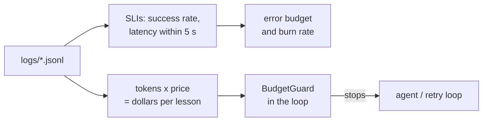

# 17.3 · Cost tracking, budgets and service-level objectives

**Module:** [17 · Monitoring, evaluation and fine-tuning](../README.md) · **Time:** 45-60 minutes · **Model needs:** chat · **Packages:** none beyond the base install (everything is computed from run logs; no service needed)

## What you will learn

- How to read the JSON-lines run logs that every lesson writes, and turn token counts into dollars.
- Why input and output tokens have separate prices and belong in separate columns.
- How to write a **budget guard** that stops a runaway loop, even when the endpoint reports no token usage.
- What an **SLI**, an **SLO**, an **error budget** and a **burn rate** are, and how to compute them from logs.
- Why percentiles and burn-rate alerts work better than averages and raw error counts.

## The idea

In 17.2 you charted live metrics. This lesson starts from the other end: the raw log of what happened, read offline. It adds two ideas on top of metrics. One is a **budget** that your code enforces. The other is an **SLO** that you measure against.

Every lesson run writes `logs/<time>-<lesson>.jsonl`. Three event types are enough for running the service day to day:

| Event | Fields used | Gives you |
| --- | --- | --- |
| `start` | `lesson` | who made the calls |
| `usage` | `reported`, `tokens_in`, `tokens_out` | cost |
| `wire` | `direction`, `summary`, `t` | latency (response `t` minus request `t`) and success (`200 OK`) |



### Cost

dollars = tokens_in x price_in + tokens_out x price_out. The prices in these scripts are made up, so use your provider's list. Most tokens are usually input, because prompts are long. Output usually costs more per token.

### Budget guard

A guard checks the budget before each call and adds the cost after it. It has caps on dollars, tokens and calls. It is a backup: the loop still has its own limit on how many times it runs.

One caveat: the last allowed call can go past a cap, so leave some headroom. When the endpoint reports no usage, the guard estimates tokens as characters divided by four. That is a rough rule, but it is better than not counting at all.

### SLOs

An SLI (service level indicator) is a measurement, such as "share of calls that succeeded". An SLO (service level objective) is the target for it, such as "99%". The **error budget** is how much failure you have left: 1% of 759 calls is 7.6 failures.

The **burn rate** is the share of calls that actually failed divided by the share you are allowed. At 1.0x you use up the budget exactly over the window. At 14x you would burn a month of budget in about two days, which is worth waking someone up for.

Latency SLOs use percentiles ("95% of calls within 5 seconds"), because an average hides the slowest calls.

## Scripts

### 1. `01_cost_from_logs.py`: cost per lesson from run logs

Run: `./run 17.3/1`. The script makes two small calls, so the logs are never empty. It reads every `*.jsonl` in the logs folder (`labkit.config.state_dir("logs")`), groups the calls by lesson and prints a ranked table with totals. Your numbers depend on what you have run on your machine.

**Expected output** (trimmed, real run on the author's full logs folder):

```text
Step 2: Read every run log
522 log file(s) in the logs folder.

Step 3: Group tokens and estimated dollars by lesson
lesson     runs calls tokens in tokens out   dollars
14.2/2        1     1     11403       4206  0.012011
01.7/3        8     8      7241       4044  0.009687
...
Step 4: Totals, and what the totals hide
1039 calls, 218593 tokens in, 69407 tokens out: about $0.213407 at the invented prices.
average per call: $0.0002054; input is 76% of all tokens.
1 call(s) reported no token counts, so the true spend is higher than shown. ...
```

### 2. `02_budget_guard.py`: stop a loop when the budget is spent

Run: `./run 17.3/2`. A `BudgetGuard` with small caps, chosen on purpose, wraps a "make this reply friendlier" loop. `check()` runs before each call and raises `BudgetExceeded` when a cap is reached. `charge()` runs after each call. With `--model no-usage` on the stub, you can watch it fall back to estimates.

**Expected output** (trimmed, real run):

```text
caps: $0.0005, 150 tokens, 6 calls. ...
iteration 1: 20 in + 33 out | left: $0.000441, 97 tokens, 5 calls
iteration 2: 49 in + 39 out | left: $0.000358, 9 tokens, 4 calls
iteration 3: 55 in + 46 out | left: $0.000261, 0 tokens, 3 calls
iteration 4: BLOCKED before calling the model: token cap reached (242/150)
3 calls, 242 tokens, about $0.000239. 0 call(s) were estimated ...
```

Look at iteration 3. It took the total from 97 tokens left to over the cap, because the guard stops the next call, not the current one. This real run shows why you leave headroom.

### 3. `03_slo_report.py`: SLIs, error budget and burn rate

Run: `./run 17.3/3`. The script makes three real calls and pairs every request with its response in the logs. It computes availability and latency and checks two SLOs: 99% success, and 95% within 5 seconds. A final what-if marks 3 calls as failed, and the output labels it SIMULATED.

**Expected output** (trimmed, real run):

```text
759 calls found. Latency: median 1.47s, p95 2.68s, max 5.64s.
[real] 759 calls | availability 100.00% (SLO 99%) | within 5s 99.87% (SLO 95%)
    error budget: 7.6 failures allowed, 0 used, 7.6 left
    burn rate 0.00x (on track); ...
SLOs met.
What if? Simulate failures (NOT real data)
[simulated] 759 calls | availability 99.60% (SLO 99%) | within 5s 99.87% (SLO 95%)
    error budget: 7.6 failures allowed, 3 used, 4.6 left
    burn rate 0.40x (on track); ...
```

The logs only record calls that reached the endpoint as requests. A failure before the request, such as a DNS error, does not show up here. That is one more reason to have live metrics too (17.2).

## Try this

1. Change the made-up prices in script 1 to a model that costs ten times more for output. Which lesson becomes the most expensive?
2. In script 2, raise the token cap to 400 and lower the call cap to 3. Which cap fires first? Add a fourth cap: maximum seconds.
3. Make `charge()` use a cheaper price when the reply is short (a tiered price list). What extra data would a real invoice need?
4. In script 3, change the latency threshold to 1 second. Does the SLO still hold? What would you tune first: the prompt, the model or the threshold?
5. Raise the simulated failures to 12. At what number does the burn rate go past 1.0x?
6. Save the budget guard's state to a JSON file between runs, so the budget covers several runs. What breaks when two processes run at once?

## If it does not work

- Run `./run doctor`. These scripts need only a working endpoint (`.env`) and the base install.
- If the tables are empty, check the logs folder. It is wherever `LABKIT_STATE_DIR` points (by default the repo's `logs/`). Run a few lessons first.
- "tokens not reported" means your endpoint leaves out usage. The cost report says so, and script 2 estimates from the text length.
- This lesson uses no service. To send the same numbers to a hosted Prometheus or Grafana, use the counters from 17.2.

## In the running scenario

The Larkspur Labs finance lead asks what the helpdesk assistant costs per ticket, and whether it is reliable enough to answer staff directly. Script 1 gives the cost per ticket. Script 2 stops a runaway reply loop at a fixed amount. Script 3 gives the sentence that goes in the service agreement: "99% success, 95% under five seconds, 7.6 failures of budget left".

**Next:** 17.4 · Fine-tuning: when it is warranted; LoRA and QLoRA (planned)
