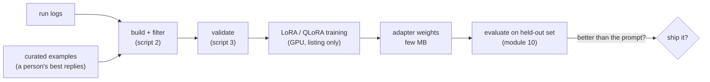

# 17.4 · Fine-tuning: when it is warranted; LoRA and QLoRA

**Module:** [17 · Monitoring, evaluation and fine-tuning](../README.md) · **Time:** 45-60 minutes · **Model needs:** none (no model call, no GPU) · **Packages:** none beyond the base install. The training code in this README needs a GPU and packages this course does not install; it is shown as a listing only.

## What you will learn

- The ladder of options to try before fine-tuning, and what fine-tuning is good and bad at.
- A break-even calculation, and why cost alone rarely justifies a tuned model.
- How LoRA and QLoRA work, with real arithmetic: how few parameters get trained and how little memory the base model needs.
- How to build a chat-format training file from curated examples and run logs, with filters and a split that cannot leak.
- How to check a dataset before you pay for training.

## The idea

In 17.3 you measured the cost and reliability of an assistant that already works. This lesson asks the next question: could a tuned model do the job better or cheaper, and what would you need to find out first? Nothing is trained here. The lesson stops where a GPU would take over.

Fine-tuning means training a model further on your own examples, so its weights (the numbers inside the model) change. It is good at teaching **behaviour**: a fixed tone, an exact output format, a narrow classification habit, or working from a shorter prompt. It is bad at teaching **facts**, because facts go stale and the model can still make things up. Facts belong in retrieval (modules 03-04).

Try the cheaper steps first: a better prompt, few-shot examples, retrieval, tools and structured output, then a stronger model. Script 1 prints this ladder and a checklist.

### How LoRA and QLoRA keep it cheap

**LoRA** (low-rank adaptation) freezes the base weights and learns a small correction for a few chosen matrices. Changing a weight matrix of size d x k directly would take d x k new numbers. LoRA instead learns two thin matrices, B (d x r) and A (r x k), with a small rank r such as 8. The update is B x A.

For a 4096 x 4096 matrix at rank 8, that is 65,536 weights instead of 16,777,216. Across a 7B-parameter model, adapting two matrices in each of 32 layers trains about 4 million weights, or 0.06%. The resulting adapter file is a few megabytes, and you can keep one per task.

**QLoRA** also stores the frozen base in 4-bit numbers. Then 7 billion weights need about 3.5 GB instead of 14 GB, which is how people tune a 7B model on one consumer GPU.



The data decides the result. Aim for hundreds of reviewed, consistent examples rather than thousands of noisy ones. Replies taken from run logs are the model's own output. Use them only after a person has reviewed them, and keep a source label on each so you can drop them later.

## Scripts

### 1. `01_when_to_fine_tune.py`: ladder, break-even and LoRA arithmetic

Run: `./run 17.4/1`. No model call. The script prints the ladder, a checklist of reasons to fine-tune the helpdesk assistant, and a break-even calculation with made-up prices and volumes (edit the constants at the top). It ends with the LoRA and QLoRA numbers above.

**Expected output** (trimmed, real run):

```text
Step 2: Warrant checklist: answer these about the helpdesk assistant
[x] Prompting and few-shot were tried and measured (module 10 eval set)
[ ] You have 500+ clean, reviewed examples
...
Step 3: Break-even: does a shorter prompt repay the training?
today:  900 prompt tokens x 400000 tickets = $216.00 per month
tuned:  120 prompt tokens, price x1.5 = $90.00 per month
saving: $126.00 per month
Training $400 now plus 2 retrains a year = $1,200 in year one; it pays back in 9.5 months.
Step 4: Why LoRA is cheap: count the trainable parameters
one 4096x4096 attention matrix: 16,777,216 weights
its LoRA update at rank 8: 65,536 weights (0.39%)
adapter over 32 layers x 2 matrices: 4,194,304 weights = 0.060% of the 7B model
Step 5: Why QLoRA fits on one GPU: memory for the frozen weights
base weights at 16-bit: 14.0 GB   at 4-bit (QLoRA): 3.5 GB
```

### 2. `02_build_dataset.py`: build the training files

Run: `./run 17.4/2`. The script loads `curated_examples.json` (24 invented tickets with ideal replies) and collects helpdesk-style calls from your run logs. It drops text that looks like personal data, duplicates, and examples that are too short or too long. It splits train and validation by a hash of the ticket text, and writes `train.jsonl` and `validation.jsonl` to a temporary folder. Your counts depend on your logs.

**Expected output** (trimmed, real run on the author's logs folder):

```text
24 curated examples written by a person, one JSON object per ticket.
552 log file(s) read; 380 helpdesk-style single-turn calls found.
kept 129 of 404
  dropped 188: duplicate ticket text
  dropped  64: ticket text too short or too long
  dropped  17: reply too short or too long
  dropped   6: looks like personal data or a key
train 98, validation 31. ...
train.jsonl: 98 lines, 56903 bytes
validation.jsonl: 31 lines, 16879 bytes
sources kept: {'curated': 24, 'log': 105}
```

### 3. `03_validate_dataset.py`: catch problems before training

Run: `./run 17.4/3`. The script writes a clean dataset and shows the validator passing it. Then it plants six defects and checks that each one is reported with its line number. The defects are: truncated JSON, an unknown role, no assistant answer, a duplicate, an email address, and a validation ticket leaked into training. Finally it shows the category balance and a token estimate.

**Expected output** (trimmed, real run):

```text
train: no problems
validation: no problems
  line 2: not valid JSON
  line 3: unknown role in ['user', 'robot']
  line 4: the last message must be the assistant's answer (the training target)
  line 5: duplicate of line 1
  line 6: contains an email, phone number or key-like string
  line 18: this ticket also appears in the other split (leakage)
6 problems reported (6 planted: 5 defects above plus the leakage line).
PASS: the validator caught what we planted.
```

## The training code (listing only, NOT run)

This sketch shows what comes next, on a machine with a GPU, after `pip install transformers peft trl bitsandbytes datasets accelerate`. **It was not run here.** There is no GPU, and this course does not install these packages. Library APIs also change between versions, so treat it as a map and check each library's current docs.

```python
# NOT RUN. QLoRA fine-tuning of a small open model on train.jsonl / validation.jsonl.
import torch
from datasets import load_dataset
from peft import LoraConfig
from transformers import AutoModelForCausalLM, AutoTokenizer, BitsAndBytesConfig
from trl import SFTConfig, SFTTrainer

BASE = "your-open-model-name"                      # any causal LM you may legally tune

bnb = BitsAndBytesConfig(                          # QLoRA: the frozen base in 4-bit
    load_in_4bit=True, bnb_4bit_quant_type="nf4",
    bnb_4bit_compute_dtype=torch.bfloat16,
)
model = AutoModelForCausalLM.from_pretrained(BASE, quantization_config=bnb, device_map="auto")
tokenizer = AutoTokenizer.from_pretrained(BASE)

lora = LoraConfig(                                 # LoRA: which matrices, what rank
    r=8, lora_alpha=16, lora_dropout=0.05,
    target_modules=["q_proj", "v_proj"], task_type="CAUSAL_LM",
)

data = load_dataset("json", data_files={"train": "train.jsonl", "validation": "validation.jsonl"})
trainer = SFTTrainer(
    model=model, peft_config=lora, processing_class=tokenizer,
    train_dataset=data["train"], eval_dataset=data["validation"],
    args=SFTConfig(output_dir="larkspur-adapter", num_train_epochs=3,
                   per_device_train_batch_size=4, learning_rate=2e-4, eval_strategy="epoch"),
)
trainer.train()
trainer.save_model("larkspur-adapter")             # saves only the adapter: a few MB
```

Read it line by line. `BitsAndBytesConfig` is the "Q" in QLoRA. `LoraConfig` is the "LoRA" part (rank `r` and the target matrices). The validation file lets you spot overfitting (the model memorising its training data): the eval loss rises while the training loss falls. `save_model` stores only the adapter. Hosted services (a provider's fine-tuning API) take the same `train.jsonl` and hide all of this from you.

## Try this

1. In script 1, set `RANK` to 64. What share of the model is trained now? What do you gain, and what do you risk, with a higher rank?
2. Set `TICKETS_PER_MONTH` to 40,000, then to 4,000. At what volume does cost stop being a reason?
3. Add one more filter to script 2: drop examples whose reply starts with "Sorry". What does that remove, and is that what you wanted?
4. Remove the `_source` handling so log replies are labelled `curated`. Why is that dangerous when the logged replies are the model's own?
5. Add a validator check to script 3 that rejects replies longer than 60 words, then run it on the clean file. Does your gold data pass?
6. Write ten new tickets in a category the data lacks (for example `other`) and watch the balance chart change.

## If it does not work

- Run `./run doctor`. These scripts need only the base install, with no extras and no services.
- On a fresh machine, script 2 finds few log examples. That is expected, and the curated file still gives you 24. Run a few helpdesk lessons first.
- Script 2 writes to a temporary folder and prints its path in the `folder:` line. Copy the files out to keep them, or change `tempfile.mkdtemp` to a path you choose.
- To actually train, use a GPU machine or a notebook service, and check the PEFT, TRL and Transformers docs for the current argument names. Use `pip`/`uv` in a separate environment, not this course's.
- This lesson uses no service.

## In the running scenario

Larkspur Labs asks whether the helpdesk assistant should be fine-tuned to answer in the house tone from a short prompt. The checklist says not yet, because two boxes are still open: there are not enough reviewed examples, and the policies are still changing. The useful result is the reviewed, validated dataset and the held-out evaluation set (module 10). They are worth having whichever way the decision goes.

**Next:** 17.5 · Capstone: a monitored helpdesk assistant (planned)
