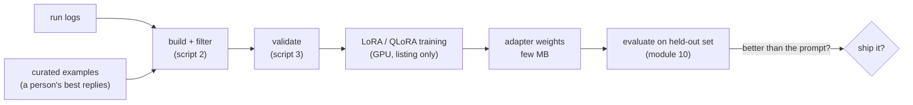

# 17.4 · Fine-tuning: when it is warranted; LoRA and QLoRA

**Module:** [17 · Monitoring, evaluation and fine-tuning](../README.md) · **Time:** 45-60 minutes · **Model needs:** none (no model call, no GPU) · **Packages:** none beyond the base install. The training code in this README needs a GPU and packages this course does not install; it is shown as a listing only.

## What you will learn

- The ladder of options to climb before fine-tuning, and what fine-tuning is (and is not) good for.
- A break-even calculation, and why cost alone rarely justifies a tuned model.
- LoRA and QLoRA intuition with real arithmetic: how few parameters are trained and how little memory the base needs.
- How to build a chat-format training file from curated examples and run logs, with filters and a leak-proof split.
- How to validate a dataset before paying for training.

## The idea

**What is new since 17.3.** 17.3 measured cost and reliability of an assistant that already works. This lesson asks the next question: could a tuned model do the job better or cheaper, and what would you need to find out? Nothing here is trained; the lesson ends where a GPU would take over.

Fine-tuning continues training a model on your examples so its weights change. It is good at **behaviour**: a fixed tone, an exact output format, a narrow classification habit, shorter prompts. It is bad at **facts**: they go stale, and the model can still make things up. Facts belong in retrieval (modules 03-04). Try cheaper rungs first: a better prompt, few-shot examples, retrieval, tools and structured output, a stronger model. Script 1 prints the ladder and a checklist.

**LoRA** (low-rank adaptation) freezes the base weights and learns a small correction for chosen matrices. A weight matrix of size d x k would need d x k new numbers to change; LoRA learns two thin matrices, B (d x r) and A (r x k), with a small rank r such as 8, and the update is B x A. For a 4096 x 4096 matrix at rank 8 that is 65,536 weights instead of 16,777,216. Over a 7B-parameter model, adapting two matrices in each of 32 layers trains about 4 million weights, 0.06%. The adapter file is a few megabytes and you can keep one per task. **QLoRA** also stores the frozen base in 4-bit, so 7 billion weights need about 3.5 GB instead of 14 GB, which is how a 7B model is tuned on one consumer GPU.



Data decides the result. Aim for hundreds of reviewed, consistent examples, not thousands of noisy ones. Replies taken from run logs are the model's own output; use them only after a person has reviewed them, and keep a source label so you can drop them.

## Scripts

### 1. `01_when_to_fine_tune.py` — ladder, break-even and LoRA arithmetic

Run: `./run 17.4/1`. No model call. Prints the ladder, a warrant checklist for the helpdesk assistant, a break-even with invented prices and volumes (edit the constants at the top), and the LoRA and QLoRA numbers above.

**Expected output** (trimmed, real run):

```text
Step 2: Warrant checklist: answer these about the helpdesk assistant
[x] Prompting and few-shot were tried and measured (module 10 eval set)
[ ] You have 500+ clean, reviewed examples
...
Step 3: Break-even: does a shorter prompt repay the training?
today:  900 prompt tokens x 400000 tickets = $216.00 per month
tuned:  120 prompt tokens, price x1.5 = $90.00 per month
saving: $126.00 per month
Training $400 now plus 2 retrains a year = $1,200 in year one; it pays back in 9.5 months.
Step 4: Why LoRA is cheap: count the trainable parameters
one 4096x4096 attention matrix: 16,777,216 weights
its LoRA update at rank 8: 65,536 weights (0.39%)
adapter over 32 layers x 2 matrices: 4,194,304 weights = 0.060% of the 7B model
Step 5: Why QLoRA fits on one GPU: memory for the frozen weights
base weights at 16-bit: 14.0 GB   at 4-bit (QLoRA): 3.5 GB
```

### 2. `02_build_dataset.py` — build the training files

Run: `./run 17.4/2`. Loads `curated_examples.json` (24 invented tickets with ideal replies), harvests helpdesk-style calls from your run logs, drops personal-data-like text, duplicates and extreme lengths, splits train and validation by a hash of the ticket text, and writes `train.jsonl` and `validation.jsonl` to a temporary folder. The counts depend on your logs.

**Expected output** (trimmed, real run on the author's logs folder):

```text
24 curated examples written by a person, one JSON object per ticket.
552 log file(s) read; 380 helpdesk-style single-turn calls found.
kept 129 of 404
  dropped 188: duplicate ticket text
  dropped  64: ticket text too short or too long
  dropped  17: reply too short or too long
  dropped   6: looks like personal data or a key
train 98, validation 31. ...
train.jsonl: 98 lines, 56903 bytes
validation.jsonl: 31 lines, 16879 bytes
sources kept: {'curated': 24, 'log': 105}
```

### 3. `03_validate_dataset.py` — catch problems before training

Run: `./run 17.4/3`. Writes a clean dataset, shows the validator passing it, plants six defects (truncated JSON, an unknown role, no assistant answer, a duplicate, an email address, a validation ticket leaked into training) and checks each is reported with its line number. Finally shows the category balance and a token estimate.

**Expected output** (trimmed, real run):

```text
train: no problems
validation: no problems
  line 2: not valid JSON
  line 3: unknown role in ['user', 'robot']
  line 4: the last message must be the assistant's answer (the training target)
  line 5: duplicate of line 1
  line 6: contains an email, phone number or key-like string
  line 18: this ticket also appears in the other split (leakage)
6 problems reported (6 planted: 5 defects above plus the leakage line).
PASS: the validator caught what we planted.
```

## The training code (listing only, NOT run)

This is a sketch of what comes next, on a machine with a GPU after `pip install transformers peft trl bitsandbytes datasets accelerate`. **It was not run here** (no GPU, and these packages are not installed by this course), and library APIs change between versions, so treat it as a map and check each library's current docs.

```python
# NOT RUN. QLoRA fine-tuning of a small open model on train.jsonl / validation.jsonl.
import torch
from datasets import load_dataset
from peft import LoraConfig
from transformers import AutoModelForCausalLM, AutoTokenizer, BitsAndBytesConfig
from trl import SFTConfig, SFTTrainer

BASE = "your-open-model-name"                      # any causal LM you may legally tune

bnb = BitsAndBytesConfig(                          # QLoRA: the frozen base in 4-bit
    load_in_4bit=True, bnb_4bit_quant_type="nf4",
    bnb_4bit_compute_dtype=torch.bfloat16,
)
model = AutoModelForCausalLM.from_pretrained(BASE, quantization_config=bnb, device_map="auto")
tokenizer = AutoTokenizer.from_pretrained(BASE)

lora = LoraConfig(                                 # LoRA: which matrices, what rank
    r=8, lora_alpha=16, lora_dropout=0.05,
    target_modules=["q_proj", "v_proj"], task_type="CAUSAL_LM",
)

data = load_dataset("json", data_files={"train": "train.jsonl", "validation": "validation.jsonl"})
trainer = SFTTrainer(
    model=model, peft_config=lora, processing_class=tokenizer,
    train_dataset=data["train"], eval_dataset=data["validation"],
    args=SFTConfig(output_dir="larkspur-adapter", num_train_epochs=3,
                   per_device_train_batch_size=4, learning_rate=2e-4, eval_strategy="epoch"),
)
trainer.train()
trainer.save_model("larkspur-adapter")             # saves only the adapter: a few MB
```

Read it line by line: `BitsAndBytesConfig` is the "Q" in QLoRA, `LoraConfig` is the "LoRA" (rank `r`, target matrices), the validation file lets you see overfitting as the eval loss rises while the training loss falls, and `save_model` stores just the adapter. Hosted services (a provider's fine-tuning API) take the same `train.jsonl` and hide all of this.

## Try this

1. In script 1 set `RANK` to 64. What fraction of the model is trained now? What do you gain and risk with a higher rank?
2. Set `TICKETS_PER_MONTH` to 40,000, then to 4,000. At what volume does cost stop being a reason?
3. Add one more filter to script 2: drop examples whose reply starts with "Sorry". What does that remove, and is that what you wanted?
4. Remove the `_source` handling so log replies are labelled `curated`. Why is that dangerous when the logged replies are the model's own?
5. Add a validator check to script 3 that rejects replies longer than 60 words, then run it on the clean file. Does your gold data pass?
6. Write ten new tickets in a category the data lacks (for example `other`) and watch the balance chart change.

## If it does not work

- Run `./run doctor`. These scripts need only the base install; no extras, no services.
- Script 2 finds few log examples on a fresh machine: that is expected, the curated file still gives 24. Run a few helpdesk lessons first.
- Script 2 writes to a temporary folder and prints its path in the `folder:` line; copy the files out to keep them, or change `tempfile.mkdtemp` to a path you choose.
- To actually train: use a GPU machine or a notebook service, then check the PEFT, TRL and Transformers documentation for current argument names. Use `pip`/`uv` in a separate environment, not this course's.
- No service is used in this lesson.

## In the running scenario

Larkspur Labs asks whether the helpdesk assistant should be fine-tuned to answer in the house tone with a short prompt. The checklist says not yet: two boxes are open (not enough reviewed examples, policies still changing). The useful output is the reviewed, validated dataset and the held-out evaluation set (module 10), which are worth having whichever way the decision goes.

**Next:** 17.5 · Capstone: a monitored helpdesk assistant (planned)
