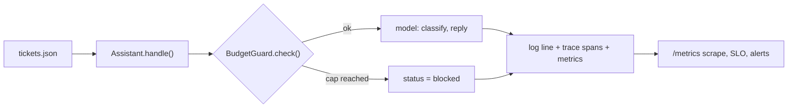

# 17.5 · Capstone: a monitored helpdesk assistant

**Module:** [17 · Monitoring, evaluation and fine-tuning](../README.md) · **Time:** 45-60 minutes · **Model needs:** chat · **Packages:** `observability` extra (`opentelemetry-sdk`, `opentelemetry-exporter-otlp-proto-http`, `prometheus-client`; install with `./setup.sh --all`) · **Services (optional):** Jaeger (`OTEL_EXPORTER_OTLP_ENDPOINT`) for script 3

## What you will learn

- How to combine logs, traces, metrics and a budget guard around one small assistant.
- How to make a budget stop a degrade (a `blocked` status), not a crash.
- How to check acceptance criteria for an operated service, and evaluate alert rules on scraped metrics.

## The idea

**What is new since 17.4.** Nothing new is introduced: this capstone combines 17.1 (logs, traces), 17.2 (served and scraped metrics, same names as the dashboard), and 17.3 (budget guard, SLO). 17.4's lesson applies to what you would do next: the logs these scripts produce are the raw material for a dataset.

**The brief.** The Larkspur Labs helpdesk assistant classifies a ticket and replies (two model calls). Make it operable: whoever is on call must be able to see what happened, how much it cost, and be protected from a runaway bill.

**Acceptance criteria.**

1. Every ticket produces a JSON log line with a trace id, and one trace with `classify` and `reply` spans.
2. Metrics `helpdesk_requests_total`, `_llm_latency_seconds`, `_llm_tokens_total`, `_llm_cost_dollars_total` and `helpdesk_budget_remaining_dollars` are exposed and match the 17.2 dashboard.
3. A budget guard checks before each model call; an exhausted budget gives status `blocked`, never an exception to the caller, and no call is made.
4. Blocked tickets are visible in metrics and alertable.
5. Availability on attempted tickets meets a 99% SLO.

**Stretch goals.** Run Jaeger (17.1) and set `OTEL_EXPORTER_OTLP_ENDPOINT` so script 3 exports the traces. Serve on port 8000 with the 17.2 compose stack and watch the dashboard. Turn the alert rules into a Prometheus rules file. Add a cheaper-model fallback when the budget is 80% spent.



## Scripts

All three contain the same `Assistant` wrapper (lessons never import each other); read it in script 1.

### 1. `01_monitored_assistant.py` — the wrapper and its three outputs

Run: `./run 17.5/1`. Handles six tickets with a comfortable budget, then prints log lines, one trace and the metrics.

**Expected output** (trimmed, real run):

```text
LL-3001  network   ok       2.9s  I have logged a ticket regarding the unstable Wi-Fi in meeting room 3B
...
{"category": "network", "event": "ticket", "id": "LL-3001", "seconds": 2.9, "status": "ok", "trace_id": "c7984e297394582fd7ecc5b4b339ea62"}
- handle_ticket (2895 ms) ticket.category=network, ticket.status=ok
  - classify (1582 ms) llm.tokens.in=47, llm.tokens.out=1, ticket.category=network
  - reply (1313 ms) llm.tokens.in=41, llm.tokens.out=42
helpdesk_requests_total{category="network",status="ok"} 1.0
helpdesk_llm_latency_seconds_count 12.0
helpdesk_llm_tokens_total{direction="in"} 448.0
helpdesk_llm_cost_dollars_total 0.0006259999999999999
helpdesk_budget_remaining_dollars 0.009374
6 of 6 tickets ok.
```

### 2. `02_budget_and_slo.py` — the budget runs out; acceptance criteria

Run: `./run 17.5/2`. A cap of 5 model calls cannot cover six tickets. The guard blocks the rest and the script prints PASS/FAIL per criterion.

**Expected output** (trimmed, real run):

```text
LL-3001  ok       network
LL-3002  ok       hardware
LL-3003  blocked  access
LL-3004  blocked  other
LL-3005  blocked  other
LL-3006  blocked  other
tickets by status: {'ok': 2.0, 'error': 0.0, 'blocked': 4.0}
model calls made: 5 (cap 5); spend $0.000226; budget gauge 0.999774
PASS  every ticket produced a record and none crashed
PASS  one trace per ticket
PASS  the guard stopped the calls at its cap
PASS  blocked tickets are visible in metrics
PASS  availability meets the SLO on attempted tickets
```

Ticket 3 was classified (call 5) but its reply was blocked, so it is `blocked` with category `access`; the others never called the model and fall back to `other`.

### 3. `03_serve_scrape_and_alert.py` — scrape and alert

Run: `./run 17.5/3`. Runs the batch, serves metrics on a free loopback port, scrapes them with `urllib`, and evaluates three alert rules with the PromQL beside each. If `OTEL_EXPORTER_OTLP_ENDPOINT` is reachable it also exports traces; otherwise it says so and continues (exit 0, no service required).

**Expected output** (trimmed, real run, no Jaeger):

```text
No (OTEL_EXPORTER_OTLP_ENDPOINT is not set). Traces stay in memory only. ...
scraped 43 lines from http://127.0.0.1:63224/metrics
quiet   error ratio above 5%
quiet   a ticket was blocked by the budget
quiet   less than 20% of the budget left
6 tickets, 0 errors, 0 blocked, $0.009374 budget left.
Done. Metrics were scraped over HTTP; traces were kept in memory.
```

With Jaeger running you would also see "exporting traces to the OTLP endpoint" and find service `larkspur-helpdesk` in its UI (described, not run here).

## Try this

1. In script 2 change the call cap to 8. How many tickets are blocked now? Is it the same ones?
2. Make a model error: use `--model` with a name the endpoint lacks. Which status and alert does it produce?
3. Add a `model` label to the request counter. What does it do to the number of series?
4. Make the guard read a monthly spend from a file so budgets persist across runs.
5. Add a fourth alert: p95 latency above 5 seconds, computed from the histogram buckets.
6. Use the logs these scripts wrote as input to 17.4/2 and see what the dataset builder keeps.

## If it does not work

- Run `./run doctor` and install the extra with `./setup.sh --all`.
- Script 3 exports traces only if `OTEL_EXPORTER_OTLP_ENDPOINT` is set and reachable (start Jaeger with the compose file from 17.1, or point it at a cloud collector in `.env`; 4318 is the HTTP port).
- A FAIL on the availability line means a call errored; check the error type on the trace's root span.
- Slow runs: each ticket makes two sequential model calls.

## In the running scenario

The assistant is now something you can operate: a log line, a trace and metrics per ticket, a hard stop on spend, and alert rules that say when to wake someone. That is the evidence a team needs before letting it answer staff directly.

**Next:** 18.1 · The risk landscape and prompt injection (planned)
