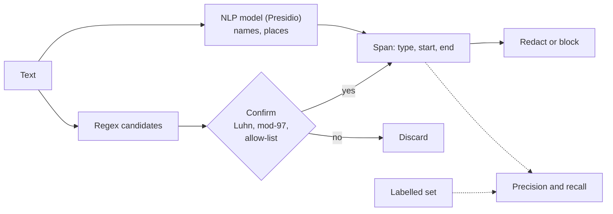

# 18.3 · Validators and detecting personal data

**Module:** [18 · Guardrails and safety](../README.md) · **Time:** 45-60 minutes · **Model needs:** chat · **Packages:** `guardrails` extra (Presidio), used only in the optional part of script 3

## What you will learn

- Why a regex alone over-matches, and how a confirmation step (Luhn, mod-97, allow-list) fixes it.
- How to return **spans** instead of yes/no, so you can redact precisely.
- How to measure a detector: true positives, false positives, misses, precision and recall.
- How to validate structured model output in three layers: parse, shape, content.
- What NLP-based detection (Presidio) adds, and what it costs (a ~380 MB download, tuning).

## The idea

**What is new since 18.2:** the engine of 18.2 was general; here the validators inside it get serious. A validator should (1) find candidates, (2) confirm them cheaply, (3) say where, and (4) be **measured** on labelled data, because "it seems to work" is how false alarms and leaks reach production.



A **false positive** blocks a legitimate ticket (for example an order number that happens to be 16 digits). A **miss** lets personal data out. You trade one against the other, so you need both numbers.

In Guardrails AI terms the detectors here are validators (its hub has ready-made PII validators); Presidio is the engine many of them wrap. Neither framework is installed.

## Scripts

Run all with `./run 18.3` (Windows: `run 18.3`), or one at a time.

### 1. `01_pii_validators.py`: regex finds, checksums confirm

```
./run 18.3/1
```

Detectors for email, phone, card (Luhn), IBAN (mod-97) and a UK National Insurance number, with an allow-list for public mailboxes. Returns spans, redacts, then scores itself on ten labelled sentences, and again with the confirmations switched off. No model call.

**Expected output** (trimmed):

```
detect()
  "spans": ["EMAIL [7:34] priya.nair@larkspur.example", "PHONE [36:51] +44 7700 900123", "CARD [63:82] 4111 1111 1111 1111"]
redact()
  "out": "Priya ([EMAIL], [PHONE]) paid with [CARD]."
  valid Luhn     4111111111111111  luhn_ok=True
  one digit off  4111111111111112  luhn_ok=False
  DIFF expect=['ADDRESS', 'PERSON']    got=[]   Hi, this is Priya Nair and I live at 12 Mill
  true positives 5, false positives 0, misses 2  ->  precision 1.00, recall 0.71
  naive: true positives 5, false positives 5, misses 2  ->  precision 0.50, recall 0.71
```

Same recall, half the false alarms. The two misses are a name and an address: regexes cannot see them.

### 2. `02_validated_structured_output.py`: three validation layers

```
./run 18.3/2
```

First the pydantic validator is run on four fixed replies (valid, summary with an email, bad id and category, not JSON). Then the model summarises a ticket that contains a name, email and phone for a **public dashboard**; the reply is parsed, shape-checked and scanned for personal data, with at most one re-ask.

**Expected output** (trimmed):

```
"summary: Value error, summary contains personal data: EMAIL 'priya.nair@larkspur.example'"
"ticket_id: Value error, ticket_id must look like LL-12345",
"category: Value error, category must be one of network|hardware|software|access|other"
attempt 1
  "reply": "{\"ticket_id\": \"LL-20931\", \"category\": \"hardware\", \"summary\": \"The user's laptop is failing to boot following a recent system update.\"}",
  "valid": true
  Accepted: {'ticket_id': 'LL-20931', ...}
Run summary: 1 model call(s), 115 in + 40 out = 155 tokens
```

On the author's run the model kept the personal data out by itself, so the re-ask path did not fire live. The validator is the safety net for the run where it does not (it is exercised on the fixed strings). On a stub or weak model you will see the "cap reached, human queue" branch.

### 3. `03_regex_vs_presidio_optional.py`: regex against Presidio on a labelled set

```
./run 18.3/3                              # safe default: no download
LABKIT_ALLOW_DOWNLOADS=1 ./run 18.3/3     # opt in (Windows PowerShell: $env:LABKIT_ALLOW_DOWNLOADS=1; run 18.3/3)
```

**Warning: the default Presidio engine downloads a ~380 MB spaCy model (`en_core_web_lg`) on first use.** The script only runs Presidio when `LABKIT_ALLOW_DOWNLOADS=1` is set; the opt-in code path was **not run** by the author for this lesson, so there is no pasted Presidio output here. Without the opt-in it scores the regex detector on a five-sentence answer key and exits 0. Needs the `guardrails` extra (`./setup.sh --all`) for the opt-in part.

**Expected output without opt-in** (trimmed):

```
Step 2: Regex detector on the labelled set (always runs)
  regex: true positives 3, false positives 0, misses 4  ->  precision 1.00, recall 0.43
    missed: [('PERSON', 'Priya Nair')]
    missed: [('LOCATION', 'Leeds'), ('PERSON', 'Ana Costa')]
Step 3: Presidio part skipped (not opted in)
  To run it:  LABKIT_ALLOW_DOWNLOADS=1 ./run 18.3/3
```

With the opt-in the script prints a second line for Presidio and a third for the union of both, so you can compare. In 18.1/3 the real Presidio run on the author's machine missed a name and an email with default settings and mislabelled a street as a person: expect to tune thresholds and recognisers, and measure on your own tickets.

## Try this

1. Add a detector for your own ID format (for example `LL-` followed by five digits is an asset tag, not personal data: write the test cases first).
2. Add an allow-list entry to `ALLOW_EMAILS` and a sentence to the labelled set that proves it works.
3. Add five harder sentences to `LABELLED` (spaces in phone numbers, an email in angle brackets) and watch precision and recall move.
4. In 18.3/2, change the ticket so the model is likely to copy the email into the summary. Does the re-ask fix it?
5. Change `score_threshold` in 18.3/3 (opt-in) from 0.4 to 0.2 and 0.7. What happens to false positives?
6. Decide for the helpdesk: block, fix or noop on a detected phone number in a reply? Defend it.

## If it does not work

- Run `./run doctor` to check settings and installed extras.
- Presidio part: install with `./setup.sh --all`. The first opt-in run downloads ~380 MB; offline or behind a proxy it will fail: skip it, the rest does not need it.
- If a reply is not valid JSON, that is an outcome the script reports (and re-asks), not a crash.
- No external service is needed.

## In the running scenario

Larkspur Labs wants a public "recent incidents" dashboard built from tickets. Tickets contain names, emails and phone numbers. The validators here are the gate in front of that dashboard: reject or redact, and keep the measured precision and recall so you know what the gate really does.

**Next:** 18.4 · Red-teaming a safety stack
