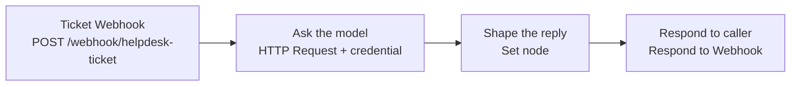

# 19.1 · n8n concepts: workflows, nodes, triggers, credentials

**Module:** [19 · Workflow automation with n8n](../README.md) · **Time:** 45-60 minutes · **Model needs:** none for scripts 1 and 3; chat for script 2 (n8n itself would call the model; the scripts do not need one for the workflow) · **Packages:** none beyond the base install · **Service (optional):** `N8N_URL`, only for script 3

## What you will learn

- What n8n is: a workflow automation tool where a **workflow** is a graph of **nodes** that starts at a **trigger**.
- How a workflow is stored: a JSON document of nodes plus a `connections` map, which you can read with plain Python.
- **Credentials** (secrets stored encrypted by n8n, referenced by name) and **expressions** (`{{ ... }}` snippets that pull data from earlier nodes).
- The difference between **test** and **production** webhook URLs.
- How to self-host n8n with Docker and why the **encryption key** matters.
- When n8n is the right tool and when plain code is.

## The idea

n8n is a workflow tool. You draw a graph on a canvas; each box is a **node** that does one thing (receive a request, call an HTTP API, reshape data, send an email). Data flows along the arrows as a list of **items** (JSON objects). Every workflow begins with exactly one **trigger** node: a webhook that waits for a POST, a cron schedule, a new email, and so on.

Key vocabulary:

- **Node**: one step. It has a `type` such as `n8n-nodes-base.httpRequest`, a `typeVersion`, and `parameters`.
- **Trigger**: the node that starts a run. Without a trigger a workflow only runs when you press Execute.
- **Connections**: the arrows. In the file they are a map keyed by the *source node's name*.
- **Credentials**: logins and API keys. You create them once in the n8n UI; they are encrypted in n8n's database with `N8N_ENCRYPTION_KEY`. A node only stores a *reference* (id and name), so the exported workflow contains no secret.
- **Expressions**: a value starting with `=` and containing `{{ ... }}` is evaluated at run time. `$json` is the current item, so `{{ $json.body.ticket }}` is the `ticket` field of the webhook body. `$('Node name').item.json` reaches back to an earlier node.

The workflow shipped in this lesson, `helpdesk-ticket-workflow.json`:



The webhook is set to respond "using the Respond to Webhook node", so the caller waits until the last node answers.

### Test versus production URLs

Every Webhook node has two URLs:

| | Test URL | Production URL |
|---|---|---|
| Path | `/webhook-test/helpdesk-ticket` | `/webhook/helpdesk-ticket` |
| Works when | you clicked "Listen for test event" in the editor | the workflow is saved and **Active** |
| Listens | once, then stops | always |
| Shows data | in the editor, for debugging | in the Executions list |

A 404 from one of them almost always means you used the wrong one for the state of the workflow.

### Error handling, retries and cron (conceptual)

- Each node has settings, including **Retry On Fail** (with max tries and wait between tries). The shipped workflow turns it on for the model call, because model endpoints fail transiently.
- A workflow can name an **Error Workflow** that runs when any execution fails, typically to notify someone.
- The **Schedule Trigger** (cron) node starts a workflow on a timetable, for example "every weekday at 08:00 summarise open tickets". Lesson 19.3 goes deeper.

### Agents and webhooks

n8n and your own agent code meet over HTTP. An n8n workflow can call your agent's API with an HTTP Request node, and your agent can trigger a workflow by POSTing to its webhook (script 3 does the second one). Lessons 19.2 and 19.3 go further.

## Files in this folder

- `helpdesk-ticket-workflow.json`: an n8n workflow export **written by hand**. It uses the real workflow JSON structure and current node types, but it has **not been tested against a live n8n here** (n8n is not installed on the author's machine). If the import complains, fix the node in the editor and compare; that is a legitimate part of the lesson.
- `docker-compose.yml`: runs n8n (pinned image tag, port bound to `127.0.0.1`, a named volume for data). **Verified by structure checks only, not run on the author's machine.**

## Self-hosting with Docker

n8n encrypts stored credentials with `N8N_ENCRYPTION_KEY`. If you do not set it, n8n invents one and stores it in its data volume; if you later lose the volume or move to a new container, every saved credential becomes unreadable. So set your own, keep it in a password manager, and never put it in a file you commit.

Generate one and start n8n (macOS/Linux):

```
export N8N_ENCRYPTION_KEY=$(openssl rand -hex 32)
docker compose up -d
```

Without openssl (any OS): `python -c "import secrets; print(secrets.token_hex(32))"` and set `N8N_ENCRYPTION_KEY` to the result (PowerShell: `$env:N8N_ENCRYPTION_KEY = "..."`). Compose also reads a `.env` file next to `docker-compose.yml`, but keep it out of git.

Then open <http://localhost:5678>, create the owner account, and set `N8N_URL=http://localhost:5678` in the course `.env`. Stop with `docker compose down` (the volume, and your workflows, survive; `docker compose down -v` deletes them).

### Import the workflow and add the credential

1. In n8n: **Workflows**, then the menu next to **Create workflow**, **Import from file**, choose `helpdesk-ticket-workflow.json`.
2. Open the **Ask the model** node. Edit the URL and `model` in the body to your provider's (the file has placeholders `https://your-provider.example/v1/chat/completions` and `your-model-name`).
3. In its **Credential** field create a new **Header Auth** credential: name `Authorization`, value `Bearer <your key>`. Typing it here keeps it in n8n's encrypted store and out of the file.
4. Click **Execute workflow** (or **Listen for test event** on the webhook) and run script 3; later save and toggle **Active** and use `--production`.

## Scripts

Run all with `./run 19.1`, or one at a time.

### 1. `01_workflow_anatomy.py`: the workflow as a graph

```
./run 19.1/1
```

Loads the JSON with plain Python, lists nodes and types, finds the trigger, walks `connections`, prints the execution order and a Mermaid diagram, and checks for dangling connections, unreachable nodes and secret-looking strings. Needs neither n8n nor a model.

**Expected output** (real run, trimmed):

```
Step 2: List the nodes ─────────────────────────────────────
  Ticket Webhook     type=webhook            v2    at [0, 0]
  Ask the model      type=httpRequest        v4.2  at [240, 0]
  Shape the reply    type=set                v3.4  at [480, 0]
  Respond to caller  type=respondToWebhook   v1.1  at [720, 0]

Step 3: Find the trigger ───────────────────────────────────
Trigger: Ticket Webhook (n8n-nodes-base.webhook) listens for POST /webhook/helpdesk-ticket

Step 4: Walk the connections as a graph ────────────────────
  Ticket Webhook  --[main#0]-->  Ask the model
  Ask the model  --[main#0]-->  Shape the reply
  Shape the reply  --[main#0]-->  Respond to caller
  Ticket Webhook -> Ask the model -> Shape the reply -> Respond to caller

Step 6: Check the file ─────────────────────────────────────
'Ask the model' references credential 'LLM endpoint key' by name only (secret lives in n8n)
No dangling connections, no unreachable nodes, no secret-looking strings.
```

### 2. `02_n8n_vs_code.py`: the same flow in about 25 lines of Python

```
./run 19.1/2
```

Prints the workflow's four nodes, then runs the same flow as a Python function: webhook body in, model call through the `openai` SDK, shaped reply out. A comparison table closes the lesson's "when to choose which" question.

**Expected output** (real run, trimmed; the reply wording will differ):

```
Response to the caller
{
  "reply": "Please try restarting your laptop and forgetting the \"Larkspur-Staff\" network ...",
  "ticket": "My laptop will not connect to the Larkspur-Staff wifi since this morning."
}
...
Run summary: 1 model call(s), 32 in + 46 out = 78 tokens
```

Choose n8n for glue between systems, built-in triggers and credentials, and run history that non-developers can read. Choose code for core logic that needs tests, code review and version-controlled diffs.

### 3. `03_call_the_webhook.py`: POST a ticket to n8n

```
./run 19.1/3                  # test URL
./run 19.1/3 --production     # production URL (workflow must be Active)
```

Calls `require("N8N_URL")`, then POSTs an invented ticket to `<N8N_URL>/webhook-test/helpdesk-ticket` (or `/webhook/helpdesk-ticket`) with a 15-second timeout and prints the status and body.

**Without n8n** (the real output here, exit code 3):

```
This lesson needs n8n: N8N_URL is not set.
- Start one: docker run --rm -p 5678:5678 docker.n8n.io/n8nio/n8n
- Then set it in .env, for example N8N_URL=http://localhost:5678
```

**With the service running you will see** status 200 and a JSON body with `reply` and `ticket`, if you imported the workflow, set the model URL and credential, and the webhook is listening or active. Not run on the author's machine.

## Try this

1. In the editor, change the system prompt in the HTTP Request node, execute again and compare the replies.
2. Add a fifth node (a second Set node that adds a `priority` field), export the workflow, and re-run script 1 to see it appear in the graph.
3. Break the file on purpose: rename a node in `connections` only, and watch script 1 report a dangling connection.
4. Call the test URL twice in a row without listening again. What status do you get the second time, and why?
5. Turn off **Retry On Fail** on the model node and point it at a bad URL. Look at the failed execution in the Executions list.
6. Extend the Python in script 2 with a retry loop (hard cap of 3) and compare the effort with ticking a checkbox in n8n.

## If it does not work

- Run `./run doctor` to see which services and settings are detected.
- Script 3 exits with code 3 when `N8N_URL` is not set or nothing answers there. This is expected without n8n. Start n8n as above and set `N8N_URL=http://localhost:5678` in `.env`.
- **Cloud-hosted instance:** set `N8N_URL` in `.env` to its address, for example `N8N_URL=https://your-name.app.n8n.cloud`. The webhook paths are the same.
- Compose says `N8N_ENCRYPTION_KEY` is not set: export it (see above) in the same shell.
- Import error or a red node: the file is hand-written and untested against a live n8n; open the node, re-select its type options in the UI and save.
- 404 from the webhook: wrong URL kind for the workflow state (see the table).
- Port 5678 is busy: change the left side of `"127.0.0.1:5678:5678"` and `N8N_URL` to match.

## In the running scenario

The Larkspur Labs helpdesk gets tickets from a form. A webhook workflow is the thinnest possible front door: the form POSTs the ticket, n8n asks the model for a first reply and sends it back. Lesson 19.4 swaps the model call for the helpdesk agent.

**Next:** 19.2 · Webhooks, HTTP requests and model nodes (planned)
