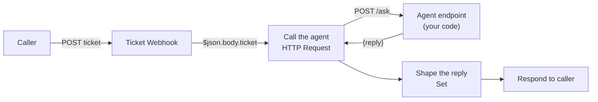

# 19.2 · Webhooks, HTTP requests and model nodes

**Module:** [19 · Workflow automation with n8n](../README.md) · **Time:** 45-60 minutes · **Model needs:** chat for scripts 1 and 2; none for script 3 · **Packages:** none beyond the base install · **Service (optional):** `N8N_URL`, only for script 3

## What you will learn

- What data a **Webhook** node hands to the next node: one item split into `headers`, `params`, `query` and `body`.
- How an **HTTP Request** node calls your agent: method, URL, body fields, query fields, retry settings.
- How **expressions** carry data along the chain: `$json` (the previous node) and `$('Node name')` (any earlier node).
- How to put your helpdesk agent behind a plain HTTP endpoint so that any workflow can call it, and how to test that endpoint offline.
- Where the **model nodes** fit (n8n's built-in AI nodes versus an HTTP Request to your own agent).

## The idea

**What is new since 19.1:** 19.1 read a workflow and called a webhook. Here the workflow calls OUT: an HTTP Request node posts the ticket to your own agent endpoint instead of straight at a model API, and you learn to run the whole thing offline with an in-process mock, so you can test without n8n.



Why put an agent behind an endpoint rather than rebuilding it in nodes? The agent's logic (prompts, tools, tests) stays in code, under version control, and the workflow stays glue: trigger, call, branch, notify. The endpoint is also reusable from other callers.

**The Webhook output.** One request becomes one item with four parts: `headers` (names lower-cased), `params` (path parameters), `query` (the `?a=b` part) and `body`. So the ticket is `{{ $json.body.ticket }}`, not `{{ $json.ticket }}`. This is the most common first mistake.

**The HTTP Request node.** In `helpdesk-agent-workflow.json` it sends a JSON body built from fields (`specifyBody: keypair`, one field `ticket`) and a query field `source=n8n`, with Retry On Fail set to 3 tries, 2 s apart. The next node receives the parsed JSON reply as its `$json`. By default a 4xx or 5xx status FAILS the node; 19.3 covers branching on that.

**Expressions.** A value that starts with `=` is evaluated. Inside `{{ }}`: `$json` is the previous node's item; `$('Ticket Webhook').item.json.body.ticket` reaches back to the webhook even after other nodes changed the data (the Set node uses this to keep the original ticket beside the reply).

**Model nodes.** n8n has two ways to use a model. (1) An HTTP Request to any OpenAI-compatible `/chat/completions` URL, as in 19.1: works with any provider and shows you everything. (2) n8n's built-in AI nodes (an AI Agent node with a chat-model sub-node, selected in the editor with its own credential): quicker to assemble, but the prompts and tool logic then live in the canvas, not in tested code. This lesson's workflow uses the first style and routes to your agent; look up the exact AI node parameters in the n8n docs when you choose the second.

## Files in this folder

- `helpdesk-agent-workflow.json`: an n8n export **written by hand** from the node source definitions (Webhook v2, HTTP Request v4.2, Set v3.4, Respond to Webhook v1.1). **Not tested against a live n8n here.** The agent URL `http://host.docker.internal:8008/ask` is a placeholder: from a Docker-run n8n, `host.docker.internal` is the machine running your agent.

## Scripts

### 1. `01_mock_agent_endpoint.py`: the agent as an HTTP endpoint

```
./run 19.2/1
```

Starts a stdlib HTTP server in the script's own process on a free port, with `POST /ask` answering a ticket through one real model call, and calls it like an HTTP Request node would, including two failure cases (422 and 404).

**Expected output** (real run, trimmed):

```
Step 2: Call it like an HTTP Request node: POST /ask?source=n8n
  status: 200
Response JSON
{
  "reply": "Please try restarting your laptop and forgetting the \"Larkspur-Staff\" network in your settings before attempting to reconnect. ...",
  "source": "n8n"
}

Step 3: What the node sees when the call goes wrong
  empty ticket   -> 422 {'error': "field 'ticket' is required"}
  unknown route  -> 404 {'error': 'no route /nope'}
Run summary: 1 model call(s), 32 in + 46 out = 78 tokens, 1.3s
```

### 2. `02_run_workflow_offline.py`: the workflow JSON, run offline

```
./run 19.2/2
```

A miniature interpreter walks the exported workflow: it builds the item a Webhook would produce, really POSTs from the HTTP Request node to an in-process endpoint, then applies the Set and Respond nodes, printing every node's output item. It understands only the two expression forms the file uses; it is a teaching model, not n8n.

**Expected output** (real run, trimmed):

```
Execution order: Ticket Webhook -> Call the agent -> Shape the reply -> Respond to caller

Step 2: Node: Call the agent (httpRequest)
POST http://host.docker.internal:8008/ask  (rewritten to http://127.0.0.1:<port>/ask for this run), query source=n8n
retryOnFail=True maxTries=3 wait=2000 ms (not needed this time)
Output item
{ "reply": "Please ensure you are connected to a stable internet network ...", "source": "n8n" }

Step 5: What the caller of the webhook receives
HTTP 200 body
{ "reply": "Please ensure you are connected ...", "ticket": "I cannot reach the Larkspur VPN from home; it times out after login." }
Run summary: 1 model call(s), 32 in + 45 out = 77 tokens, 3.1s
```

### 3. `03_post_to_n8n_webhook.py`: the same call against a real n8n

```
./run 19.2/3                 # test URL
./run 19.2/3 --production    # production URL (workflow Active)
```

Posts a ticket with `?priority=high` and a custom header to your n8n. **n8n is not installed on the author's machine**, so the script was only run to its exit-3 stop here (real message):

```
This lesson needs n8n: N8N_URL is not set.
- Start one: docker run --rm -p 5678:5678 docker.n8n.io/n8nio/n8n
- Then set it in .env, for example N8N_URL=http://localhost:5678
```

With n8n running (see 19.1 for `docker-compose.yml`) and the workflow imported, you will see a 200 with `reply` and `ticket` (clearly labelled: this is what to expect, not captured output). To make the HTTP node succeed you need an agent listening where n8n can reach it; 19.4 supplies one.

## Try this

1. In script 1 send `{"ticket": "x"}` to `/ask` without `?source=`. What does `source` become, and why does an endpoint need defaults for optional query fields?
2. In script 2 change the Set node's `reply` value to `={{ $json.replyy }}` and run it. How does the failure look, and how would n8n show it?
3. Add a field `"priority": "={{ $json.query.priority }}"` to the Set node and a `?priority=high` query to the simulated webhook item. Does it reach the caller?
4. Change `url` in the JSON to `/nope`. Predict, then check, which status the node sees.
5. Make the endpoint slower with `time.sleep(5)` and think about what `timeout: 30000` and 3 tries would do to the caller waiting on the webhook.
6. Open the JSON and find the `retryOnFail` keys. Which node should have them, and why not the Webhook?

## If it does not work

- `./run doctor` checks the base install and services. Scripts 1 and 2 need only a chat endpoint.
- Script 3 exits 3 until n8n is running. Start it as in 19.1, or point `N8N_URL` in `.env` at a cloud-hosted or remote n8n.
- `Connection refused` inside n8n for the agent call: the agent must listen on an address n8n can reach, not just `127.0.0.1` of another machine/container.
- 404 from the webhook: test versus production URL (see 19.1).

## In the running scenario

The helpdesk assistant is now a service with one route, and the ticket-intake workflow is the glue in front of it: a webhook receives a ticket from any form or email tool, the HTTP node calls the assistant, and the answer goes back to the caller. 19.3 makes the workflow survive failures and run on a schedule.

**Next:** 19.3 · Error handling, schedules and expressions (planned)
