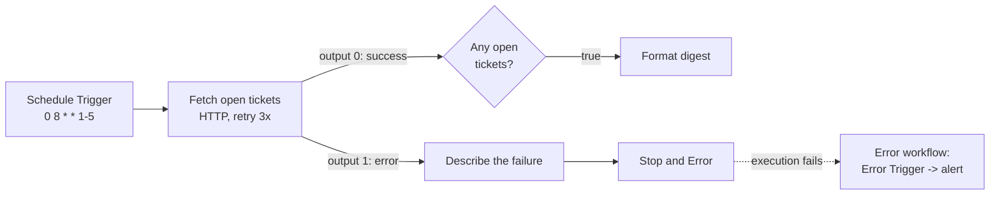

# 19.3 · Error handling, schedules and expressions

**Module:** [19 · Workflow automation with n8n](../README.md) · **Time:** 45-60 minutes · **Model needs:** none · **Packages:** none beyond the base install · **Service:** none (all three scripts run offline)

## What you will learn

- How the **Schedule Trigger** takes a cron expression, and how to read, parse and test one by hand (including the day-of-month / day-of-week trap).
- How n8n's **Retry On Fail** works (fixed wait, capped tries), how it differs from exponential backoff with jitter, and why client errors (4xx) must not be retried.
- How to build an **error branch**: a node set to *continue using its error output*, wired to a failure path.
- How an **Error Workflow** (Error Trigger node) notifies someone when any execution fails, and how to link it.
- How to check workflow JSON structurally, expressions included, before importing it.

## The idea

**What is new since 19.2:** 19.2 made the happy path work. This lesson is about everything else: what runs when, what happens when a call fails, and how to catch mistakes in the JSON without opening n8n.



**Schedules.** The Schedule Trigger's Custom (Cron) rule is stored as `{"field": "cronExpression", "expression": "0 8 * * 1-5"}`. The five fields are minute, hour, day of month, month, day of week. n8n also accepts an optional leading seconds field (the teaching parser in script 1 does not). The workflow's timezone setting decides what "08:00" means; the digest sets `Europe/London`. A schedule only fires while the workflow is **Active**.

**Retries.** The node settings `retryOnFail`, `maxTries` and `waitBetweenTries` repeat a failing node. The wait is fixed. If you need backoff, build a loop with a Wait node. Always keep a hard cap.

**Error output.** Setting a node's `onError` to `continueErrorOutput` gives it a second output (index 1) that receives the failed item with an `error` field, so the workflow can react instead of stopping. The digest then ends the run with a **Stop and Error** node, so the execution is recorded as failed and the error workflow fires. (`continueRegularOutput` instead passes the error data down the normal path; the default `stopWorkflow` just fails.)

**Error workflow.** A separate workflow starting with an **Error Trigger**, selected in the failing workflow's settings (`settings.errorWorkflow`, an ID). It receives `workflow.name` and `execution.error.message` and typically posts to chat. It runs for production executions, not for manual test runs.

**Expressions** reach earlier nodes with `$('Node name')`. A rename breaks every expression that still uses the old name, which script 3 catches.

## Files in this folder

- `helpdesk-digest-workflow.json` and `helpdesk-error-workflow.json`: n8n exports **written by hand**, using node types and parameter names looked up in the n8n node source (Schedule Trigger v1.2, IF v2.2, Stop and Error v1, Error Trigger v1). **Not tested against a live n8n here**; the placeholder `errorWorkflow` ID, agent URL and chat URL need replacing after import.

## Scripts

### 1. `01_cron_by_hand.py`: cron expressions by hand

```
./run 19.3/1
```

Parses five-field cron (lists, ranges, steps, names), prints the next three runs from a fixed reference time, shows the day-of-month / day-of-week OR rule and the error for bad expressions.

**Expected output** (real run, trimmed):

```
  0 8 * * 1-5    08:00 on weekdays (the digest workflow)
      next: Mon 30 Nov 08:00, Tue 01 Dec 08:00, Wed 02 Dec 08:00
  30 17 * * fri  17:30 on Fridays (weekly report)
      next: Fri 27 Nov 17:30, Fri 04 Dec 17:30, Fri 11 Dec 17:30
'0 9 13 * fri' does NOT mean 'Friday the 13th'. When both day fields are set, either one matches.
  next four: Fri 04 Dec, Fri 11 Dec, Sun 13 Dec, Fri 18 Dec
  '61 8 * * *': minute: '61' is outside 0-59
  '0 8 * * funday': day of week: 'funday' is not a number, range or name
```

### 2. `02_retry_with_backoff.py`: retry and when not to

```
./run 19.3/2
```

A flaky in-process agent and a simulated clock (nothing sleeps): fixed wait versus exponential backoff with jitter, the hard cap, and a 422 that is never retried.

**Expected output** (real run, trimmed):

```
    try 1 at t=  0.0s -> 503
    try 2 at t=  2.0s -> 503
    try 3 at t=  4.0s -> 200
Result 200 after 3 tries, 4.0s of waiting.
...
    try 3 at t=  4.0s -> 503
    giving up after 3 tries (the hard cap)
...
    try 4 at t=  8.6s -> 200
Result 200 after 4 tries, 8.6s waiting. Jitter stops many clients retrying in lockstep.
    try 1 at t=  0.0s -> 422
    not retryable: stopping at once
```

### 3. `03_error_branch_workflows.py`: validate the workflow JSON

```
./run 19.3/3
```

Checks both workflows (one trigger each, no dangling connections, a cron that parses, an error output that is actually wired, `$('Node')` references that exist), then deliberately breaks a copy to show the checker catching it.

**Expected output** (real run, trimmed):

```
  Fetch open tickets     httpRequest      retryOnFail=True maxTries=3 waitBetweenTries=2000 onError=continueErrorOutput
  OK: no structural problems
digest settings.errorWorkflow = 'REPLACE_WITH_ERROR_WORKFLOW_ID'
  PROBLEM: cron '0 25 * * 1-5': 25 outside 0-23
  PROBLEM: 'Fetch open tickets' continues on error but nothing is wired to its error output (output 1)
  PROBLEM: 'Format digest': expression refers to unknown node 'Fetch tickets'
```

## Try this

1. In script 1 add the expression `0 */2 * * *` and a monthly-last-day question: why can plain cron not express "last day of the month"?
2. Change the reference date to a Sunday evening and predict the next run of `0 8 * * 1-5` before running.
3. In script 2 give the backoff a cap (for example 30 s) and a `max_tries` of 8. What total wait do you get against a long outage, and is that acceptable for a webhook caller waiting for an answer?
4. Add 400 and 401 to a test list and confirm they are not retried; then think about why 429 is.
5. In script 3 rename the node `Fetch open tickets` in the JSON only. Which checks fail?
6. Import the digest in n8n (optional), pin some data on the HTTP node with `open: 0` and see which branch the IF takes.

## If it does not work

- `./run doctor` checks the base install; this lesson needs no extra and no service.
- If you import the workflows into n8n and a node shows as "unknown", the node type or version may differ in your n8n release: fix it in the editor and compare with the JSON, which is a legitimate part of the exercise. n8n runs in Docker via the 19.1 `docker-compose.yml`, or point `N8N_URL` in `.env` at a cloud-hosted instance.

## In the running scenario

Larkspur Labs wants a digest of open tickets in the IT channel each weekday at 08:00, and an alert when the digest cannot be produced. The cron rule schedules it, retries absorb a flaky agent, the error output and error workflow tell a human when it is truly down. 19.4 combines this with the intake workflow.

**Next:** 19.4 · Capstone: a helpdesk ticket workflow calling an agent (planned)
