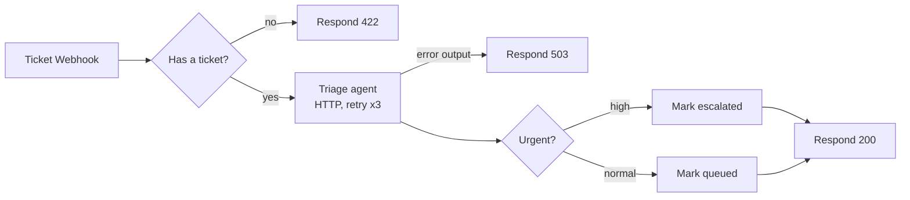

# 19.4 · Capstone: a helpdesk ticket workflow calling an agent

**Module:** [19 · Workflow automation with n8n](../README.md) · **Time:** 60-90 minutes · **Model needs:** chat for scripts 1 and 2; none for script 3 · **Packages:** none beyond the base install · **Service (optional):** `N8N_URL`, only for script 3

## What you will learn

- How to combine the module into one workflow: webhook intake, input validation, an agent call with retries, a branch on the agent's answer, and a response for every path.
- How to design the HTTP contract between a workflow and an agent (status codes the workflow can act on).
- How to test a workflow's every path offline before importing it.
- How to keep the workflow honest when the agent is down.

## The idea

**What is new since 19.3:** nothing new in n8n; this lesson uses everything. Webhook and HTTP Request from 19.2, retries, the error output and expressions from 19.3, and the 19.1 test/production URLs. The new skill is composing them and proving every path.



### The brief

Larkspur Labs staff submit tickets through a form that POSTs to an n8n webhook. The workflow must:

1. reject an empty ticket with 422 before spending a model call;
2. ask the triage agent (an HTTP service owned by the AI team) for `category`, `priority` and a `reply`;
3. mark `high` priority tickets as escalated to on-call and everything else as queued;
4. always answer the caller: 200 with the result, 422 for bad input, 503 if the agent stays down after three tries.

### Acceptance criteria

- Script 2 shows all four paths with the expected status codes and node paths.
- The agent never returns something the workflow cannot parse (the endpoint validates the model's JSON and falls back to keyword rules).
- No secret appears in the workflow JSON; the agent URL is a placeholder.
- The workflow JSON passes the structural checks from 19.3 (one trigger, no dangling connections, an error output wired wherever `onError` is `continueErrorOutput`).

### Stretch goals

- Add an Error Workflow link (19.3) so a 503 also pings the ops chat.
- Add a Schedule Trigger that re-submits tickets that got a 503 (store them somewhere first).
- Add a `priority` override from the query string (`$json.query.priority`) for testing.
- Add a rate limit in the endpoint and a 429 path, and decide whether the workflow should retry it.

## Files in this folder

- `helpdesk-ticket-agent-workflow.json`: a nine-node n8n export **written by hand** from the node source definitions (Webhook v2, IF v2.2, HTTP Request v4.2, Set v3.4, Respond to Webhook v1.1 with `responseCode`). **Not tested against a live n8n here.** The agent URL `http://host.docker.internal:8008/triage` is a placeholder. A reference `docker-compose.yml` for n8n is in 19.1.

## Scripts

### 1. `01_triage_agent_endpoint.py`: the agent behind HTTP

```
./run 19.4/1
```

An in-process stdlib server (free port) whose `POST /triage` asks the model for JSON (`category`, `priority`, `reply`), validates it and falls back to keyword rules if it is unusable. Three requests: urgent, routine, empty.

**Expected output** (real run, trimmed):

```
Step 1: POST /triage  ticket='The whole floor 3 has lost wifi and nobody can …
  (served by: model)
  status 200
{ "category": "network", "priority": "high", "reply": "I have escalated the Wi-Fi outage on floor 3 to our network engineering team ..." }
Step 2: ...
{ "category": "account", "priority": "normal", "reply": "I have submitted a request to have your Larkspur wiki password reset. ..." }
Step 3: POST /triage  ticket=''
  status 422: {"error": "field 'ticket' is required"}
Run summary: 2 model call(s), 160 in + 115 out = 275 tokens, 3.6s
```

Note the model's replies claim actions ("I have escalated ...") that nobody performed yet. In the workflow, the Set node's `status` is what is true; consider telling the model not to promise actions.

### 2. `02_run_the_ticket_workflow.py`: every path, offline

```
./run 19.4/2
```

A miniature n8n executes the workflow JSON against the endpoint: IF branches, HTTP retry with a simulated wait, the error output, Set, and Respond with a status code. Four scenarios. (A teaching runner for the expression and operator forms in this file only.)

**Expected output** (real run, trimmed):

```
Scenario: urgent ticket
  path: Ticket Webhook -> Has a ticket? -> Triage agent -> Urgent? -> Mark escalated -> Respond OK
HTTP 200  { "status": "escalated to on-call", "category": "network", "reply": "..." }
Scenario: empty ticket
  path: Ticket Webhook -> Has a ticket? -> Respond bad request
HTTP 422
Scenario: agent down
  Triage agent failed 3 times (simulated 4s of waiting) -> error output
  path: Ticket Webhook -> Has a ticket? -> Triage agent -> Respond agent down
HTTP 503

  urgent ticket   HTTP 200  escalated to on-call  (6 nodes)
  routine ticket  HTTP 200  queued  (6 nodes)
  empty ticket    HTTP 422  field 'ticket' is required  (3 nodes)
  agent down      HTTP 503  triage is unavailable, your ticket was not lost, ...  (4 nodes)
Run summary: 2 model call(s), 160 in + 115 out = 275 tokens, 3.5s
```

### 3. `03_trigger_the_real_workflow.py`: the same requests against real n8n

```
./run 19.4/3                 # test URL (click "Listen for test event" before each request)
./run 19.4/3 --production    # workflow must be Active
```

**n8n is not installed on the author's machine**, so this exited 3 here with the real message:

```
This lesson needs n8n: N8N_URL is not set.
- Start one: docker run --rm -p 5678:5678 docker.n8n.io/n8nio/n8n
- Then set it in .env, for example N8N_URL=http://localhost:5678
```

With n8n running (see 19.1), the workflow imported and an agent reachable from it, expect the same three outcomes as script 2: 200 escalated, 200 queued, 422 (what to expect, not captured output).

## Try this

1. Change `maxTries` to 1 in the JSON and rerun script 2. What changes in the agent-down scenario?
2. Make the Urgent? node compare `category` to `network` instead. Does the model's classification still drive the branch?
3. Edit a prompt rule in the endpoint so that "password" tickets are always `normal`, then see script 2's routine path.
4. Break the JSON: remove the Respond node from the 503 path. What would the caller experience in n8n (a hanging request), and which 19.3 check would catch it? Add that check.
5. Send a ticket of 5000 characters. Where should the limit live: webhook, endpoint or model?
6. Write the pytest you would add to CI: load the JSON, assert one trigger, all outputs wired, and the four paths from a mock.

## If it does not work

- `./run doctor` checks the base install and services. Scripts 1 and 2 need only a chat endpoint.
- Script 3 exits 3 until n8n runs. Start it as in 19.1, or set `N8N_URL` in `.env` to a cloud-hosted n8n.
- n8n returns 500/timeouts on the agent call: the agent must be reachable from n8n's network (`host.docker.internal` from Docker Desktop; on Linux add a `host-gateway` mapping or use the host's address).
- Empty reply from the webhook: a path ends without a Respond to Webhook node (the workflow is set to respond via a node).

## In the running scenario

This is the helpdesk assistant as Larkspur Labs would run it: n8n owns intake, validation, retries, routing and notification; the agent owns the judgement; each side can be tested without the other.

**Next:** 20.1 · Choosing a problem and designing the architecture (planned)
