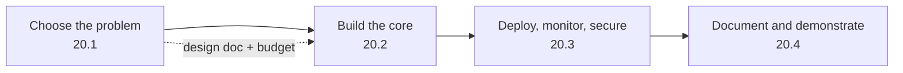

# 20.1 · Choosing a problem and designing the architecture

**Module:** [20 · Capstone](../README.md) · **Time:** 60-90 minutes · **Model needs:** none (all three scripts run offline) · **Packages:** none beyond the base install

## What you will learn

- How to pick a capstone problem that you can finish, test and defend, using a scored rubric with hard rules.
- How to write a short architecture document with the sections a reviewer looks for, and how to check it mechanically.
- How to turn the design into a budget (tokens, cost, latency) before writing code.
- How this module works: it is a **guided project**. The problem is yours; the Larkspur Labs helpdesk assistant is the worked example you can copy from.

## The idea

**What is new since the rest of the course:** every earlier lesson taught one technique. The capstone asks you to choose which techniques a problem needs, justify the choice in writing and check it against numbers. Lessons 20.1 to 20.4 are four guided steps; each ends with a short "Your turn" checklist for your own project.



Three habits make capstones succeed:

1. **Pick a problem you can test.** If you cannot write ten questions with known good answers, you cannot tell whether the system works.
2. **Keep the blast radius small.** A wrong answer should be annoying, not harmful. A tool that changes things needs a person in the loop.
3. **Write the design before the code.** Success criteria with numbers, non-goals, risks and a budget turn "build a chatbot" into something you can finish and be graded on.

### The worked example

Larkspur Labs staff ask the IT desk the same questions daily. The assistant answers from eight policy pages with a cited source, looks up and opens tickets, and hands over anything it cannot support. You will build it in 20.2, deploy and audit it in 20.3 and document and demo it in 20.4. Your own project follows the same four steps with different data.

### Files in this folder

- `design-template.md`: the blank architecture document (12 sections, TODO markers).
- `helpdesk-architecture.md`: the same document filled in for the helpdesk assistant.
- `candidates.json`: the rubric and five candidate projects for script 1.
- `budget.json`: the numbers for script 3.

## Scripts

### 1. `01_score_problem_candidates.py`: choose the problem

```
./run 20.1/1
```

Scores each candidate (0-100) on six weighted criteria, then applies hard rules that override the sum: a project that cannot be tested, can do harm when wrong or is too big is rejected however high it scores. Pass another JSON file as an argument to score your own candidates.

**Expected output** (real run, trimmed):

```
Step 2: Score each candidate (0-100) and apply the hard rules ──────────────────
 90  Helpdesk knowledge assistant       ok
 87  Ticket categoriser                 ok
 59  Automatic account unlocker         REJECT: harm if wrong is high
 43  Outage predictor                   REJECT: cannot be tested, too big for a first version
 43  Company-wide chatbot for everything REJECT: cannot be tested, harm if wrong is high, too big for a first version

Step 3: What the ranking says ──────────────────────────────────────────────────
Start with: Helpdesk knowledge assistant
```

The weights are an opinion. Change one and rerun: if the winner changes, the choice was close and you should talk to the people who would use it.

### 2. `02_validate_architecture_doc.py`: check the design document

```
./run 20.1/2                      # the example, the blank template, a damaged copy
./run 20.1/2 my-architecture.md   # your own file (exit code 1 if invalid)
```

Checks that every required section exists and is not empty or a TODO, that every success criterion has a number, that there is a mermaid diagram and at least three risks.

**Expected output** (real run, trimmed):

```
Step 1: The filled-in worked example ───────────────────────────────────────────
helpdesk-architecture.md: valid (12 required sections present)

Step 2: The blank template (should fail until you fill it in) ──────────────────
design-template.md: 14 problem(s)
    - Problem: still has TODO or <placeholder> text
    ...
Step 3: The example with two sections damaged on purpose ───────────────────────
damaged copy: 2 problem(s)
    - missing section: Evaluation plan
    - Success criteria: every bullet needs a number (a target you can measure)
```

### 3. `03_estimate_the_budget.py`: cost and latency before code

```
./run 20.1/3
```

Reads `budget.json` and computes tokens, cost and latency per request, per day and per month, against your targets. Then it asks what happens if the agent loops (5 calls instead of 2) or if retrieval stuffs a big prompt. The prices are invented; use your provider's.

**Expected output** (real run, trimmed):

```
Step 1: The baseline from budget.json ──────────────────────────────────────────
2100 tokens and 0.135 cents per request, 5.2s expected
PASS  daily tokens within cap: 840000 of 1000000
PASS  monthly cost within ceiling: 16.20 of 20 USD
PASS  latency within target: 5.2s of 6s

Step 2: What if the agent loops: 5 model calls per request ─────────────────────
FAIL  daily tokens within cap: 2100000 of 1000000
FAIL  monthly cost within ceiling: 40.50 of 20 USD
FAIL  latency within target: 12.7s of 6s
...
Latency target breaks at 3 model calls per request; this is why the graph in 20.2 caps calls at 2.
```

## Try this

1. Add your own three candidate projects to a copy of `candidates.json`, score them honestly and run script 1 on the copy.
2. Raise the weight of `real_owner` to 5. Does the winner change? What does that tell you?
3. Delete the Risks section from a copy of the example and run script 2: which message appears?
4. In `budget.json` set `model_calls_per_request` to 3. Which target fails first? What would you cut?
5. Replace the prices with your provider's and the token counts with numbers from a real run (the Run summary of any lesson prints them).
6. Add a rule to script 2: every risk bullet must name a mitigation (look for the word "by", "with" or ":"). Is the rule too strict?

## Your turn

- [ ] Write down three candidate problems and score them with script 1.
- [ ] Pick one that passes the hard rules and name its owner (someone who will give feedback).
- [ ] Copy `design-template.md`, fill every section and run `./run 20.1/2 your-file.md` until it is valid.
- [ ] Put your own numbers in a copy of `budget.json`. Write any unmeasured assumption under Open questions.
- [ ] Write 10 test questions with the expected outcome of each (answer with a source, hand-over, refusal). You will need them in 20.2.

## If it does not work

- `./run doctor` checks the base install. These scripts need no model or extra packages.
- Script 2 reports an unexpected "TODO" problem in your file: search for `TODO` and `<` in it; angle brackets in prose (for example `<5 seconds`) count as placeholders.
- Script 1 cannot read your JSON: it must contain `criteria` and `candidates` like the example, with scores 0-5 for every criterion.

## In the running scenario

The helpdesk assistant is the project you will watch being built: this lesson fixes its problem (staff wait hours for answers already written in policy pages), its limits (it does not unlock accounts) and its numbers (at most two model calls, about 2000 tokens a request).

**Next:** 20.2 · Building the core: retrieval, graph, tools, guardrails
