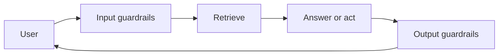

# <Project name>: architecture and decisions

Copy this file, replace every `<...>` and every TODO, then run `./run 20.1/2 your-file.md`.

## Problem

TODO: Who has the problem, what do they do today, and what does it cost them? Two or three sentences, no solution words.

## Users

TODO: Who uses it, how often, and who is affected when it is wrong?

## Success criteria

- TODO: a measurable target with a number, for example "at least 80 percent of test questions answered with the right source".
- TODO: a second measurable target (latency, cost per answer or escalation rate).

## Non-goals

- TODO: one thing this project will deliberately not do.

## Data sources

TODO: What does the system read (documents, tickets, an API)? Who owns each source, how fresh is it, is any of it personal data?

## Architecture

TODO: One paragraph walking through the diagram.

## Components

- **Retrieval:** TODO what is indexed and how it is searched.
- **Graph:** TODO which steps, which branches, where it stops.
- **Tools:** TODO each tool, its inputs and whether it changes anything.
- **Guardrails:** TODO what is checked on the way in and out.

## Risks and guardrails

- TODO: risk one and what limits it.
- TODO: risk two and what limits it.
- TODO: risk three and what limits it.

## Cost and latency budget

TODO: model calls per request, tokens per call, a price per million tokens, a target latency and a daily cap.

## Evaluation plan

TODO: the test set (how many questions, who wrote them), the metrics and the pass mark.

## Deployment

TODO: where it runs, how secrets are supplied, how you will know it is unhealthy.

## Open questions

- TODO: something you do not know yet and how you will find out.
