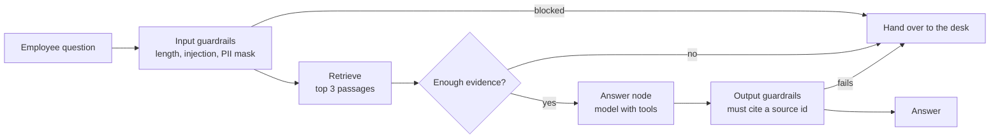

# Larkspur Labs helpdesk assistant: architecture and decisions

The worked example for the capstone. Replace it with your own problem.

## Problem

Larkspur Labs staff ask the IT desk the same twenty questions (VPN, passwords, laptop refresh, guest Wi-Fi, stipend) and wait hours for an answer that is already written in a policy page. Two people on the desk spend about a third of their day answering questions that a document already answers, and the pages that do exist disagree in places.

## Users

All 300 Larkspur Labs employees ask; two desk agents review. A wrong answer about security (passwords, VPN) costs more than a slow answer, so the assistant must say "I will pass this to the desk" instead of guessing.

## Success criteria

- At least 8 of 10 test questions answered with the right source id cited.
- Every request the assistant cannot answer from the knowledge base is handed to a person (0 invented answers on the 3 out-of-scope test questions).
- Under 3 model calls and under 2000 tokens per request on average.
- Median latency under 6 seconds with the real endpoint.

## Non-goals

- It does not reset passwords or unlock accounts itself; it only opens a ticket.
- It does not answer HR, legal or finance questions.
- No long-term memory of individual employees in version 1.

## Data sources

Eight short policy pages owned by the IT desk (markdown, reviewed quarterly) and a ticket store (an in-memory stand-in for the helpdesk API). Two pages contain old and new versions of the VPN policy, so each page carries a `status` and an `effective` date. None of the pages hold personal data; tickets do, so tickets are written only by the open_ticket tool after the input guardrail has masked emails and phone numbers.

## Architecture

A question is checked, then searched for. If the best passage is too weak the assistant hands over instead of guessing. Otherwise the model answers from the passages and may call a tool (look up the status of a ticket, open a new one). The output is checked once more before it reaches the employee.

## Components

- **Retrieval:** eight markdown pages, split by page, searched by embedding similarity with a lexical fallback when no embedder is available. Newest `status: current` page wins ties.
- **Graph:** five nodes (guard, retrieve, decide, answer, finish) and two exits; at most one tool round, so a request costs at most two model calls.
- **Tools:** `lookup_ticket` (read only) and `open_ticket` (writes to the ticket store, needs a category and a summary).
- **Guardrails:** input length cap, a small injection pattern list, email and phone masking; output must cite a known source id and must not contain a secret-shaped string.

## Risks and guardrails

- Prompt injection inside a question: pattern check on the way in, and the model only ever sees retrieved text as quoted sources.
- A confident wrong answer: a similarity threshold before answering, a citation check after, and an evaluation set that includes out-of-scope questions.
- Runaway cost: a hard cap of two model calls per request and a daily token budget guard in the service.
- Personal data in tickets: masking before any model or tool sees the text.

## Cost and latency budget

Two model calls per request at most, about 900 input and 150 output tokens each. At an assumed 0.50 USD per million input tokens and 1.50 USD per million output tokens, one request costs well under a tenth of a cent. A daily cap of 1000000 tokens stops the service; the median latency target is 6 seconds.

## Evaluation plan

Ten questions written by the desk (7 answerable, 3 out of scope), run on every change. Metrics: correct source cited, handed over when it should be, calls per request. Pass mark: 8 of 10 correct and no invented answer on the out-of-scope questions.

## Deployment

One small container behind the company reverse proxy. The API key comes from an environment variable set by the platform, never from the image. Health endpoint, a request counter and a token counter feed the existing dashboards; an alert fires when the hand-over rate doubles.

## Open questions

- Who reviews a hand-over within what time, and does the desk want the retrieved passages attached to the ticket?
- Is 0.35 a good similarity threshold for the production embedding model? Measure it before launch.
