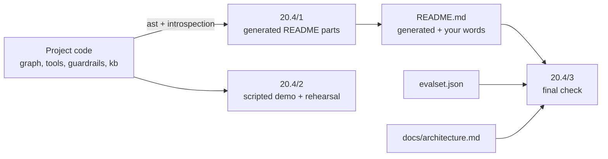

# 20.4 · Documenting and demonstrating

**Module:** [20 · Capstone](../README.md) · **Time:** 60-90 minutes · **Model needs:** none (all three scripts run offline) · **Packages:** base install only

## What you will learn

- How to generate the parts of a README that can be derived from code (graph diagram, tools, guardrails, endpoints, configuration), so they cannot drift.
- How to script a five-minute demo and **rehearse** it: the script runs each step and compares reality with your expectation.
- How to run a final readiness check: documentation complete, evaluation set passing, no secrets, non-root image.
- How to finish a project honestly: known limitations and next steps written down.

## The idea

**What is new since 20.3:** nothing is added to the system; this lesson makes it understandable and presentable. `project/` is a **copy** of the 20.3 project plus `docs/architecture.md` (from 20.1) and a finished `README.md`.



What a reader needs, in order: what it is for, how it works (one diagram), how to run it, how to configure it, what it will not do. What an audience needs from a demo: one normal case, one tool, one graceful failure and one refusal, each with a sentence on what it proves.

Docker, Redis and n8n are not used or needed in this lesson.

## Scripts

### 1. `01_generate_the_docs.py`: a README built from the code

```
./run 20.4/1               # print it, save to a temp folder
./run 20.4/1 --write       # save as project/README.generated.md
```

Parses `larkspur_desk/graph.py` with `ast` to find every `return "next_node"` in the node methods and draws them as a mermaid flowchart; reads the tool specs, guardrail constants, knowledge-base headers, the endpoint list in `app.py`'s docstring and the variables in `.env.example`. The parts only you can write (purpose, what each route means, limitations) come out as `TODO` blocks.

**Expected output** (real run, trimmed):

```
Step 1: Read the graph from the code and draw it
guard     -> retrieve, finish
retrieve  -> decide
decide    -> handover, answer
answer    -> check
check     -> handover, finish
handover  -> finish
finish    -> (end)

Step 2: Assemble the README
69 lines; 3 TODO block(s) left for you to write
    ## How it works
    ```mermaid
    flowchart LR
        guard --> retrieve
        guard --> finish
    ...
    | Tool | What it does | Arguments |
    | `lookup_ticket` | Read the status of an existing ticket by its id, ... | `ticket_id` |
```

The shipped `project/README.md` is that output with the three TODO blocks replaced by hand-written text.

### 2. `02_the_demo_script.py`: five questions, what to say, a rehearsal

```
./run 20.4/2
```

Runs five scripted questions (normal, ticket lookup, ticket creation, out of scope, attack) against the offline desk. For each: what to say, the graph path, the answer, and a rehearsal verdict comparing the route and an expected phrase. If any step differs, the script exits 1: you learn it before the audience does. It also writes a run sheet to a temp folder. It uses no model on purpose, so a demo cannot fail on a network.

**Expected output** (real run, trimmed):

```
Step 4: Demo 4/5: Does Larkspur Labs offer pet insurance? ──────────────────────
SAY: Out of scope: no passage covers it, so it hands over to the desk and opens a ticket. No invented answer.
PATH: guard -> retrieve -> decide -> handover -> finish
ANSWER: I could not answer that from the Larkspur knowledge base, so I have passed it to the IT desk. Ticket LL-2002.
REHEARSAL: ok (route handover, expected handover; 0 ms)
Step 6: Result
All five steps behaved as scripted.
```

For a live demo with a model, run 20.2/3 and say honestly that wording varies between runs, which is why this scripted version exists.

### 3. `03_the_final_checklist.py`: ready to hand over?

```
./run 20.4/3
```

Nine automatic checks (README sections and no TODO, every tool and environment variable mentioned, architecture document complete, evaluation set at least 8 of 10, non-root Dockerfile, no key-shaped strings, no `.env`) and five manual ones for you to tick. Exit code 1 if an automatic check fails: leave a `TODO` in the README, or remove a tool from it, and watch.

**Expected output** (real run, trimmed):

```
Step 2: Automatic checks ───────────────────────────────────────────────────────
PASS  README has the required sections
PASS  README has no TODO left
PASS  README names every tool
PASS  evaluation set: at least 8 of 10 as expected  (10 of 10)
PASS  Dockerfile runs as a non-root user
PASS  no key-shaped string in the project
Step 3: Manual checks: tick these off yourself
[ ] A teammate who has not seen the project can run it from the README in under ten minutes.
...
9 of 9 automatic checks passed
Ready for the manual checks. Then present it.
```

## Try this

1. Rename a node function in `larkspur_desk/graph.py` (for example `check` to `verify`, and update the `return` strings) and run script 1: does the diagram follow? (Script 1's `NODES` list must be updated too: what does that tell you about generated docs?)
2. Add a third tool to the project and rerun scripts 1 and 3. Script 3 fails until the README mentions it; regenerate and fix.
3. Add a sixth demo step that shows a limitation (for example, a paraphrase that gets handed over). Does the rehearsal pass? Should the demo include it?
4. Put a `TODO` back into `project/README.md` and run script 3, then remove it.
5. Time yourself reading the demo aloud. Is it under five minutes? Cut the weakest step.
6. Write the "Known limitations" section for your own project **before** anyone asks. Which limitation would you fix first, and why?

## Your turn

- [ ] Generate your project's README with script 1, and write the three TODO blocks in your own words.
- [ ] Write your five-step demo: one normal case, one tool, one graceful failure, one refusal, one limitation. Rehearse it until it passes.
- [ ] Adapt the final check to your project and make all automatic checks pass.
- [ ] Do the five manual checks, including a teammate running your project from the README alone.
- [ ] Write down the two things you would build next. That list is the honest end of a project.

## If it does not work

- `./run doctor` checks the base install. No lesson in this module needs a service.
- Script 1 fails with a `KeyError` in the knowledge-base listing: a page header needs `id`, `title`, `effective` and `status` lines.
- Script 3 says README does not exist: run `./run 20.4/1 --write`, copy `project/README.generated.md` to `project/README.md` and replace the TODOs.
- Script 2 exits 1 after you edited the knowledge base: read the REHEARSAL line; either fix the page or update the expected phrase in `DEMO`.

## In the running scenario

The helpdesk assistant now ships with a README that is true by construction, a demo you can give in five minutes and a checklist that tells you whether it is done. That is a complete agentic system, from problem to presentation.

**Next:** This is the end of the course. Go back to the [curriculum map](../../../CURRICULUM.md) to revisit any module, or take your own project further with your two "next" items.
