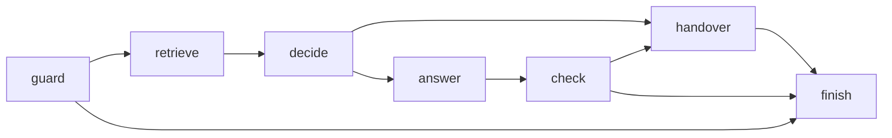

# Larkspur desk

Larkspur Labs staff ask the IT desk the same questions again and again (VPN, passwords, laptop refresh, guest Wi-Fi) and the answers already exist in policy pages. This assistant answers from those pages with a cited source, opens or looks up tickets, and hands anything it cannot support to a person. It is the worked example for the capstone: replace the problem and keep the structure.

## How it works

`answered` means the reply cites a source or a tool result. `handover` means no page covered the question (or an output check failed), so a ticket was opened for the desk. `blocked` means the input guardrail refused the request and nothing else ran.

## Knowledge base

- `wifi`: Guest Wi-Fi (current, effective 2024-09-01)
- `stipend`: Home office stipend (current, effective 2025-01-15)
- `laptop`: Laptop refresh (current, effective 2025-02-01)
- `mfa`: Multi-factor authentication (current, effective 2025-03-20)
- `password`: Password reset (current, effective 2025-01-15)
- `printer`: Printers (current, effective 2024-06-01)
- `vpn-old`: VPN access (old) (superseded, effective 2023-01-10)
- `vpn`: VPN access (current, effective 2025-03-01)

## Tools

| Tool | What it does | Arguments |
|---|---|---|
| `lookup_ticket` | Read the status of an existing ticket by its id, for example LL-1001. Read only. | `ticket_id` |
| `open_ticket` | Open a NEW ticket for the IT desk when the user needs a person to act. Creates a record. | `category`, `summary` |

## Guardrails

- Questions longer than 500 characters or empty are refused.
- 5 prompt-injection patterns are blocked before retrieval.
- Email addresses and phone numbers are masked before any model or tool sees the text.
- Answers must cite a known source id (or come from a tool) and may not contain secret-shaped strings.

## Run it

- Offline, no model: `python app.py` (set nothing).
- With a model: set the variables below, then `python app.py`.
- Container: `docker build -t desk .` then `docker run -p 8080:8080 --env-file .env desk` (not run on the author's machine).

## HTTP API

- `POST /ask      {"question": "..."}  ->  {"answer", "route", "sources", "model_calls", "ticket_id"}`
- `GET  /health   liveness: always 200 while the process is up`
- `GET  /metrics  counters in the Prometheus text format (no client library needed)`

## Configuration

- `LLM_BASE_URL`
- `LLM_MODEL`
- `LLM_API_KEY`
- `DAILY_TOKEN_CAP`
- `DAILY_CALL_CAP`

## Known limitations

- Search is lexical by default; paraphrases can be handed over even though a page exists (embeddings only reorder results).
- Tickets live in memory and are lost on restart; a real deployment needs the helpdesk API.
- English only, eight short pages, no memory of earlier questions, and the budget caps reset on restart.
